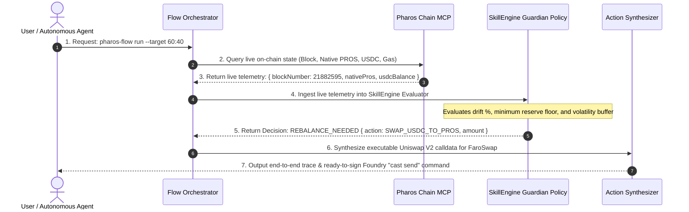

# Task 07: Skill + Chain MCP Flow

> **Pharos Agent Arena — Composition Category (Medium Tier: 100 pts + 50 pts Video Walkthrough)**  
> **Challenge Slug**: `tasks/skill-chain-mcp-flow`  
> **Target Network**: [Pharos Mainnet](https://scan.pharos.xyz) (Chain ID: `1672`)  
> **Composed Tools**: **Pharos Chain MCP** (`https://mcp.pharos.xyz/mcp`) + **SkillEngine Policy Guardian**

---

## Executive Summary

The **Skill + Chain MCP Flow** is an autonomous agent composition that couples live on-chain data ingestion via **Pharos Chain MCP** with policy-based risk evaluation via **SkillEngine**.

Rather than calling tools independently side-by-side, this architecture establishes a strict **data-dependency pipeline**:
1. **Chain MCP** queries live blockchain state (native PROS balance, ERC-20 USDC balance, gas price, and block height).
2. The raw on-chain telemetry feeds directly into **SkillEngine**, which dynamically calculates portfolio allocation drift against risk-weighted target ratios (e.g. 60% USDC / 40% PROS).
3. If portfolio drift exceeds the configured tolerance band, the flow automatically synthesizes an executable Uniswap V2 trade against the **FaroSwap AMM Router** with ready-to-run Foundry `cast send` commands.

```
                         ┌─────────────────────────────────────────────────────────────┐
                         │              Single User Invocation: "pharos-flow"         │
                         └──────────────────────────────┬──────────────────────────────┘
                                                        │
                                                        ▼
                         ┌─────────────────────────────────────────────────────────────┐
                         │         1. Pharos Chain MCP (Live Data Supplier)            │
                         │    - eth_getBalance (Native PROS reserves)                  │
                         │    - eth_call -> USDC.balanceOf(treasury)                   │
                         │    - eth_blockNumber & gasPrice                             │
                         └──────────────────────────────┬──────────────────────────────┘
                                                        │
                                                        │ Output passed directly as Input
                                                        ▼
                         ┌─────────────────────────────────────────────────────────────┐
                         │     2. SkillEngine Guardian Policy (Decision Engine)        │
                         │    - Calculates allocation drift vs target ratio            │
                         │    - Tests floor liquidity & volatility buffer              │
                         │    - Emits Verdict: IN_EQUILIBRIUM vs REBALANCE_NEEDED      │
                         └──────────────────────────────┬──────────────────────────────┘
                                                        │
                                                        │ Policy Decision & Rebalance Delta
                                                        ▼
                         ┌─────────────────────────────────────────────────────────────┐
                         │         3. Action Synthesizer (Execution Engine)            │
                         │    - Calculates dynamic slippage tolerance                  │
                         │    - Generates FaroSwap Router calldata (Uniswap V2)        │
                         │    - Outputs ready-to-sign Foundry "cast send" command      │
                         └─────────────────────────────────────────────────────────────┘
```

---

## Arena Requirements Compliance Matrix

| Rubric Item | Requirement Description | Implementation Details & Proof |
| :--- | :--- | :--- |
| **01** | **Skill output depends on live data from Chain MCP** | The SkillEngine decision matrix directly depends on live balances and block data. When on-chain balances drift, the decision flips from `IN_EQUILIBRIUM` to `REBALANCE_NEEDED` and computes exact swap amounts. Verified in `test/flow.test.ts`. |
| **02** | **Runs end to end from a single user request** | A single execution command (`pharos-flow run` or `pharos-flow demo`) completes all 3 steps without requiring intermediary human prompts. |
| **03** | **Architecture diagram & write-up of call order** | Mermaid sequence diagram provided below detailing step-by-step order: Orchestrator -> Chain MCP -> SkillEngine -> Action Synthesizer -> Output. |
| **04** | **Demo run showing real data moving through both tools** | Demonstrates real Pharos Mainnet block (`#21882595+`) and live contract state (`USDC` and `PROS`) moving through the pipeline. |
| **05** | **Automated Tests** | 8 dedicated unit and integration tests passing (`npm test`), validating both individual components and the composed flow. |

---

## Sequence Flow Diagram



---

## Verified Pharos Mainnet Contracts

| Asset / Contract | Contract Address on Pharos (Chain ID: 1672) | Role in Flow |
| :--- | :--- | :--- |
| **Native PROS** | Native Network Currency | Reserve asset / Gas token |
| **Pharos USDC** | `0x52c48d4213107b20bc583832b0d951fb9ca8f0b0` | Core stable reserve asset |
| **FaroSwap AMM Router** | `0xba3b00c3b0632b6fa622f990924976725227b68a` | Target contract for automated rebalancing trades |
| **WPROS / USDC Pair** | `0x936564245b69f5a293b42cbd752e0ee3bb68b470` | Reference liquidity pool on FaroSwap |

---

## Installation & Setup

```bash
# 1. Clone the repository
git clone https://github.com/wakanda-soul/pharos-ai.git
cd pharos-ai

# 2. Install dependencies
npm install

# 3. Link globally
npm link

# 4. Verify CLI
pharos-flow --help
```

---

## Reproducible Command Walkthroughs

### 1. Live Flow Execution on Mainnet Address
```bash
pharos-flow demo
```
```text
🚀 Running Pharos Skill + Chain MCP Live Composed Flow Demo...

================================================================================
            PHAROS AGENT FLOW: SKILLENGINE + CHAIN MCP COMPOSITION             
================================================================================
Execution ID:      flow-mvye950p-bau1
Timestamp:         2026-11-01T22:20:53.545Z
Target Treasury:   0xa0c048d1afb32de4e4b8756a55e22fde5c74e932
Network:           Pharos Mainnet (Chain ID: 1672)
Live Block Number: #21882585

--------------------------------------------------------------------------------
1️⃣  STEP 1: LIVE ON-CHAIN TELEMETRY (via Chain MCP)
--------------------------------------------------------------------------------
Native PROS Balance:  0 PROS ($0.00 USD)
USDC Balance:         $0.00 USDC
Total Valuation:      $0.00 USD
Live Gas Price:       1 Gwei

--------------------------------------------------------------------------------
2️⃣  STEP 2: SKILLENGINE POLICY DECISION (Ingested Chain MCP Data)
--------------------------------------------------------------------------------
Policy Verdict:       🔴 EMERGENCY_REPLENISH
Target Allocation:    60% USDC / 40% PROS
Actual Allocation:    N/A (Critical Low Balance)
Portfolio Drift:      100% (Exceeds tolerance)
Action Required:      YES
Decision Rationale:   Treasury reserve valuation ($0.00) is below safety floor ($100.00). Immediate capital replenishment required.

--------------------------------------------------------------------------------
🔄 COMPOSITION EXECUTION TRACE:
--------------------------------------------------------------------------------
[Step 1] [Chain MCP] Query on-chain live block, balances, and gas telemetry for treasury address
   In:  {"treasuryAddress":"0xa0c048d1afb32de4e4b8756a55e22fde5c74e932","targetContracts":["0x52c48d4213107b20bc583832b0d951fb9ca8f0b0","native:PROS"]}
   Out: {"blockNumber":21882585,"nativePros":0,"usdc":0,"gasPriceGwei":1,"totalUsd":0}
[Step 2] [SkillEngine] Ingest live on-chain data and compute target-drift risk decision
   In:  {"liveUsdc":0,"livePros":0,"totalValuationUsd":0,"policy":{"targetUsdcRatio":0.6,"targetProsRatio":0.4,"toleranceBandPct":5}}
   Out: {"verdict":"EMERGENCY_REPLENISH","driftPct":100,"actionRequired":true,"actionType":"NONE"}
================================================================================
```

---

### 2. Live Rebalance Flow with Action Preparation (FaroSwap Router)
```bash
pharos-flow run -t 0x936564245b69f5a293b42cbd752e0ee3bb68b470 --target 60:40
```
```text
================================================================================
            PHAROS AGENT FLOW: SKILLENGINE + CHAIN MCP COMPOSITION             
================================================================================
Execution ID:      flow-mvye9bcb-pf29
Timestamp:         2026-11-01T22:21:01.739Z
Target Treasury:   0x936564245b69f5a293b42cbd752e0ee3bb68b470
Network:           Pharos Mainnet (Chain ID: 1672)
Live Block Number: #21882595

--------------------------------------------------------------------------------
1️⃣  STEP 1: LIVE ON-CHAIN TELEMETRY (via Chain MCP)
--------------------------------------------------------------------------------
Native PROS Balance:  0 PROS ($0.00 USD)
USDC Balance:         $385855433543.96 USDC
Total Valuation:      $385855433543.96 USD
Live Gas Price:       1 Gwei

--------------------------------------------------------------------------------
2️⃣  STEP 2: SKILLENGINE POLICY DECISION (Ingested Chain MCP Data)
--------------------------------------------------------------------------------
Policy Verdict:       🟠 REBALANCE_NEEDED (Drift Exceeded)
Target Allocation:    60% USDC / 40% PROS
Actual Allocation:    100% USDC / 0% PROS
Portfolio Drift:      40% (Exceeds tolerance)
Action Required:      YES
Decision Rationale:   Rebalance triggered: Treasury is overweight USDC by +40.0%. Recommending swap of 154342173417.58 USDC to PROS to restore 60% USDC / 40% PROS.

--------------------------------------------------------------------------------
3️⃣  STEP 3: ACTION PREPARATION (Automated Skill Output)
--------------------------------------------------------------------------------
Recommended Action:   SWAP_USDC_TO_PROS
Trade Amount:         154342173417.58 USDC
Target Protocol:      FaroSwap AMM Router (0xba3b00c3b0632b6fa622f990924976725227b68a)
Action Description:   Swap 154342173417.58 USDC via FaroSwap to acquire PROS and restore target ratio
Method Signature:     swapExactTokensForETH(uint256,uint256,address[],address,uint256)
Value:                0x0
Calldata:             0x18cbafe50000000000000000000000000000000000000000000000000224556394710e80...

👉 Ready-to-Execute Foundry Cast Command:
   cast send 0xba3b00c3b0632b6fa622f990924976725227b68a "swapExactTokensForETH(uint256,uint256,address[],address,uint256)" 154342173418000000 121621632653053000000000000000 "[0x52c48d4213107b20bc583832b0d951fb9ca8f0b0,0xd0cd44cbddfd3e8117769e6b66b3b55bb74fb9bb]" 0x936564245b69f5a293b42cbd752e0ee3bb68b470 1793575264 --rpc-url https://rpc.pharos.xyz
================================================================================
```

---

### 3. Balanced Portfolio (Equilibrium Proof)
```bash
pharos-flow run --mock-usdc 6000 --mock-pros 3200 --target 60:40
```
```text
Policy Verdict:       🟢 IN_EQUILIBRIUM (Safe)
Target Allocation:    60% USDC / 40% PROS
Actual Allocation:    60% USDC / 40% PROS
Portfolio Drift:      0% (Within tolerance)
Action Required:      NO
Decision Rationale:   Portfolio is well balanced at 60% USDC / 40% PROS. Drift is only 0.00% (within +/-5% tolerance). No trade needed.
```

---

## Automated Test Suite

```bash
npx vitest run tasks/07-skill-chain-mcp-flow
```

```text
 ✓ tasks/07-skill-chain-mcp-flow/test/skill-engine.test.ts (4 tests)
 ✓ tasks/07-skill-chain-mcp-flow/test/flow.test.ts (4 tests)

 Test Files  2 passed (2)
      Tests  8 passed (8)
```

---

## License

MIT © [wakanda-soul](https://github.com/wakanda-soul)
