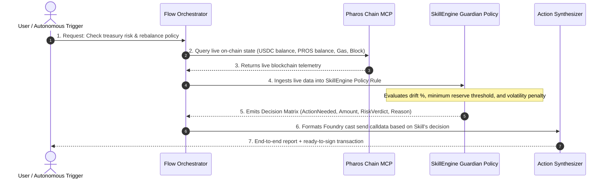

# Pharos Skill + Chain MCP Flow Skill

## Overview
This skill implements a tightly composed agent workflow where **Pharos Chain MCP** and a **SkillEngine Policy Guardian** work in tandem:
1. **Chain MCP** queries real-time on-chain state (block height, native PROS balances, ERC-20 USDC balances, and gas conditions).
2. The raw telemetry is fed directly into **SkillEngine**, which computes allocation drift against risk-weighted target ratios.
3. The flow synthesizes executable calldata and Foundry `cast` commands for automated AMM rebalancing on FaroSwap.

## When to Activate
Activate this skill when:
- The user asks to audit, monitor, or rebalance a treasury, portfolio, or liquidity position on Pharos.
- Real-time on-chain balances must drive dynamic hedging or reserve protection decisions.
- Demonstrating tool composition (output of tool A feeding input of tool B).

## Architecture


## CLI Usage
```bash
# Run flow on treasury address
pharos-flow run --treasury 0xa0c048d1afb32de4e4b8756a55e22fde5c74e932 --target 60:40

# Run live demo
pharos-flow demo

# Print architectural diagram
pharos-flow diagram
```
