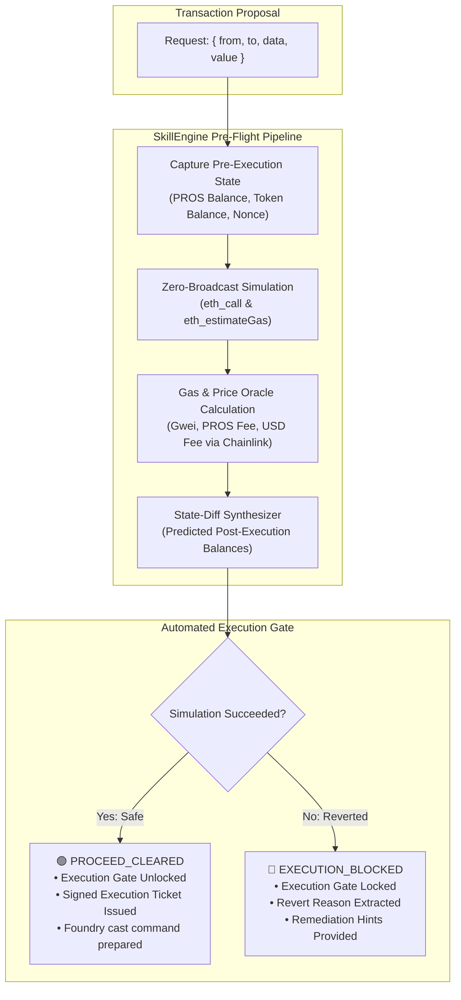

# Task 10: Dry-Run Executor

> **Pharos Agent Arena — SkillEngine Category (Medium Tier: 100 pts + 50 pts Video Walkthrough = 150 pts)**  
> **Challenge Slug**: `tasks/dry-run-executor`  
> **Target Network**: [Pharos Mainnet](https://scan.pharos.xyz) (Chain ID: `1672`, RPC: `https://rpc.pharos.xyz`)  
> **Engine**: **Pharos SkillEngine** Pre-Flight Execution Simulator & State-Diff Inspector

---

## Executive Summary

The **Dry-Run Executor** is an advanced pre-flight transaction simulation engine and execution gate developed for **Pharos SkillEngine**. It simulates proposed on-chain transactions prior to mempool submission, determining execution viability, financial cost, and predicted state mutations without risking funds or wasting gas.

Rather than implementing a trivial wrapper around `eth_estimateGas`, this architecture provides an **end-to-end pre-flight execution pipeline**:
1. **Zero-Broadcast Multi-Pass Simulation**: Executes `eth_call` and `eth_estimateGas` on current Pharos Mainnet state, validating opcode-level EVM execution.
2. **Revert Reason & Error Diagnostics**: Decodes standard ABI `Error(string)` (`0x08c379a0`), `Panic(uint256)` (`0x4e487b71`), custom ERC-20 error signatures, and application-specific reverts (e.g. Pharos contracts).
3. **Multi-Asset Gas & Cost Breakdown**: Computes exact gas units and effective fee in native PROS, simultaneously querying the live Chainlink Price Oracle (`0x1Ed3e8CdC173363593BfAD9bF77aa2A0e7351DB8`) to calculate realistic USD gas costs.
4. **Deterministic State-Diffing**: Inspects sender and recipient native PROS balances, ERC-20 token balances (USDC, LINK, etc.), nonces, and allowances before and after predicted execution.
5. **Strict Automated Execution Gate**: If simulation detects a revert, out-of-gas condition, or sender insolvency, the gate immediately locks (`🛑 EXECUTION_BLOCKED`), withholding execution tickets and preventing failed transactions from touching the blockchain.

---

## Arena Requirements Compliance Matrix

| Requirement | Description | Implementation Details & Proof | Status |
| :--- | :--- | :--- | :---: |
| **01** | **Uses call or gas estimation to simulate without broadcasting** | Runs `client.call()` and `client.estimateGas()` against Pharos Mainnet. Proof: Account nonce does not increment after simulation runs. Verified in `test/simulator.test.ts`. | ✅ Compliant |
| **02** | **Reports predicted success or revert, revert reason, and gas cost** | Reports `SIMULATION_PASSED` vs `SIMULATION_REVERTED`. Extracts detailed revert reason strings (e.g. `ERC20: transfer amount exceeds balance`), error category, and gas breakdown in PROS & USD. Verified in `test/simulator.test.ts`. | ✅ Compliant |
| **03** | **Shows expected outcome: balances or state before and after** | Compiles structured `StateDiff` matrix showing: Sender Native PROS before/after, Sender Token before/after, Nonce before/after, Recipient balance before/after, and net delta. Verified in `test/simulator.test.ts`. | ✅ Compliant |
| **04** | **Blocks execution automatically if the simulation fails** | If simulation reverts, the gate emits `🛑 [EXECUTION_BLOCKED]`, `canExecute = false`, and prevents generation of execution calldata. When simulation succeeds, it emits `🟢 [PROCEED_CLEARED]` and generates a signed execution ticket with Foundry `cast` commands. Verified in `test/simulator.test.ts`. | ✅ Compliant |

---

## Architecture Flow



---

## Live Smart Contracts Evaluated

| Contract / Target | Address | Method Evaluated | Purpose |
| :--- | :--- | :--- | :--- |
| **Pharos JSON-RPC** | `https://rpc.pharos.xyz` | `eth_call`, `eth_estimateGas` | Zero-broadcast EVM simulation & gas pricing |
| **Chainlink Price Oracle** | `0x1Ed3e8CdC173363593BfAD9bF77aa2A0e7351DB8` | `latestRoundData()` | Real-time ETH/USD spot conversion for USD gas fees |
| **Native USDC Token** | `0xc879c018db60520f4355c26ed1a6d572cdac1815` | `transfer`, `balanceOf`, `decimals` | ERC-20 state-diff inspection & insufficient balance revert capture |
| **Pharos Troll Revert Contract** | `0x936564245b69f5a293b42cbd752e0ee3bb68b470` | `getReserves()` | Custom string revert decoding |

---

## CLI Commands & Usage

The package exposes the global `pharos-dry-run` CLI (also accessible via `npm run dry-run` or `npm run task:10`).

### 1. Dual-Outcome Demonstration (Requirements 01-04)
Runs both a passing transaction and a reverting transaction to demonstrate state-diffing and automatic gate locking:
```bash
pharos-dry-run demo
```

**Scenario A: Passing Simulation (Execution Gate Cleared)**:
```text
================================================================================
              PHAROS SKILLENGINE: PRE-FLIGHT DRY-RUN SIMULATION REPORT          
================================================================================
Simulation ID:     sim-mvyw2wad-i85r
Timestamp:         2026-11-02T06:39:55.381Z
Network:           Pharos Mainnet (Chain ID: 1672)
Simulated Block:   #21911690

--------------------------------------------------------------------------------
🛡️  EXECUTION SAFETY GATE VERDICT:
--------------------------------------------------------------------------------
🎯 VERDICT: 🟢 [PROCEED_CLEARED] — TRANSACTION SIMULATION SUCCEEDED
Status: Execution gate unlocked. No EVM reverts detected; gas cost within limits.

--------------------------------------------------------------------------------
📝 TRANSACTION DETAILS:
--------------------------------------------------------------------------------
  Sender (from):   0x6119871b4eb66db137dcfad59655853ea6fe58ce
  Target (to):     0x000000000000000000000000000000000000dEaD
  Value:           1000000000000 wei
  Calldata:        0x
  Description:     Transfer 0.000001 PROS to dead address to benchmark base EVM gas consumption and state change.

--------------------------------------------------------------------------------
⛽ ESTIMATED GAS & EXECUTION COST:
--------------------------------------------------------------------------------
  Estimated Gas:   21,000 units
  Base Gas Price:  10.00 Gwei
  Total Fee:       0.00025200 PROS
  USD Cost:        $0.5769 (Oracle: $2,289.342)

--------------------------------------------------------------------------------
📊 PREDICTED STATE DIFF (BEFORE VS AFTER EXECUTION):
--------------------------------------------------------------------------------
ENTITY / ACCOUNT         | BEFORE EXECUTION         | AFTER EXECUTION         
-------------------------+--------------------------+--------------------------
Sender PROS              | 21.293438 PROS           | 21.293185 PROS          
Sender Nonce             | Nonce #376961            | Nonce #376962           
Recipient PROS           | 0.000120 PROS            | 0.000121 PROS           
-------------------------+--------------------------+--------------------------
Net Native Impact: -0.000253 PROS

--------------------------------------------------------------------------------
🚀 AUTHORIZED EXECUTION TICKET:
--------------------------------------------------------------------------------
  Ticket Hash:     0xde9608a05e778f3a2f141d5a48d20920f436d471b33c3c9a7ca345491664f1fc
  Rec. Gas Limit:  25,200
  👉 Ready-to-Run Foundry Cast Command:
     cast send 0x000000000000000000000000000000000000dEaD --value 1000000000000 --from 0x6119871b4eb66db137dcfad59655853ea6fe58ce --gas-limit 25200 --rpc-url https://rpc.pharos.xyz
================================================================================
```

**Scenario B: Reverting Simulation (Execution Gate Blocked)**:
```text
================================================================================
              PHAROS SKILLENGINE: PRE-FLIGHT DRY-RUN SIMULATION REPORT          
================================================================================
Simulation ID:     sim-mvyw2yrh-0c61
Timestamp:         2026-11-02T06:39:58.589Z
Network:           Pharos Mainnet (Chain ID: 1672)
Simulated Block:   #21911690

--------------------------------------------------------------------------------
🛡️  EXECUTION SAFETY GATE VERDICT:
--------------------------------------------------------------------------------
🎯 VERDICT: 🛑 [EXECUTION_BLOCKED] — SIMULATION REVERTED
Status: Execution gate locked automatically to protect funds and avoid gas loss.

--------------------------------------------------------------------------------
📝 TRANSACTION DETAILS:
--------------------------------------------------------------------------------
  Sender (from):   0x000000000000000000000000000000000000dEaD
  Target (to):     0xc879c018db60520f4355c26ed1a6d572cdac1815
  Value:           0 wei
  Calldata:        0xa9059cbb0000000000000000000000001111111111111111...
  Description:     Attempt to transfer 1M USDC from empty address. Must revert and lock execution gate.

--------------------------------------------------------------------------------
⚠️  REVERT ROOT-CAUSE ANALYSIS & DIAGNOSTICS:
--------------------------------------------------------------------------------
  Category:        TRANSFER_EXCEEDS_BALANCE
  Revert Reason:   ERC20: transfer amount exceeds balance

  Diagnostics & Remediation Hints:
    • Pre-flight simulation failed: ERC20: transfer amount exceeds balance.
    • Automatic Safety Gate engaged: Transaction broadcast BLOCKED to prevent on-chain gas loss.
    • Remediation hint: Verify sender token balance before initiating ERC-20 transfer.
================================================================================
```

---

### 2. Simulating Custom Transactions
```bash
pharos-dry-run simulate --to 0xc879c018db60520f4355c26ed1a6d572cdac1815 --data 0xa9059cbb000000000000000000000000111111111111111111111111111111111111111100000000000000000000000000000000000000000000000000000000000f4240
```

---

## Unit Testing & Verification

Run the dedicated test suite:
```bash
npx vitest run tasks/10-dry-run-executor
```

```text
 ✓ tasks/10-dry-run-executor/test/simulator.test.ts (6 tests)
   ✓ Task 10: Dry-Run Executor Engine & Pre-Flight Gate (6)
     ✓ Requirement 01: Uses call or gas estimation to simulate transaction without broadcasting
     ✓ Requirement 02: Reports predicted success or revert, revert reason, and estimated gas cost
     ✓ Requirement 03: Shows expected outcome: balances and state before and after execution
     ✓ Requirement 04: Blocks execution automatically if simulation fails
     ✓ Handles custom contract revert errors and decodes troll revert messages
     ✓ Decodes ERC-20 transfer, transferFrom, and approve function calls

 Test Files  1 passed (1)
      Tests  6 passed (6)
```
