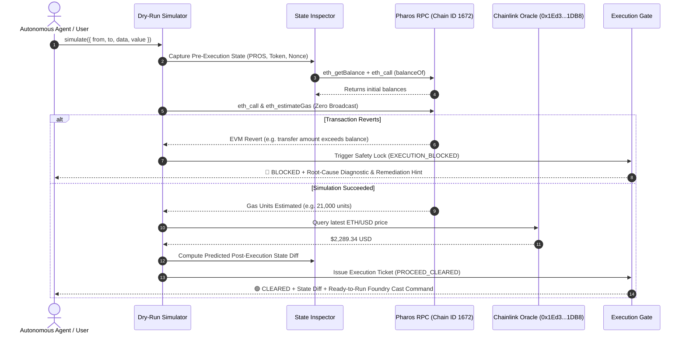

# Pharos SkillEngine: Dry-Run Executor Skill

## Overview
The **Pharos Dry-Run Executor** is an autonomous pre-flight simulation engine and security gate designed for **Pharos SkillEngine**. It intercepts proposed smart contract interactions, token transfers, and DeFi transactions before broadcast, deterministically predicting execution feasibility and financial impact.

### Core Capabilities:
1. **Zero-Broadcast Simulation**: Simulates the transaction directly against current state on Pharos Mainnet (Chain ID 1672) using `eth_call` and `eth_estimateGas`. The transaction is never broadcast to mempools.
2. **Revert & Cost Diagnostic**: Extracts precise EVM revert reasons (including standard `Error(string)`, `Panic(uint256)`, custom ERC-20 error signatures, and Pharos contract messages), estimating exact gas units and dollar value via Chainlink Price Oracles (`0x1Ed3e8CdC173363593BfAD9bF77aa2A0e7351DB8`).
3. **Pre- vs Post-Execution State Diffing**: Inspects sender and recipient native PROS balances, ERC-20 token balances (USDC, LINK, etc.), nonces, and allowances before and after predicted execution.
4. **Strict Automated Execution Gate**: If simulation detects a revert, out-of-gas condition, or insufficient solvency, the gate instantly locks (`🛑 EXECUTION_BLOCKED`), preventing wasted gas and user fund loss.

---

## When to Activate
Activate this skill when:
- An autonomous agent or user is preparing to send any value-bearing transaction on Pharos.
- Pre-flight checks are needed to guarantee a transaction won't revert on-chain.
- Exact gas fees and USD transaction costs need to be calculated beforehand.
- The user asks: "What will happen if I call this contract?", "Will this transfer succeed?", or "Simulate this transaction".

---

## Architecture Flow


---

## CLI Usage

```bash
# 1. Run dual-outcome demonstration (shows both CLEARED and BLOCKED outcomes)
pharos-dry-run demo

# 2. Simulate native transfer with state diff
pharos-dry-run simulate --to 0x000000000000000000000000000000000000dEaD --value 1000000000000 --from 0x6119871b4eb66db137dcfad59655853ea6fe58ce

# 3. Simulate contract call with calldata
pharos-dry-run simulate --to 0xc879c018db60520f4355c26ed1a6d572cdac1815 --data 0xa9059cbb000000000000000000000000111111111111111111111111111111111111111100000000000000000000000000000000000000000000000000000000000f4240

# 4. List and run benchmark scenarios
pharos-dry-run scenarios
pharos-dry-run scenarios --run SCENARIO_VALID_NATIVE_TRANSFER
pharos-dry-run scenarios --run SCENARIO_REVERT_TRANSFER_EXCEEDS_BALANCE
```
