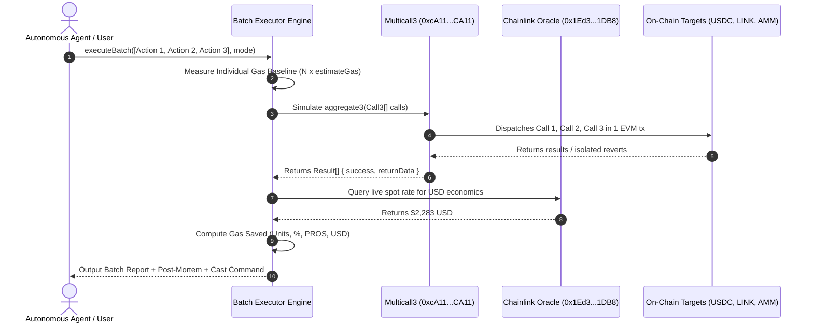

# Pharos SkillEngine: Batch Executor Skill

## Overview
The **Pharos Batch Executor** is an advanced transaction orchestration and optimization engine built on **Pharos SkillEngine**. It takes lists of independent smart contract calls, token transfers, or oracle queries, bundling them into a single optimized **Multicall3 `aggregate3`** execution rather than firing separate individual transactions.

### Key Innovations:
1. **Adaptive Multicall3 Orchestration**:
   - Compiles heterogeneous actions into canonical Multicall3 structures (`0xcA11bde05977b3631167028862bE2a173976CA11`).
   - Supports both `FAULT_TOLERANT` (individual failures do not break the batch) and `STRICT_ATOMIC` (atomic all-or-nothing rollback).
2. **Deterministic Gas Economics & Savings Matrix**:
   - Compares the baseline gas of $N$ individual transactions against the batched multicall.
   - Computes gas units saved, percentage saved (>35%), native PROS saved, and live USD equivalent savings via Chainlink Oracle (`0x1Ed3e8CdC173363593BfAD9bF77aa2A0e7351DB8`).
3. **Granular Partial Failure Post-Mortem**:
   - Decodes exact revert reasons (`Error(string)`, `Panic`, and custom contract errors) for failed actions.
   - Provides clear isolation trace proving how subsequent actions executed successfully without interruption.

---

## When to Activate
Activate this skill when:
- The user or agent has multiple independent transactions to send (e.g., claiming rewards, approving tokens, querying feeds, rebalancing).
- Gas optimization and transaction fee minimization are required.
- The user wants atomic execution or fault-isolated batching across multiple contracts on Pharos.
- The user asks: "Can you batch these transactions?", "How much gas do I save by using multicall?", or "Bundle these 3 actions".

---

## Architecture Flow


---

## CLI Usage

```bash
# 1. Run dual-outcome demonstration (optimal batch + fault-tolerant partial failure)
pharos-batch demo

# 2. Benchmark gas savings across individual vs batched execution
pharos-batch compare

# 3. List available benchmark scenarios
pharos-batch scenarios

# 4. Run a specific scenario
pharos-batch scenarios --run SCENARIO_3_ACTIONS_OPTIMIZED
pharos-batch scenarios --run SCENARIO_4_ACTIONS_WITH_PARTIAL_FAILURE
```
