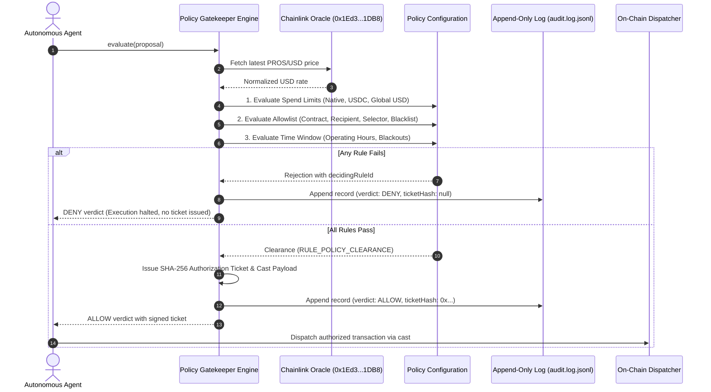

# Policy Gatekeeper for Autonomous On-Chain Agents

When deploying autonomous agents or bots with signing capabilities on Pharos, granting unrestricted access to private keys is a recipe for disaster. Prompt injection, edge-case logic loops, or unexpected market conditions can easily trigger unconstrained token drains or interact with malicious contracts.

The **Policy Gatekeeper** is an execution firewall designed to intercept proposed on-chain actions *before* any transaction can be signed or broadcast. It evaluates each proposal against three core governance rule types—spend limits with live oracle valuation, strict contract/recipient allowlists, and operational time windows—and produces a deterministic verdict along with an append-only audit trail.

---

## Key Design Decisions & Mechanics

### 1. Multi-Asset Spend Limits & Dynamic USD Valuation
Simple value checks that only count native tokens are insufficient when an agent trades across multiple assets. The gatekeeper enforces three distinct spend ceilings:
- **Per-transaction Native Limit**: Caps native PROS transfers (default: `10.0 PROS`).
- **Per-transaction Token Limit**: Caps ERC-20 USDC transfers (default: `1,000.0 USDC`).
- **Global USD Valuation**: Translates native PROS into USD equivalence by querying the live Chainlink Price Feed on Pharos (`0x1Ed3e8CdC173363593BfAD9bF77aa2A0e7351DB8`), combining it with token transfers to cap overall per-transaction exposure (default: `$2,500.00 USD`).

> **Note on Price Feeds**: If the RPC or price feed experiences a temporary failure, the engine safely falls back to a conservative default exchange rate ($2,300.00 / ETH) rather than crashing or permitting unchecked transactions.

### 2. Multi-Tier Allowlist & Trap Contract Interception
Contract verification operates at three distinct checkpoints:
- **Contract Boundary**: Targets must match known audited contracts (such as Multicall3 at `0xcA11bde05977b3631167028862bE2a173976CA11`, FaroSwap Router at `0xba3b...`, or verified token contracts).
- **Recipient Verification**: When an action passes a destination recipient address, that recipient must be explicitly approved (e.g. enterprise cold vault or hot wallet).
- **Method Selector Whitelist**: Only authorized signatures (e.g., `transfer(address,uint256)`, `aggregate3(...)`) can be executed. Unrecognized function selectors are rejected immediately.
- **Blacklist Interception**: Explicitly flags and blocks known exploit or reverting trap contracts (such as `0x936564245b69f5a293b42cbd752e0ee3bb68b470` on Pharos).

### 3. Operational Time Windows & Blackout Governance
To reduce operational risk during non-staffed hours or protocol hard forks:
- **Daily Operating Windows**: Actions are restricted to active treasury hours (e.g., `08:00 - 22:00 UTC`).
- **Day-of-Week Filters**: Restricts execution to trading weekdays (`Monday - Friday`).
- **Blackout Windows**: Explicit ISO date ranges during which all execution is frozen (e.g. during planned network upgrades or hard forks).

### 4. Non-Execution Invariant & Authorization Tickets
A denied proposal is strictly neutralized:
- If a proposal fails *any* rule, the verdict is `DENY`, and the specific rule ID that caused the rejection (e.g. `RULE_SPEND_LIMIT_USDC`, `RULE_ALLOWLIST_BLOCKED_ADDRESS`, or `RULE_TIME_WINDOW_OPERATIONAL_HOURS`) is recorded.
- When `DENY` is returned, **no authorization ticket or dispatch command is generated**.
- Only when all rules pass (`ALLOW`) does the engine issue a cryptographically hashed `AuthorizationTicket` with a 10-minute expiry and ready-to-run Foundry `cast send` payload.

### 5. Append-Only Audit Trail
Every evaluation is appended as a single-line JSON record into `audit.log.jsonl`. This log captures the decision ID, timestamp, calling agent ID, verdict, deciding rule, and ticket hash (if authorized) for downstream forensic verification and accounting reconciliations.

---

## Architecture



---

## CLI Usage

The package exposes the `pharos-gatekeeper` binary with commands for interactive testing, proposal evaluation, and audit inspection:

```bash
# 1. Run demonstration covering ALLOW and all 3 DENY rule types
pharos-gatekeeper demo

# 2. View current active policy rules and parameter thresholds
pharos-gatekeeper policy

# 3. Evaluate an arbitrary action proposal JSON file
pharos-gatekeeper evaluate ./proposal.json

# 4. Inspect recorded audit log entries
pharos-gatekeeper audit
pharos-gatekeeper audit --verdict DENY
pharos-gatekeeper audit --verdict ALLOW
```

---

## Demonstration Scenarios

The test suite and CLI demo cover four standard execution scenarios:

| Scenario | Proposed Action | Verdict | Deciding Rule | Reason |
| :--- | :--- | :---: | :--- | :--- |
| **Normal Transfer** | 500 USDC to approved hot wallet during active hours | **`ALLOW`** | `RULE_POLICY_CLEARANCE` | All spend, allowlist, and time window checks pass. |
| **Excessive Spend** | 5,000 USDC transfer exceeding 1,000 USDC cap | **`DENY`** | `RULE_SPEND_LIMIT_USDC` | Value exceeds per-transaction token ceiling. |
| **Trap Contract** | Interaction with known reverting troll address (`0x9365...b470`) | **`DENY`** | `RULE_ALLOWLIST_BLOCKED_ADDRESS` | Target is on the explicit security blacklist. |
| **Off-Hours Call** | Settlement triggered at 03:15 UTC (night freeze) | **`DENY`** | `RULE_TIME_WINDOW_OPERATIONAL_HOURS` | Outside allowed 08:00 - 22:00 UTC operating hours. |

---

## Test Suite & Verification

The policy engine is backed by a dedicated Vitest test suite verifying policy configurations, rule evaluations, denial guarantees, and audit persistence:

```bash
./node_modules/.bin/vitest run tasks/12-policy-gatekeeper
```

**Results (12 passing tests)**:
- Requirement 01: Defines spend limits, allowlists, and time windows with runtime overrides.
- Requirement 02: Returns deterministic ALLOW or DENY with the specific deciding rule ID on all proposals.
- Requirement 03: Confirms that denied actions never receive authorization tickets; demonstrates distinct denials for spend limit, allowlist, and time window rules.
- Requirement 04: Confirms immutable append-only JSONL audit logs with query filters.
