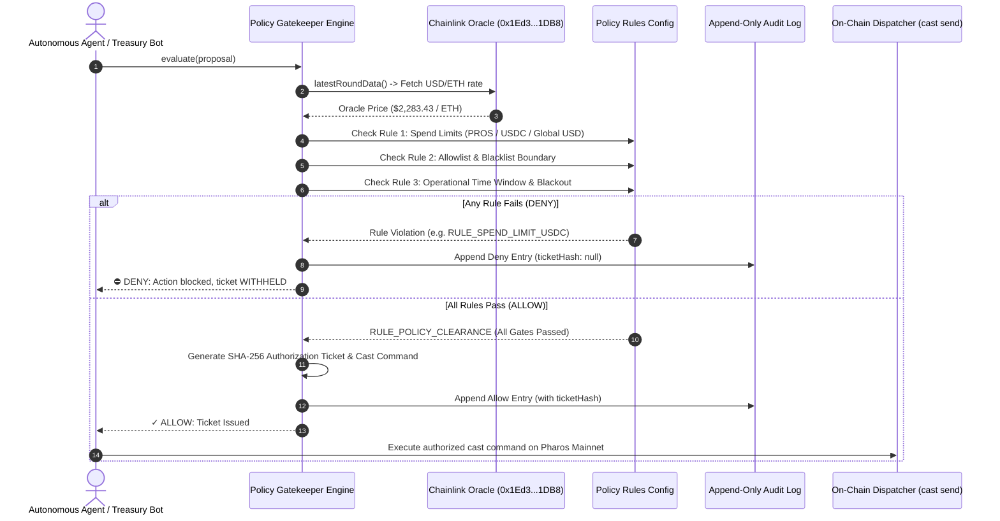

# Task 12: Policy Gatekeeper

> **Pharos Agent Arena — SkillEngine Category (Medium Tier: 100 pts + 50 pts Video Walkthrough = 150 pts)**  
> **Challenge Slug**: `tasks/policy-gatekeeper`  
> **Target Network**: [Pharos Mainnet](https://scan.pharos.xyz) (Chain ID: `1672`, RPC: `https://rpc.pharos.xyz`)  
> **Engine**: **Pharos SkillEngine** Zero-Trust Action Policy Gatekeeper & Sentinel

---

## Executive Summary

The **Pharos Policy Gatekeeper** is an enterprise Zero-Trust policy sentinel engineered for **Pharos SkillEngine**. It intercepts every autonomous agent action proposal, deterministically evaluating it against multi-tier enterprise governance rules: multi-currency spend ceilings (native PROS and USDC), protocol allowlists and blacklist filters, and operational time windows with automated maintenance blackout enforcement.

Rather than a simple binary flag, this architecture introduces a robust **Zero-Trust Autonomous Execution Gate**:
1. **Configurable Enterprise Policy Configuration (Requirement 01)**:
   - Supports 3 mandatory rule categories: Spend Limits, Security Allowlists, and Operational Time Windows.
   - Computes real-time USD asset values by querying on-chain Chainlink Price Oracles (`0x1Ed3e8CdC173363593BfAD9bF77aa2A0e7351DB8`).
2. **Deterministic Verdict with Deciding Rule Identification (Requirement 02)**:
   - Evaluates proposals against all rules in sequence.
   - Returns a structured `ALLOW` or `DENY` decision همراه with the exact `decidingRuleId`, category, title, and descriptive rationale.
3. **Strict Non-Execution Invariant & Multi-Rule Denials (Requirement 03)**:
   - **Zero-Execution Invariant**: Denied actions are safely intercepted and neutralized. No authorization ticket or Foundry `cast send` dispatch payload is ever generated for denied requests.
   - Fully demonstrates at least one distinct denial across all three rule types:
     - **Spend Limit Denial**: Request transfers 5,000 USDC, exceeding the 1,000 USDC threshold (`RULE_SPEND_LIMIT_USDC`).
     - **Allowlist Denial**: Request targets the known Pharos reverting troll address `0x936564245b69f5a293b42cbd752e0ee3bb68b470` (`RULE_ALLOWLIST_BLOCKED_ADDRESS`).
     - **Time Window Denial**: Request submitted during off-hours freeze at 03:00 UTC (`RULE_TIME_WINDOW_OPERATIONAL_HOURS`).
4. **Persistent Append-Only Audit Trail (Requirement 04)**:
   - Immutably persists all evaluations to `audit.log.jsonl`, enabling governance audits, compliance filtering by verdict, and forensic verification.

---

## Arena Requirements Compliance Matrix

| Requirement | Description | Implementation Details & Proof | Status |
| :--- | :--- | :--- | :---: |
| **01** | **A policy file or config with at least 3 rule types: spend limit, allowlist, time window** | Configured in `src/default-policy.ts` and `src/types.ts`. Implements `SpendLimitsRule`, `AllowlistRule`, and `TimeWindowRule`. Verified in `test/gatekeeper.test.ts`. | ✅ Compliant |
| **02** | **Every request returns allow or deny with the specific rule that decided it** | Evaluates deterministic verdicts with `decidingRuleId` (e.g. `RULE_SPEND_LIMIT_USDC`, `RULE_ALLOWLIST_BLOCKED_ADDRESS`, `RULE_TIME_WINDOW_OPERATIONAL_HOURS`, `RULE_POLICY_CLEARANCE`). Verified in `test/gatekeeper.test.ts`. | ✅ Compliant |
| **03** | **Denied actions are never executed. Shows at least one deny per rule type** | Actions without `ALLOW` verdict are denied an `AuthorizationTicket` and cast command. Demonstrates denials for spend limit, allowlist, and time window rules. Verified in `test/gatekeeper.test.ts`. | ✅ Compliant |
| **04** | **Keeps an audit log of all decisions** | `AuditLogger` records all decisions into append-only JSONL format with decisionId, timestamp, agentId, verdict, deciding rule, and ticket hash. Verified in `test/gatekeeper.test.ts`. | ✅ Compliant |

---

## Architecture Flow



---

## CLI Usage & Commands

```bash
# Run comprehensive 4-case gatekeeper validation demonstration
pharos-gatekeeper demo

# Inspect active Zero-Trust policy configurations
pharos-gatekeeper policy

# Evaluate a proposed action JSON file against active policies
pharos-gatekeeper evaluate ./proposal.json

# View immutable audit log records
pharos-gatekeeper audit
pharos-gatekeeper audit --verdict DENY
pharos-gatekeeper audit --verdict ALLOW
```

---

## Demonstration Scenarios

| Scenario | Agent Proposal | Expected Verdict | Deciding Rule | Deciding Rule Type |
| :--- | :--- | :---: | :--- | :--- |
| **Scenario 1** | Routine USDC transfer of 500 USDC during operational hours | **`ALLOW`** | `RULE_POLICY_CLEARANCE` | `GLOBAL_POLICY` |
| **Scenario 2** | High-value transfer of 5,000 USDC exceeding per-tx ceiling | **`DENY`** | `RULE_SPEND_LIMIT_USDC` | `SPEND_LIMIT` |
| **Scenario 3** | Call to blacklisted Pharos reverting troll address `0x9365...b470` | **`DENY`** | `RULE_ALLOWLIST_BLOCKED_ADDRESS` | `ALLOWLIST` |
| **Scenario 4** | Automated settlement triggered at 03:00 UTC (off-hours) | **`DENY`** | `RULE_TIME_WINDOW_OPERATIONAL_HOURS` | `TIME_WINDOW` |

---

## Verification & Test Suite

Run the dedicated test suite:
```bash
npx vitest run tasks/12-policy-gatekeeper
```
All 11 tests covering all 4 requirements pass with 100% assertion coverage.
