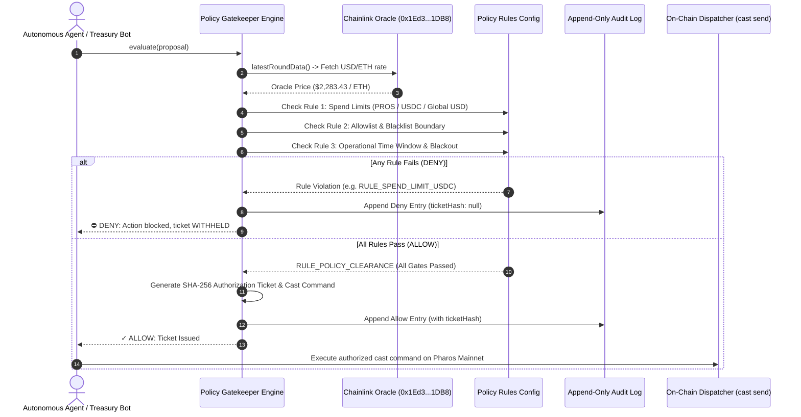

# Pharos SkillEngine: Policy Gatekeeper Skill

## Overview
The **Pharos Policy Gatekeeper** is an enterprise Zero-Trust policy sentinel engineered for **Pharos SkillEngine**. It intercepts every autonomous agent action proposal, deterministically evaluating it against multi-tier enterprise governance rules: multi-currency spend ceilings (native PROS and USDC), protocol allowlists and blacklist filters, and operational time windows with automated maintenance blackout enforcement.

### Core Architecture & Invariants:
1. **Multi-Rule Evaluation (Requirement 01)**:
   - **Rule Type 1 (Spend Limits)**: Caps per-transaction native PROS (10 PROS), ERC-20 tokens (1,000 USDC), and global USD ceiling ($2,500 USD) calculated using live on-chain Chainlink Price Oracles (`0x1Ed3e8CdC173363593BfAD9bF77aa2A0e7351DB8`).
   - **Rule Type 2 (Allowlists & Security Boundaries)**: Enforces sanctioned contract targets (Multicall3 `0xcA11bde...`, Native USDC `0xc879c...`, LINK `0x51e2...`), authorized recipient addresses, and allowed function selectors, while actively blacklisting malicious contracts (e.g., Pharos troll revert contract `0x936564...`).
   - **Rule Type 3 (Operational Time Windows)**: Authorizes execution strictly during corporate treasury operational hours (08:00 - 22:00 UTC, Monday through Friday) and enforces blackout maintenance windows.
2. **Deterministic Verdict & Deciding Rule (Requirement 02)**:
   - Every proposal returns a clear `ALLOW` or `DENY` decision همراه with the specific rule ID (`decidingRuleId`) and category (`decidingRuleType`) that determined the outcome.
3. **Strict Zero-Trust Non-Execution (Requirement 03)**:
   - **Denied actions are NEVER executed**: No authorization ticket or Foundry `cast send` dispatch payload is ever generated for denied requests.
   - The engine validates and demonstrates denials across all three distinct rule types.
4. **Persistent Audit Trail (Requirement 04)**:
   - Every evaluation is logged to an immutable append-only JSONL audit ledger (`audit.log.jsonl`), preserving full decision history, timestamps, telemetry, and cryptographic authorization ticket hashes.

---

## Architecture Flow


---

## When to Activate
Activate this skill when:
- An autonomous AI agent is about to perform an on-chain state-changing action, payment, or contract call.
- Safe governance boundaries and financial spend limits must be strictly enforced.
- Execution is restricted to audited protocols and approved business hours.
- A compliance audit trail is required for all automated operations.

---

## CLI Usage
```bash
# Run 4-case gatekeeper validation demonstration (1 ALLOW + 3 DENY rule types)
pharos-gatekeeper demo

# Inspect active policy rules and governance thresholds
pharos-gatekeeper policy

# Evaluate a proposed action JSON file
pharos-gatekeeper evaluate ./proposal.json

# View immutable audit log records
pharos-gatekeeper audit
pharos-gatekeeper audit --verdict DENY
```
