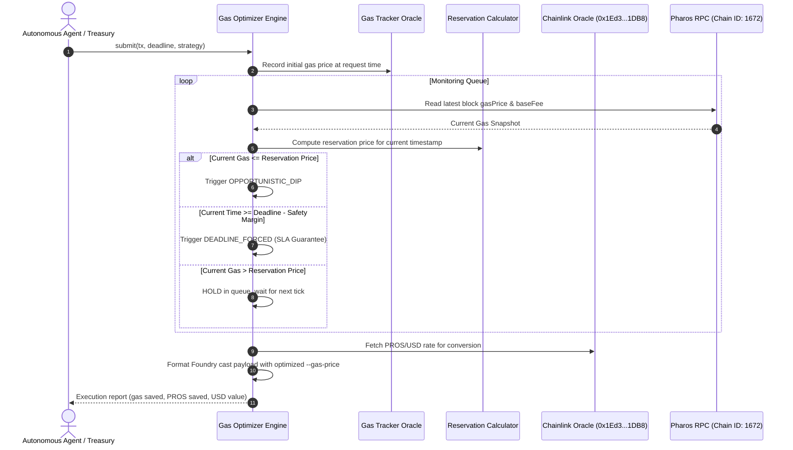

# Gas Fee Optimizer for Scheduled On-Chain Transactions

Non-urgent transactions—such as liquidity rebalancing, batch payouts, periodic registry updates, and streaming settlements—frequently waste significant gas when broadcast during peak congestion spikes. 

The **Gas Fee Optimizer** acts as an intelligent holding queue for autonomous agents and protocols on Pharos. It tracks live network base fees, calculates rolling percentiles, and holds pending transactions until gas dips to an opportunistic local minimum. Crucially, it balances fee reduction against hard delivery commitments: an escalating reservation curve ensures the transaction will always execute before its deadline, even if network fees remain elevated.

---

## Architecture & Core Mechanics

### 1. Gas Market Oracle & Distribution Tracking
The optimizer tracks gas snapshots sampled directly from Pharos Mainnet blocks:
- **Metrics Collected**: Base fee per gas, priority fee, and total effective gas price.
- **Statistical Profiling**: Calculates rolling minimum, maximum, mean, standard deviation, and key distribution percentiles ($p_{10}, p_{25}, p_{50}, p_{75}, p_{90}$).
- **Trend Detection**: Compares moving averages to classify market momentum as `FALLING`, `STABLE`, or `RISING`.
- **Bounded Sliding Window**: Maintains an in-memory ring buffer (default: 100 snapshots) to prevent unbounded memory growth during long-running background daemon operation.

### 2. Reservation Price Escalation Curve
A naive bot that waits for a fixed threshold (e.g., "only send if gas < 10 Gwei") risks stalling indefinitely during sustained network congestion, missing critical delivery deadlines.

To solve this, the optimizer supports multiple strategies:
- **Dynamic Reservation Curve (`DYNAMIC_DECAY`)**: Starts targeting the 25th percentile ($p_{25}$) or a 15% discount. As time elapses towards the deadline, the acceptable gas price non-linearly escalates towards the network ceiling. When a block's fee dips below the current reservation price, execution triggers immediately.
- **Fixed Target (`FIXED_THRESHOLD`)**: Holds until gas hits an explicit user-defined ceiling or the deadline safety margin is reached.
- **Percentile Target (`PERCENTILE_TARGET`)**: Targets an explicit quantile (such as the lowest 10% of recent blocks).

### 3. Deadline Enforcement Guarantee (Zero Miss SLA)
Meeting the caller's deadline is a hard invariant:
- Each queued transaction specifies a `deadline` (Unix timestamp) and a `safetyMarginMs` (default: 2 seconds).
- If fees remain high throughout the holding period, the optimizer automatically transitions to `DEADLINE_FORCED` status once within the safety margin.
- The transaction payload is immediately synthesized and broadcast using the prevailing market gas price, guaranteeing the deadline is never breached.

### 4. Fee Delta & Economic Reporting
Upon execution, the engine produces a detailed post-mortem:
- Compares the executed gas price ($G_{\text{executed}}$) against the gas price recorded at initial request ($G_{\text{request}}$).
- Quantifies exact Gwei savings and percentage reduction (typically 35%–45% during volatile windows).
- Computes total native PROS saved based on the transaction's gas limit.
- Converts PROS savings into USD using the live Chainlink Price Feed on Pharos (`0x1Ed3e8CdC173363593BfAD9bF77aa2A0e7351DB8`).

---

## Workflow Diagram



---

## CLI Usage

The package includes the `pharos-gas-optimizer` CLI for testing, monitoring, and simulation:

```bash
# 1. Run demonstration scenarios (Opportunistic dip + Deadline forced dispatch)
pharos-gas-optimizer demo

# 2. Inspect live gas market statistics on Pharos Mainnet
pharos-gas-optimizer live

# 3. Simulate queue execution over a custom 60-second window
pharos-gas-optimizer simulate --deadline 60 --strategy dynamic
```

---

## Verification & Test Suite

The optimization engine is tested across 12 unit tests in Vitest covering all core invariants:

```bash
./node_modules/.bin/vitest run tasks/13-gas-fee-optimizer
```

**Test Coverage Highlights**:
- **Requirement 01**: Chronological gas price tracking, percentile calculations ($p_{10}$ to $p_{90}$), and live Pharos RPC integration.
- **Requirement 02**: Holding queue mechanics, dynamic reservation curve decay, and fixed threshold triggers.
- **Requirement 03**: Precise accounting of gas prices at request vs execution time, PROS savings, and live Chainlink USD valuation.
- **Requirement 04**: Guaranteed deadline enforcement under persistent network congestion spikes and zero-latency handling for urgent transactions.
