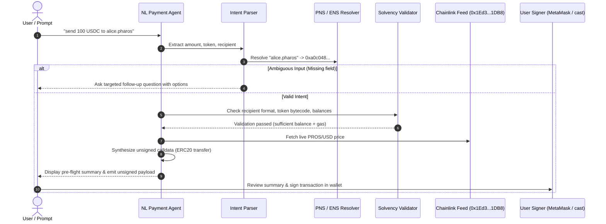

# Natural-Language Payment Agent

Autonomous agents communicating with humans need a safe way to translate informal payment requests (e.g., *"send 100 USDC to alice.pharos"* or *"wire 0.05 PROS to 0x..."*) into valid, signed blockchain transactions. 

Allowing an LLM or script to hold private keys and sign transactions directly is an unacceptable risk. The **Natural-Language Payment Agent** follows a strict non-custodial action preparation pattern: it extracts intent, resolves names, validates on-chain solvency and gas headroom, prompts for clarification when details are missing, and generates an unsigned transaction payload for explicit user signature in their wallet.

---

## Key Mechanics & Architecture

### 1. Intent Extraction & Ambiguity Clarification
Free-text instructions can be phrased in countless ways. The parser extracts three critical parameters:
- **Numerical Amount**: Supports decimal values, currency prefixes (`$50`), and written fractions.
- **Token Asset**: Identifies native `PROS` or supported ERC-20 assets (e.g. `USDC`).
- **Destination Recipient**: Handles 20-byte hexadecimal addresses, Pharos Name Service domains (`.pharos`), and ENS handles (`.eth`).

If any of these fields are missing or ambiguous (e.g., *"send 100 to alice"* without specifying a currency, or *"transfer 50 USDC"* without a recipient), the agent stops and returns a targeted follow-up question along with suggested options instead of guessing or executing a default transfer.

### 2. Multi-Vector Pre-Flight Validation
Before generating any transaction data, the agent performs four validation passes:
- **Recipient Address Verification**: Checks 20-byte address format, resolves `.pharos` domains, rejects zero-address destinations (`0x000...000`) to prevent accidental token burn, and flags self-transfers.
- **Contract Bytecode Verification**: Confirms that non-native token targets have deployed bytecode on Pharos Mainnet (e.g., Native USDC at `0xc879c018db60520f4355c26ed1a6d572cdac1815`).
- **Sender Solvency**: Queries the sender's balance on-chain to ensure sufficient funds for the transfer amount.
- **Gas Fee Headroom**: Crucially checks whether the sender holds sufficient native PROS to cover execution gas fees, preventing failed transactions when a user has tokens but zero native balance.

### 3. Human-Readable Pre-Flight Summary
Before any signing request is emitted, the agent formats a complete breakdown:
- Sender address and raw/resolved recipient addresses.
- Asset symbol, token transfer amount, and live USD equivalent calculated via the on-chain Chainlink Oracle (`0x1Ed3e8CdC173363593BfAD9bF77aa2A0e7351DB8`).
- Estimated gas units and network fee in PROS.
- Projected balance changes showing before-and-after states.

### 4. Non-Custodial Invariant (Zero-Signing)
The agent strictly adheres to a zero-custody invariant:
- It **never** asks for, imports, or stores private keys.
- It **never** broadcasts transactions autonomously.
- Its output is strictly an unsigned EIP-1193 transaction object (`to`, `from`, `data`, `value`, `chainId: 1672`) or a reproducible Foundry `cast send` terminal command for manual confirmation in MetaMask, Rabby, or a hardware wallet.

---

## Workflow Diagram



---

## CLI Usage

The package includes the `pharos-payment-agent` CLI for interactive prompt parsing and demonstration:

```bash
# 1. Run full 6-scenario demonstration suite
pharos-payment-agent demo

# 2. Parse a payment instruction directly from the command line
pharos-payment-agent parse "send 50 USDC to 0xa0c048d1afb32de4e4b8756a55e22fde5c74e932"

# 3. Test ambiguity handling (prompts follow-up question)
pharos-payment-agent parse "send 100 to alice.pharos"
```

---

## Test Suite & Verification

The agent is validated with 12 tests in Vitest covering prompt parsing, follow-ups, validation errors, and unsigned payload structure:

```bash
./node_modules/.bin/vitest run tasks/14-natural-language-payment-agent
```

**Test Coverage Highlights**:
- **Requirement 01**: Parsing standard, colloquial, and domain-based prompts; targeted follow-up questions for missing recipient, token, or amount.
- **Requirement 02**: Rejection of invalid addresses, zero-address targets, insufficient token balances, and zero-gas headroom scenarios.
- **Requirement 03**: Complete pre-flight summaries with Chainlink USD valuation and post-transfer balance projections.
- **Requirement 04**: Verification that emitted payloads contain zero private key signatures and format standard EIP-1193 and `cast send` commands.
