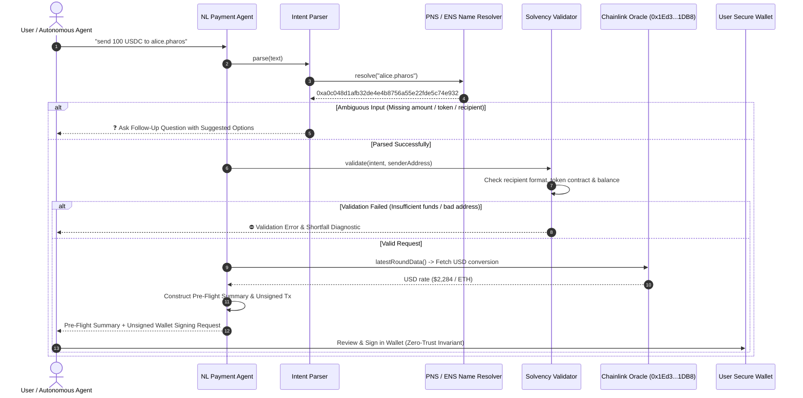

# Pharos Payments: Natural-Language Payment Agent Skill

## Overview
The **Pharos Natural-Language Payment Agent** is a non-custodial intent-to-action payment synthesizer engineered for **Pharos Mainnet (Chain ID 1672)**, generalizing the **Harbor Action Pattern**. It transforms unstructured user commands (e.g., *"send 100 USDC to alice.pharos"*, *"wire 0.05 PROS to 0x..."*) into verified, human-readable pre-flight transaction summaries and unsigned wallet signing payloads.

### Core Capabilities:
1. **Free-Text Parsing & Interactive Clarifications (Requirement 01)**:
   - Robust intent extractor supporting diverse linguistic patterns: direct transfers, currency prefixes (`$100`), colloquial expressions (*"wire 50 bucks of usdc to alice"*), and domain aliases.
   - Detects incomplete or ambiguous instructions: missing amount, missing token, missing or unresolvable recipient.
   - Formulates structured follow-up clarification prompts with suggested options.
2. **Multi-Vector Validation & Solvency Verification (Requirement 02)**:
   - **Recipient Validation**: Verifies 20-byte address format, resolves `.pharos` / `.eth` domain aliases, and blocks prohibited zero-address transfers.
   - **Token Contract Verification**: Verifies smart contract presence on Pharos Mainnet for ERC-20 tokens (USDC `0xc879...`, LINK `0x51e2...`).
   - **Real-Time Solvency & Gas Headroom**: Queries live sender balances on Pharos Mainnet to guarantee sufficient token balance and native PROS headroom for gas fees.
3. **Institutional Pre-Flight Summary (Requirement 03)**:
   - Formats a clear pre-flight summary before transaction preparation:
     - Sender, Recipient (raw & resolved address), Asset, Amount.
     - Real-time USD valuation via live Pharos Chainlink Price Oracle (`0x1Ed3e8CdC173363593BfAD9bF77aa2A0e7351DB8`).
     - Network fee estimation in PROS and USD.
     - Post-transfer balance projection.
4. **Strict Non-Custodial Invariant (Requirement 04)**:
   - **Zero-Signing Invariant**: The agent NEVER holds private keys, signs, or broadcasts on its own.
   - Generates standardized EIP-1193 / MetaMask `eth_sendTransaction` unsigned payloads and Foundry `cast send` commands for manual user authorization.

---

## Architecture Flow


---

## When to Activate
Activate this skill when:
- A user gives a natural-language payment command (e.g., "send 50 USDC to 0x...", "pay 10 PROS to bob.pharos").
- Transfer intents need to be verified against real on-chain balances and gas fees.
- Unsigned transaction payloads are required for MetaMask, WalletConnect, or Foundry cast dispatch.
- Ambiguous payment commands need interactive clarification.

---

## CLI Usage
```bash
# Run comprehensive 6-case benchmark demonstration
pharos-nl-pay demo

# Prepare an arbitrary plain-language payment instruction
pharos-nl-pay prepare "send 50 USDC to alice.pharos"

# Resolve a .pharos or .eth domain name
pharos-nl-pay resolve alice.pharos

# List supported tokens and contracts on Pharos Mainnet
pharos-nl-pay tokens
```
