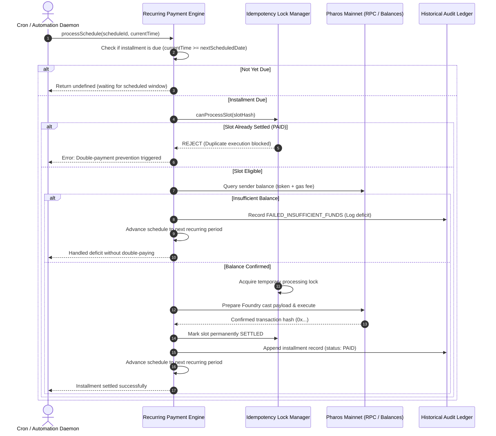

# Recurring Payment Agent

Automating periodic on-chain disbursements—such as contributor payroll, recurring SaaS subscriptions, or monthly facility leases—presents unique engineering challenges on EVM networks. Naive cron jobs or simple interval scripts frequently suffer from two critical failure modes:
1. **Accidental Double-Billing**: Re-running a scheduled task after a network timeout or concurrency collision can execute multiple identical payouts for the same period.
2. **Pipeline Lockup on Deficits**: When a treasury wallet temporarily runs low on funds, naive runners either crash, stall the entire schedule indefinitely, or retry uncontrollably.

The **Recurring Payment Agent** provides an idempotent, non-custodial recurring payment scheduler for Pharos. It models time-slotted installments, enforces cryptographic deduplication locks, tracks detailed lifecycle statuses, and recovers gracefully from balance deficits without double-paying.

---

## Architecture & Core Mechanics

### 1. Multi-Frequency Schedule Configuration
The scheduler manages repeating disbursement agreements across diverse cadence models:
- **Weekly Cycles**: Targets specific days of the week (e.g., Friday payroll at 09:00 UTC).
- **Monthly Cycles**: Advances to specific calendar days of the month (e.g., 1st of each month for rent/retainers), accounting for varying month lengths.
- **Interval-Based**: Configurable fixed intervals in seconds or hours for automated streaming or high-frequency micro-subscriptions.
- **Multi-Token Support**: Manages native `PROS` transfers or ERC-20 token contracts (such as Native USDC at `0xc879c018db60520f4355c26ed1a6d572cdac1815`).

### 2. Time-Slotted Execution Lifecycle
Each recurring schedule manages discrete numbered installments (`periodIndex = 1, 2, 3...`):
- `PENDING`: Scheduled for a future calendar timestamp; not yet eligible for preparation.
- `PREPARED`: The installment is due, parameters have been validated, and calldata is staged.
- `PAID`: Transaction successfully dispatched with an on-chain transaction hash and cast payload.
- `FAILED_INSUFFICIENT_FUNDS`: Solvency deficit detected during pre-flight balance check.
- `FAILED_EXECUTION`: On-chain revert or transport error during execution attempt.

### 3. Slotted Idempotency Locks (Zero Double-Paying)
To prevent accidental duplicate payments:
- Every installment slot is assigned a deterministic SHA-256 hash derived from the schedule ID, period index, target timestamp, recipient address, and token amount:
  $$\text{slotHash} = \text{sha256}(\text{scheduleId} + \text{periodIndex} + \text{targetTime} + \text{recipient} + \text{amount})$$
- Before initiating any disbursement, the engine queries the `IdempotencyLockManager`.
- If a slot has already transitioned to `PAID`, any subsequent execution attempt is strictly rejected with a security exception. Active in-flight executions acquire a temporary lock to prevent concurrent worker collisions.

### 4. Solvency Deficit Recovery
If the sender wallet holds insufficient balance when an installment comes due:
- The agent intercepts the shortfall before generating broadcast transactions.
- The installment is recorded in the ledger as `FAILED_INSUFFICIENT_FUNDS`, logging the exact deficit (`required` vs `available`).
- Crucially, the schedule does **not** stall or trigger repeated duplicate debits; it marks the slot as resolved-failed and cleanly advances `nextScheduledDate` to the next period.

### 5. Historical Ledger & Next Scheduled Payment
The engine preserves an auditable in-memory or persisted ledger:
- Tracks total cumulative amounts disbursed and successful vs failed installment counts.
- Exposes historical queries by schedule ID showing timestamps, statuses, and transaction hashes.
- Instantly reports the next scheduled installment date, target recipient, and projected distribution amount.

---

## Workflow Diagram



---

## CLI Usage

The package includes the `pharos-recurring` CLI for inspection and testing:

```bash
# 1. Run demonstration covering payroll, rent, solvency deficit, and duplicate guards
pharos-recurring demo

# 2. List all registered recurring schedules and their next scheduled dates
pharos-recurring list

# 3. View detailed historical installment ledger for a schedule
pharos-recurring history sched-weekly-payroll-001
```

---

## Verification & Test Suite

The recurring payment engine is verified across 12 unit tests in Vitest:

```bash
./node_modules/.bin/vitest run tasks/15-recurring-payment-agent
```

**Test Coverage Highlights**:
- **Requirement 01**: Weekly, monthly, and interval-based recurrence configuration with calendar date math for future cycles.
- **Requirement 02**: Lifecycle transition from due timestamp check to `PAID` installment status with valid transaction hashes and cast commands.
- **Requirement 03**: Clean handling of underfunded balances as `FAILED_INSUFFICIENT_FUNDS`, deterministic SHA-256 idempotency locks blocking duplicate runs, and concurrency guards.
- **Requirement 04**: Historical payment ledger reporting and next scheduled payment telemetry.
