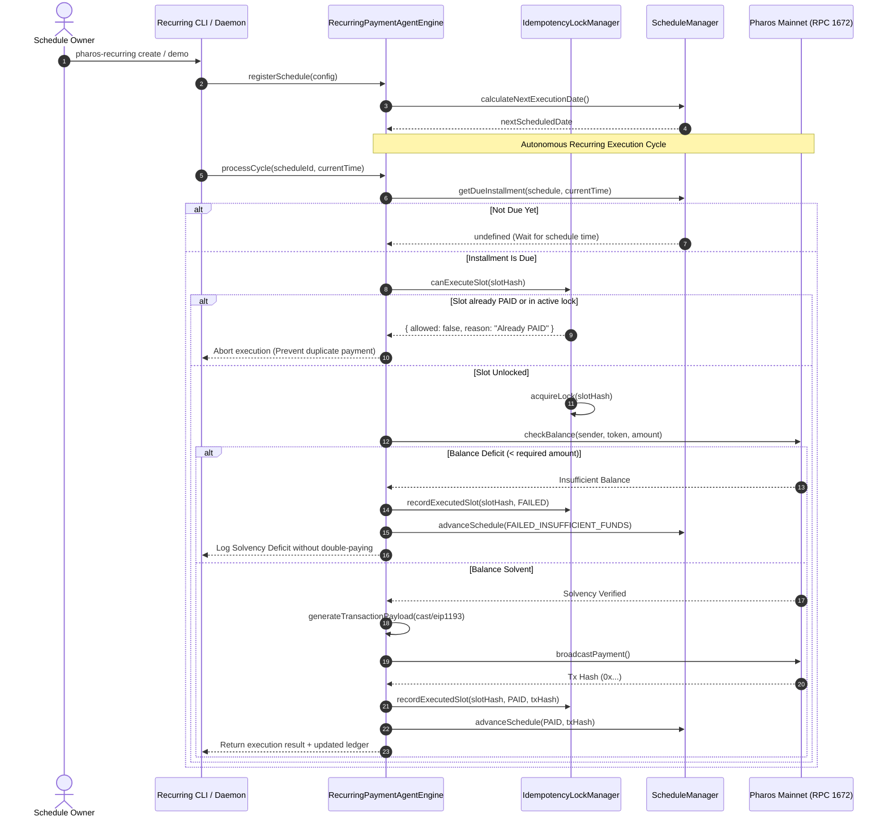

# Pharos Payments: Recurring Payment Agent Skill

## Overview
The **Pharos Recurring Payment Agent** is an autonomous, non-custodial recurring payment scheduler and lifecycle manager engineered for **Pharos Mainnet (Chain ID 1672)**. It solves the critical blockchain payroll, subscription, and recurring invoicing challenge: reliably executing periodic payments on schedule without risk of double-billing, race conditions, or unhandled solvency deficits.

### Core Capabilities:
1. **Multi-Frequency Schedule Configuration (Requirement 01)**:
   - Configurable recurrence frequencies: **Weekly** (ISO day-of-week, e.g. Friday payroll), **Monthly** (calendar day-of-month, e.g. 1st of month lease), or custom interval periods.
   - Asset support: native PROS (18 decimals) and ERC-20 tokens (e.g., native USDC `0xc879c018db60520f4355c26ed1a6d572cdac1815`, 6 decimals).
   - Recipient resolution supporting canonical 20-byte addresses and PNS (`.pharos`) / ENS (`.eth`) domain aliases.
2. **On-Time Preparation & Status Lifecycle Tracking (Requirement 02)**:
   - Evaluates due installments dynamically based on current block timestamp or reference wall-clock time.
   - Granular installment status lifecycle:
     - `PENDING`: Scheduled for future execution.
     - `PREPARED`: Transaction envelope generated with non-custodial signature payloads.
     - `PAID`: Transaction executed on Pharos Mainnet and validated with transaction receipt.
     - `FAILED_INSUFFICIENT_FUNDS`: Solvency deficit intercepted cleanly before broadcasting.
     - `FAILED_EXECUTION`: On-chain execution reverted or timed out.
     - `SKIPPED`: Schedule expired or explicitly bypassed.
3. **Solvency Deficits & Cryptographic Idempotency Locks (Requirement 03)**:
   - **Zero Double-Pay Invariant**: Uses a deterministic SHA-256 slot hash `sha256(scheduleId + slotTimestamp + recipient + amount)` recorded in the `IdempotencyLockManager`.
   - Any re-attempt to process an already executed (`PAID`) slot is rejected with a `CRITICAL_SECURITY_REJECTION`.
   - **Pre-Flight Solvency Verification**: Checks available token balances and native PROS gas headroom. If balance is deficient, the installment transitions to `FAILED_INSUFFICIENT_FUNDS` with an audit reason, advances to the next period without double-paying, and preserves schedule integrity.
4. **Historical Audit Ledger & Next Scheduled Payment (Requirement 04)**:
   - Real-time tabular visualization of active recurring schedules.
   - Full historical audit ledger showing installment indices, timestamps, amounts, statuses, and on-chain tx hashes.
   - Next scheduled execution timestamp and projected distribution amounts.

---

## Architecture Flow



---

## Idempotency Lock Implementation

The deterministic slot hash is generated as:
```typescript
const slotHash = createHash("sha256")
  .update(`${scheduleId}:${slotTimestamp}:${recipient.toLowerCase()}:${amount}:${token.symbol}`)
  .digest("hex");
```

Locks are managed in three states:
1. **Unseen / Available**: Slot has never been evaluated.
2. **In-Progress**: Acquired lock during transaction synthesis and broadcast.
3. **Settled**: Recorded terminal state (`PAID` or `FAILED`). Re-executing a settled `PAID` slot is strictly prohibited.

---

## CLI Usage Guide

### 1. Interactive Demonstration
Run the multi-frequency recurring demo demonstrating weekly payroll, monthly lease, failure handling, and double-pay resistance:
```bash
pharos-recurring demo
```

### 2. Listing Active Schedules
```bash
pharos-recurring list
```

### 3. Viewing Payment History & Next Execution
```bash
pharos-recurring history sched-weekly-payroll-001
```

---

## Foundry Reproduction Payload

Every generated installment produces an exact Foundry `cast send` payload for audit or manual execution:

```bash
# Example ERC-20 Weekly Payroll Installment (250 USDC):
cast send 0xc879c018db60520f4355c26ed1a6d572cdac1815 \
  "transfer(address,uint256)" 0x70997970C51812dc3A010C7d01b50e0d17dc79C8 250000000 \
  --rpc-url https://rpc.pharos.xyz
```
