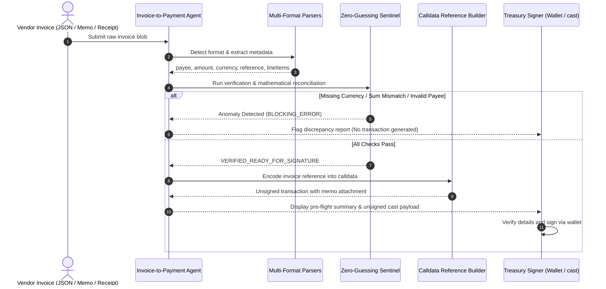

# Invoice-to-Payment Agent

When automating corporate treasury or DAO bill settlements, incoming payment requests rarely come in a single clean format. Invoices arrive as structured ERP JSON exports, unstructured plaintext emails or commercial memos, and delimited webhook receipts.

Attempting to pay these automatically creates severe financial risks:
- **Currency Assumption Risk**: Guessing an asset when the invoice says "Total: 500" can pay 500 PROS instead of 500 USDC (or vice versa).
- **Line-Item Arithmetic Discrepancies**: Invoices where itemized line amounts fail to add up to the stated total indicate tampering, tax miscalculations, or faulty export scripts.
- **On-Chain Reconciliation Void**: Payments sent without embedding the vendor's invoice reference in the transaction calldata make off-chain accounting reconciliation an operational nightmare.

The **Invoice-to-Payment Agent** ingests multi-format invoices, enforces strict zero-guessing discrepancy checks, displays human-readable summaries, and synthesizes unsigned transactions that permanently bind the invoice reference directly into on-chain calldata.

---

## Key Mechanics & Invariants

### 1. Multi-Format Invoice Extraction
The agent implements dedicated parser strategies for three industry formats:
- **Structured JSON**: Reads standard ERP and e-invoicing JSON payloads with nested line items.
- **Plaintext & Commercial Memos**: Extracts billing details from free-form markdown, handling domain aliases (like `alice.pharos`) and cleaning comma-formatted values like `$1,250.00`.
- **Delimited Receipts**: Parses `KEY=VALUE` pairs frequently generated by automated DevOps hooks and server billing scripts.

From each format, the parser reliably extracts: `payee`, `totalAmount`, `currency`, `invoiceReference`, and itemized `lineItems`.

### 2. Zero-Guessing Discrepancy Sentinel
Rather than making dangerous assumptions to force execution:
- **Currency Protection**: If the invoice omits a settlement currency, the agent halts with `MISSING_SETTLEMENT_CURRENCY`. It **never** defaults to a guessed token.
- **Line-Item Math Reconciliation**: Checks that the sum of line item quantities multiplied by unit prices matches the declared total. Any mismatch flags `LINE_ITEMS_SUM_MISMATCH` and blocks transaction synthesis.
- **Recipient & Zero-Address Guard**: Rejects the zero-address (`0x0000000000000000000000000000000000000000`) and unresolvable domains.
- **Required Reference Enforcement**: If an invoice lacks an audit reference code, it flags `MISSING_INVOICE_REFERENCE`.

### 3. Calldata-Bound Reference (On-Chain Reconciliation)
To ensure that an on-chain payment can be provably matched with internal accounting ledgers:
- **Native PROS Transfers**: Encodes the reference string (e.g. `INV-DEV-9921`) as UTF-8 hex and attaches it directly to the transaction `data` field.
- **ERC-20 (USDC) Transfers**: The standard ERC-20 `transfer(address,uint256)` calldata is 68 bytes. The agent appends the UTF-8 hex memo to the end of the calldata. The EVM executes the transfer as normal, while the calldata retains the invoice reference permanently indexed on Pharos block explorers and accounting indexers.

### 4. Non-Custodial Output
The output is strictly an unsigned transaction object (EIP-1193 format) and an executable Foundry `cast send` terminal command. The agent never asks for or manages private keys.

---

## Workflow Diagram



---

## CLI Usage

The package includes the `pharos-invoice` CLI for testing and invoice evaluation:

```bash
# 1. Run full demonstration suite (3 valid formats + 3 discrepancy catches)
pharos-invoice demo

# 2. Process an invoice file directly
pharos-invoice process ./invoice.json
pharos-invoice process ./invoice-memo.txt

# 3. View supported settlement tokens on Pharos Mainnet
pharos-invoice tokens
```

---

## Verification & Test Suite

The invoice agent is validated by 12 tests in Vitest covering multi-format parsing, anomaly detection, calldata encoding, and transaction synthesis:

```bash
./node_modules/.bin/vitest run tasks/16-invoice-to-payment-agent
```

**Test Coverage Highlights**:
- **Requirement 01**: Ingestion of structured JSON, commercial memos with line items and PNS aliases, comma-formatted amounts (`$1,250.00`), and delimited receipts.
- **Requirement 02**: Anomaly flagging for line-item sum discrepancies, missing currency, missing payee, missing invoice reference, zero-address targets, and non-positive amounts.
- **Requirement 03**: Pre-flight payment summary formatting and unsigned transaction generation with calldata-bound UTF-8 invoice references for both ERC-20 and native PROS.
- **Requirement 04**: Comprehensive sample invoice demonstration covering valid and error flows.
