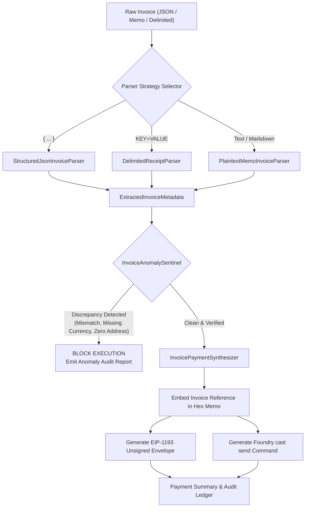

# Pharos Payments: Invoice-to-Payment Agent Skill

## Overview
The **Pharos Invoice-to-Payment Agent** is an enterprise-grade billing parser and on-chain payment synthesizer engineered for **Pharos Mainnet (Chain ID 1672)**. It automates vendor invoice reconciliation and settlement while enforcing strict financial discrepancy sentinels: never guessing missing fields, validating mathematical line-item sums, and embedding the invoice reference directly into transaction calldata for permanent on-chain accounting.

### Core Capabilities:
1. **Multi-Format Ingestion Engine (Requirement 01)**:
   - **Structured JSON (RFC-8259)**: Ingests e-invoices, Peppol/UBL records, and ERP exports.
   - **Plaintext / Markdown Commercial Memos**: Extracts payee, amount, currency, and line items from human billing statements.
   - **Delimited Key-Value Receipts**: Ingests automated DevOps and webhook billing formats (`KEY=VALUE`).
2. **Zero-Guessing Discrepancy Sentinel (Requirement 02)**:
   - **Refuses to Guess Missing Currencies**: Never assumes default tokens; flags `MISSING_SETTLEMENT_CURRENCY` if currency is omitted.
   - **Line-Item Mathematical Reconciliation**: Flags `LINE_ITEMS_SUM_MISMATCH` if stated invoice total deviates from the sum of itemized lines.
   - **Zero-Address & Format Protection**: Rejects `0x000...000` burn addresses and invalid payee identifiers.
   - **Name Service Resolution**: Resolves Pharos Name Service (`.pharos`) and ENS (`.eth`) domain aliases.
3. **Calldata-Bound Invoice Reference (Requirement 03)**:
   - Converts the invoice reference into a canonical UTF-8 hex memo.
   - For **Native PROS**: Binds memo directly to transaction data payload (`0x` + hex memo).
   - For **ERC-20 (e.g. USDC)**: Encodes `transfer(address,uint256)` and appends the hex memo suffix directly to the calldata (read safely by EVM, permanently recorded for indexers).
   - Generates standardized EIP-1193 / MetaMask transaction envelopes and Foundry `cast send` commands.
4. **Interactive Audit & Sample Demonstration (Requirement 04)**:
   - Built-in demonstration suite (`pharos-invoice demo`) validating standard JSON, Plaintext memo, Delimited receipt, and 3 discrepancy failure modes.

---

## Architecture Flow



---

## CLI Usage Guide

### 1. Interactive Demonstration
Run the multi-format invoice demonstration covering valid invoices and anomaly catches:
```bash
pharos-invoice demo
# or
npm run invoice -- demo
```

### 2. Parsing a File or Direct Text
```bash
pharos-invoice parse path/to/invoice.json
```
