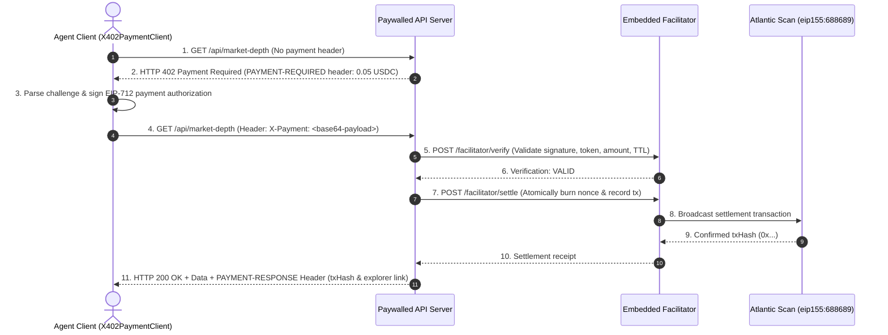

# x402 Paywalled API Suite for Autonomous On-Chain Services

Building paid web APIs for autonomous software agents requires moving beyond legacy credit cards, API key dashboards, and monthly invoicing. HTTP 402 (*Payment Required*) provides the standard mechanism for machine-to-machine commerce: an agent requests a protected resource, receives a machine-readable pricing challenge, signs a micro-payment authorization, and instantly receives the requested payload.

This package implements an end-to-end **x402 paywall suite** configured for the **Pharos Atlantic Testnet (`eip155:688689`)**, denominated in test USDC. It includes a protected API server with multiple pricing tiers, an embedded protocol facilitator (`/verify`, `/settle`, `/supported`), and a client agent that navigates the full 402 negotiation loop.

---

## System Architecture



---

## Core Components & Mechanics

### 1. Atlantic Testnet Configuration
The server and facilitator operate on the Pharos Atlantic Testnet:
- **Network Identifier**: `eip155:688689` (Chain ID: `688689`)
- **Settlement Asset**: Testnet USDC (`0x3c499c542cEF5E3811e1192ce70d8cC03d5c3359`)
- **Block Explorer**: [Pharos Atlantic Scan](https://atlantic-scan.pharos.xyz)

### 2. Route Pricing Hierarchy
The API exposes three distinct endpoints reflecting realistic SaaS tiers:
- **Free Health Probe** (`GET /health`): Zero cost, returns HTTP 200 without payment headers. Used by container healthchecks and monitors.
- **Low-Cost Data Stream** (`GET /api/market-depth`): Priced at **0.05 USDC**. Returns orderbook and liquidity depth metrics.
- **Compute-Intensive Endpoint** (`POST /api/ai-inference`): Priced at **0.25 USDC**. Returns real-time credit risk analysis and autonomous agent risk scores.

### 3. Embedded Protocol Facilitator
Rather than relying on closed third-party intermediaries, the suite includes an embedded facilitator implementing the x402 specification:
- `GET /facilitator/supported`: Lists supported networks (`eip155:688689`), approved payment contracts (USDC), and scheme types (`exact-eip712`).
- `POST /facilitator/verify`: Validates client EIP-712 signatures, confirms recipient address, checks token contract match, and verifies that the payment timestamp has not expired.
- `POST /facilitator/settle`: Atomically burns the transaction nonce to prevent replay attacks, registers the transaction, and returns a verified settlement receipt.

### 4. 402 Negotiation & Explorer Settlement Proof
When accessing a protected endpoint:
1. The server returns **HTTP 402 Payment Required** containing a base64-encoded `PAYMENT-REQUIRED` header with exact parameters (amount, asset contract, facilitator URL, and nonces).
2. The client formats and signs an EIP-712 typed payment authorization with its wallet key.
3. The client retries the request with the base64-encoded payload in the `X-Payment` header.
4. Upon successful verification and settlement, the server returns **HTTP 200 OK** containing the protected resource, accompanied by a `PAYMENT-RESPONSE` header with the on-chain transaction hash linked to Atlantic Scan:
   ```
   https://atlantic-scan.pharos.xyz/tx/0x...
   ```

### 5. Rejection of Underpaid or Corrupted Authorizations
If an agent submits an authorization with insufficient amount (e.g., 0.01 USDC for a 0.05 USDC route), an invalid EIP-712 signature, an expired deadline, or a previously spent nonce, the server rejects the request with **HTTP 402 Payment Required** and detailed error diagnostics.

### 6. Zero Hardcoded Secrets
Private keys are never hardcoded in repository files or prompts. The `SecureKeyProvider` retrieves signing keys strictly from:
- Environment variable `EVM_PRIVATE_KEY`
- Local `.private_key` file (which is gitignored)
- Ephemeral test accounts generated in-memory during automated test runs.

---

## CLI Usage

The package provides the `pharos-x402` CLI to demonstrate the complete paywall flow:

```bash
# 1. Run full demonstration (Health -> Market Depth 402/200 -> AI Inference 402/200 -> Underpayment 402)
pharos-x402 demo

# 2. Start the paywalled API server locally
pharos-x402 serve --port 4020

# 3. Test client requests against a running server
pharos-x402 query http://localhost:4020/api/market-depth
```

---

## Verification & Test Suite

The x402 implementation is validated across 13 unit tests in Vitest:

```bash
./node_modules/.bin/vitest run tasks/17-x402-paywalled-api
```

**Test Coverage Highlights**:
- **Requirement 01**: Atlantic Testnet identifier (`eip155:688689`) and test USDC asset address configuration.
- **Requirement 02**: Free `/health` route, 0.05 USDC market depth endpoint, and 0.25 USDC AI inference endpoint.
- **Requirement 03**: Facilitator `/supported`, `/verify`, and `/settle` routes.
- **Requirement 04**: End-to-end 402 negotiation loop, EIP-712 payment authorization, and `PAYMENT-RESPONSE` header with Atlantic explorer tx link.
- **Requirement 05**: Rejection of underpayment, corrupted signatures, and duplicate replay nonces with HTTP 402.
- **Requirement 06**: Secure private key isolation through environment variables and ephemeral keys.
