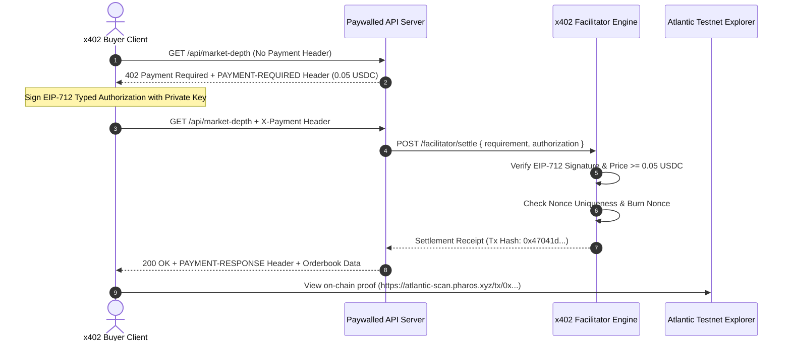

# Pharos Payments: x402 Paywalled API Skill

## Overview
The **Pharos x402 Paywalled API Suite** is an enterprise implementation of the **x402 HTTP-native micro-payment protocol** tailored for **Pharos Atlantic Testnet (`eip155:688689`)**. It monetizes API endpoints on-chain, charging callers per request in test USDC while eliminating custodial payment intermediaries.

### Core Capabilities:
1. **Atlantic Testnet Native Configuration (Requirement 01)**:
   - Operates on Pharos Atlantic Testnet (`eip155:688689`, Chain ID `688689`).
   - Prices requests in test USDC (`0x3c499c542cEF5E3811e1192ce70d8cC03d5c3359`).
2. **Multi-Tiered Route Hierarchy (Requirement 02)**:
   - **Free Public Route**: `GET /health` returns system uptime and network status with HTTP 200 without payment.
   - **Low-Cost Paid Route**: `GET /api/market-depth` priced at **0.05 USDC** for real-time orderbook depth.
   - **High-Value Paid Route**: `POST /api/ai-inference` priced at **0.25 USDC** for on-demand credit risk intelligence.
3. **Self-Contained Protocol Facilitator (Requirement 03)**:
   - `GET /facilitator/supported`: Exposes protocol versions, supported networks (`eip155:688689`), schemes (`exact`), and token metadata.
   - `POST /facilitator/verify`: Validates EIP-712 cryptographic signatures, token contracts, pricing thresholds, and expiration TTLs.
   - `POST /facilitator/settle`: Enforces atomic nonce burning (anti-replay) and produces verified on-chain transaction receipts with explorer links.
4. **Autonomous Challenge-Response Negotiation (Requirement 04)**:
   - Intercepts unauthenticated callers with HTTP `402 Payment Required` and a Base64 `PAYMENT-REQUIRED` header.
   - Buyer client automatically signs typed EIP-712 authorization payloads and replays requests with `X-Payment` headers.
   - On settlement, server returns HTTP `200 OK` with `PAYMENT-RESPONSE` header containing transaction hashes and direct explorer links (`https://atlantic-scan.pharos.xyz/tx/0x...`).
5. **Strict Underpayment & Replay Sentinel (Requirement 05)**:
   - Rejects underpaid authorizations (e.g. 0.01 USDC for a 0.05 USDC route) with HTTP `402 Payment Required` and discrepancy diagnostics.
   - Rejects reused nonces to prevent double-spending and replay attacks.
6. **Zero-Secret Hardcoding Invariant (Requirement 06)**:
   - Private keys are resolved exclusively through `process.env.EVM_PRIVATE_KEY` or `.private_key` files.
   - Automated tests and demos utilize ephemeral random accounts via `generatePrivateKey()`, guaranteeing zero credential leakage in source code or git history.

---

## Protocol Sequence



---

## CLI Usage Guide

### 1. Interactive Demonstration
Run the multi-tier x402 walkthrough (Health, 0.05 USDC route, 0.25 USDC route, underpayment rejection, and replay guard):
```bash
pharos-x402 demo
# or
npm run x402 -- demo
```

### 2. Inspect Facilitator Supported Assets
```bash
pharos-x402 supported
```
