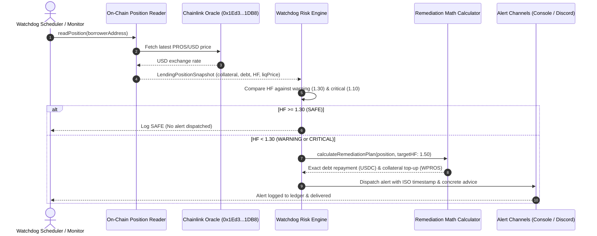

# Liquidation Watchdog for DeFi Lending Positions

Borrowers on DeFi lending protocols (such as Morpho Blue or Harbor Lending on Pharos) face sudden liquidation when collateral prices experience rapid downward volatility. When a position's Health Factor drops below 1.0, third-party liquidators seize collateral at a steep penalty (often 5%–15%), inflicting permanent capital loss on the borrower.

Generic alert bots that simply output "Health Factor low" are unhelpful in fast-moving markets. Borrowers need to know **exactly** what action to take and **how much capital** is required to secure their position before it gets wiped out.

The **Liquidation Watchdog** continuously reads on-chain lending metrics, monitors live price feeds from Chainlink, tracks configurable risk tiers (Warning at 1.30, Critical at 1.10), broadcasts timestamped alerts across multiple channels, and provides concrete mathematical remediation steps (e.g., *"Repay 835.00 USDC or deposit 1.0024 WPROS to restore Health Factor to 1.50"*).

---

## Architectural Mechanics & Math

### 1. On-Chain Position Reading & Valuation
The watchdog gathers current position data from Pharos Mainnet:
- **Collateral & Debt Assets**: Collateral (e.g., WPROS at `0xd097...`) and borrowed debt (e.g., Native USDC at `0xc879...`).
- **Live Oracle Valuation**: Queries the on-chain Chainlink Price Feed (`0x1Ed3e8CdC173363593BfAD9bF77aa2A0e7351DB8`) to calculate real-time USD asset values.
- **Health Factor ($HF$)**:
  $$HF = \frac{\text{Collateral Value (USD)} \times \text{Liquidation Threshold}}{\text{Debt Value (USD)}}$$
- **Liquidation Price**: Exact collateral price where the position reaches the liquidation threshold:
  $$\text{Liquidation Price} = \frac{\text{Debt Value (USD)}}{\text{Collateral Units} \times \text{Liquidation Threshold}}$$

### 2. Configurable Multi-Tier Risk Thresholds
Positions are categorized into four actionable risk tiers:
- **`SAFE`** ($HF \ge 1.30$): Position is adequately collateralized. No alerts dispatched.
- **`WARNING`** ($1.10 \le HF < 1.30$): Approaching risk zone. Dispatches early warning alert to give borrower time to react.
- **`CRITICAL`** ($1.00 \le HF < 1.10$): Immediate liquidation danger. Dispatches urgent high-priority alerts.
- **`LIQUIDATION_IMMINENT`** ($HF < 1.00$): Position is underwater and actively liquidatable.

Thresholds are fully configurable to support institutional risk mandates or high-beta collateral assets.

### 3. Multi-Channel Alert Delivery
When a threshold is breached, the engine constructs a structured alert payload and broadcasts it across registered notification channels:
- **Console Notification Channel**: Outputs formatted terminal alerts with ISO-8601 timestamps, protocol name, borrower address, liquidation price buffer, and remediation steps.
- **Discord Notification Channel**: Posts rich embed webhooks with color-coded severity (orange for warning, red for critical).
- **In-Memory Audit Ledger**: Preserves all dispatched alerts with timestamps for governance review and programmatic inspection.

### 4. Concrete Remediation Advisory (Exact Actionable Guidance)
Unlike passive monitoring tools, each alert includes an exact calculation showing how to restore the position to a target safe Health Factor (default: 1.50):
- **Option A (Repay Debt)**:
  $$\text{Debt Repayment USD} = \text{Current Debt} - \frac{\text{Collateral Value} \times \text{Liquidation Threshold}}{\text{Target HF}}$$
- **Option B (Deposit Collateral)**:
  $$\text{Added Collateral USD} = \frac{\text{Target HF} \times \text{Current Debt}}{\text{Liquidation Threshold}} - \text{Collateral Value}$$

Both figures are converted into exact asset units (e.g. USDC or WPROS) and formatted into human-readable advice.

---

## Workflow Diagram



---

## CLI Usage

The package includes the `pharos-watchdog` CLI for testing and position inspection:

```bash
# 1. Run demonstration across 4 scenarios (Safe, Warning, Critical, Flash Crash)
pharos-watchdog demo

# 2. Inspect a live borrower position on Pharos Mainnet
pharos-watchdog inspect 0x70997970C51812dc3A010C7d01b50e0d17dc79C8

# 3. Test remediation calculations under a custom collateral price
pharos-watchdog simulate --collateral 5.0 --debt 5000 --price 1470
```

---

## Verification & Test Suite

The liquidation watchdog is tested across 11 unit tests in Vitest:

```bash
./node_modules/.bin/vitest run tasks/18-liquidation-watchdog
```

**Test Coverage Highlights**:
- **Requirement 01**: Reading on-chain position metrics (collateral, debt, LTV, liquidation price) and live Chainlink oracle queries.
- **Requirement 02**: Threshold classification (SAFE, WARNING, CRITICAL, LIQUIDATION_IMMINENT) and custom institutional overrides.
- **Requirement 03**: Multi-channel alert dispatch with ISO timestamps, borrower addresses, and price drop buffers.
- **Requirement 04**: Precise mathematical remediation calculations for debt repayment and collateral additions to restore safe Health Factors.
