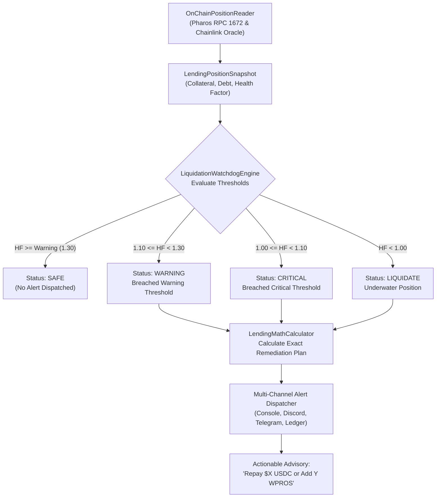

# Pharos DeFi: Liquidation Watchdog Skill

## Overview
The **Pharos Liquidation Watchdog** is an autonomous risk sentinel and insolvency mitigation agent engineered for lending protocols (such as Morpho Blue and Harbor Lending) on **Pharos Mainnet (Chain ID 1672)**. It monitors borrower collateralization in real time against Chainlink price oracles (`0x1Ed3e8CdC173363593BfAD9bF77aa2A0e7351DB8`), assesses Health Factors ($HF$), and fires proactive multi-channel alerts with exact mathematical debt repayment or collateral addition advice before liquidation occurs.

### Core Capabilities:
1. **On-Chain Position & Health Factor Reading (Requirement 01)**:
   - Queries live collateral, outstanding debt, and oracle pricing on Pharos Mainnet.
   - Computes canonical DeFi lending metrics:
     $$HF = \frac{\text{Collateral Value (USD)} \times \text{Liquidation Threshold}}{\text{Debt Value (USD)}}$$
     $$\text{Liquidation Price} = \frac{\text{Debt Value (USD)}}{\text{Collateral Units} \times \text{Liquidation Threshold}}$$
2. **Configurable Tiered Risk Sentinels (Requirement 02)**:
   - Fully customizable risk thresholds:
     - `warningHealthFactor` (Default: `1.30`)
     - `criticalHealthFactor` (Default: `1.10`)
     - `targetSafeHealthFactor` (Default: `1.50` safe buffer)
   - Supports institutional risk profiles with tighter volatility bands.
3. **Multi-Channel Alert Dispatcher (Requirement 03)**:
   - **Console Notification Channel**: Rich terminal cards with ISO-8601 timestamps and colorized urgency tiers.
   - **Discord Notification Channel**: Webhook dispatch with dynamic embeds (Orange for Warning, Red for Critical).
   - **In-Memory Audit Ledger**: Tracks all historical alerts for accounting reconciliation and automated testing.
4. **Concrete Actionable Remediation Formulations (Requirement 04)**:
   - Rather than vague warnings, computes the exact capital required to restore solvency back to `targetSafeHealthFactor`:
     - **Option A (Debt Repayment)**: Exact USDC required to burn/repay.
     - **Option B (Collateral Supply)**: Exact WPROS required to deposit.

---

## Architecture Flow



---

## CLI Usage Guide

### 1. Interactive Demonstration
Run the multi-tier market drop simulation demonstrating SAFE, WARNING, CRITICAL, and LIQUIDATION IMMINENT states:
```bash
pharos-watchdog demo
# or
npm run watchdog -- demo
```

### 2. Live On-Chain Position Inspection
Inspect any borrower position against live Chainlink prices on Pharos Mainnet:
```bash
pharos-watchdog inspect --address 0x70997970C51812dc3A010C7d01b50e0d17dc79C8 --collateral 5.0 --debt 5000
```
