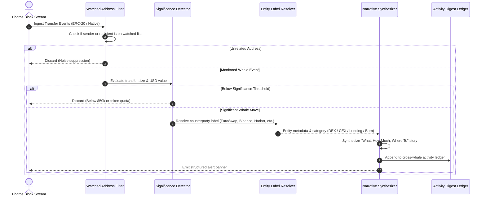

# Whale-Watching Agent

Tracking high-net-worth accounts, treasury multi-sigs, and institutional liquidity providers on Pharos is essential for understanding capital flows and liquidity shifts. However, raw EVM transfer logs are overwhelmingly noisy: arbitrage bots, liquidity rebalancers, and dust transfers generate thousands of events per hour.

The **Whale-Watching Agent** filters out market noise by tracking configurable whale addresses against multi-tier significance thresholds (both USD-equivalent and token-specific minimums). It enriches raw transfer data with verified on-chain protocol labels (FaroSwap, Harbor, Morpho Blue, CEX deposits, Burn addresses) to explain **what moved, how much, and where to**, while maintaining an aggregate activity digest across all watched accounts.

---

## Architecture & Detection Pipeline



---

## Key Mechanics

### 1. Configurable Watched Addresses
The surveillance engine maintains an active registry of high-net-worth accounts (initialized with 5 verified whale accounts on Pharos by default):
- **Genesis Alpha Whale**: Early liquidity backer and staking accumulator.
- **Harbor Liquidity Provider**: High-volume lending supplier.
- **FaroSwap Arbitrageur**: MEV and cross-pool arbitrage operator.
- **Morpho Lending Depositor**: Yield farmer and collateralized borrower.
- **Bridge Market Maker**: Cross-chain liquidity rebalancer.

The engine supports runtime registration (`registerAddress`) and unregistration (`unregisterAddress`), ignoring events that do not involve any monitored wallet.

### 2. Multi-Tier Significance Thresholds
To avoid alerting on small test transfers or routine gas top-ups:
- **Global USD Benchmark**: Evaluates transfers against a baseline USD threshold (default: `$50,000.00 USD`).
- **Token-Specific Quotas**: Enforces nominal volume minimums per token (e.g., minimum 50,000 USDC or 30,000 PROS), ensuring detection even during oracle price fluctuations.
- **Per-Whale Custom Overrides**: Allows specific accounts (e.g. high-frequency market makers) to have higher alerting thresholds to prevent notification fatigue.
- **Self-Transfer & Zero-Value Suppression**: Automatically filters internal self-transfers (`from == to`) and zero-value contract pings.

### 3. Entity Resolution & Movement Narratives
Every significant move is annotated with verified counterparty metadata:
- **DEX Protocols**: Recognizes FaroSwap Router v1 (`0xba3b...`) and liquidity pools.
- **Lending Markets**: Identifies Harbor Lending and Morpho Blue vault addresses.
- **Centralized Exchanges**: Flags known deposit addresses (e.g. Binance hot wallets).
- **Token Burns**: Recognizes burns sent to `0x000...000` or `0x000...dEaD`.
- **Inter-Whale Transfers**: Flags direct transfers between monitored whale addresses.

Each alert answers the three essential questions in plain English:
> *"Whale 0x7099...79C8 transferred 150,000.00 USDC ($150,000.00 USD) to FaroSwap Router v1 for DEX swap."*

### 4. Cross-Whale Activity Digest
The agent consolidates individual transfer events into an aggregate market activity summary:
- **Total Monitored Capital**: Cumulative USD volume moved across all watched wallets during the monitoring window.
- **Sector Distribution**: Breakdown of capital allocation across DEX trading, Lending deposits, CEX inflows, Inter-whale transfers, and Token burns.
- **Peak Move Detection**: Highlights the largest single transfer observed.
- **Reverse-Chronological Flow Ledger**: Chronological table of all recorded whale transactions.

---

## CLI Usage

The package includes the `pharos-whale` binary for interactive monitoring:

```bash
# 1. Run live demonstration stream with simulated Pharos mainnet whale transfers
pharos-whale demo

# 2. List all currently monitored whale addresses and their configured thresholds
pharos-whale list

# 3. View the consolidated cross-whale activity summary digest
pharos-whale summary
```

---

## Verification & Test Suite

The whale watching agent is verified across 19 unit tests in Vitest:

```bash
./node_modules/.bin/vitest run tasks/19-whale-watching-agent
```

**Test Coverage Highlights**:
- **Requirement 01**: Initializing with 5 default watched addresses, dynamic address registration/removal, and unmonitored event filtering.
- **Requirement 02**: Global USD threshold evaluation ($50k), token-specific nominal quotas, per-whale threshold overrides, and sub-threshold noise filtering.
- **Requirement 03**: Contextual explanatory reports for DEX swaps, lending deposits, CEX inflows, unindexed addresses, token burns, and peer-to-peer whale transfers.
- **Requirement 04**: Aggregate multi-whale volume tracking, protocol sector distribution math, and reverse-chronological flow tables.
- **Edge Cases**: Self-transfer suppression and zero-value contract interaction handling.
