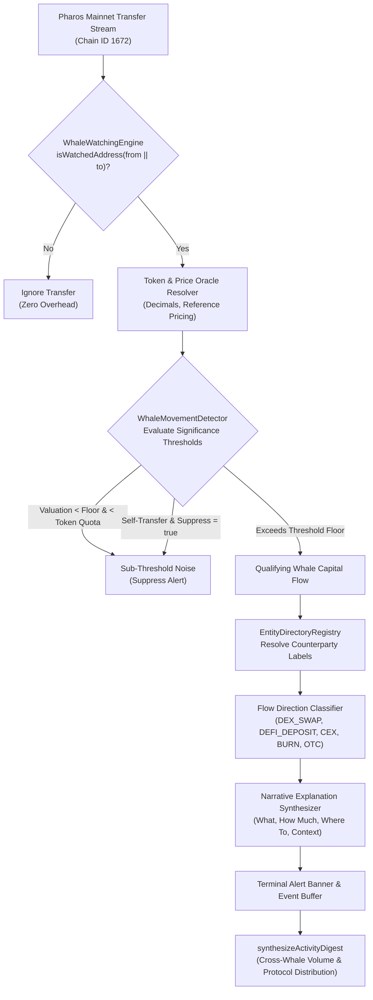

# Pharos Trading & Monitoring: Whale-Watching Agent Skill

## Overview
The **Pharos Whale-Watching Agent** is an autonomous high-impact on-chain capital surveillance agent engineered for **Pharos Mainnet (Chain ID 1672)**. It monitors high-net-worth accounts (whales, treasury multisigs, early backers, MEV arbitrageurs), evaluates transfer significance against multi-tier benchmarks (global USD valuation floors and token-specific quotas), enriches raw hex counterparties with semantic directory entries (FaroSwap, Harbor, Morpho Blue, Binance, Canonical Bridge), and generates narrative explanations answering **what moved, how much, and where to**, concluding with a cross-whale activity summary digest.

### Core Capabilities:
1. **Multi-Address Surveillance Roster (Requirement 01)**:
   - Tracks $\ge 5$ configurable addresses by default:
     - `Pharos Genesis Whale Alpha` (Treasury allocator & seed reserve)
     - `Harbor Early Liquidity Provider` (Lending collateral custodian)
     - `FaroSwap Dominant Arbitrageur` (AMM & CEX MEV trader)
     - `Morpho Collateral Vault Depositor` (Isolated lending treasury)
     - `Cross-Chain Bridge Market Maker` (L1/L2 liquidity relayer)
   - Supports runtime dynamic registration (`registerWatchedWhale`) and unregistration (`unregisterWatchedWhale`).
2. **Configurable Multi-Tier Significance Thresholds (Requirement 02)**:
   - **Global USD Benchmark**: Evaluates transfers against a baseline USD valuation floor (Default: `$50,000 USD`).
   - **Per-Token Base Quotas**: Independent volume thresholds per token (e.g., 25,000 PROS, 50,000 USDC, 20 WETH) preserving sensitivity regardless of temporary price swings.
   - **Whale-Specific Overrides**: Tailored custom threshold limits per account for tier-1 institutions.
   - **Noise Filtering**: Suppresses circular self-transfers (`suppressSelfTransfers: true`) and zero-value invocations.
3. **Explanatory Narrative Reporting with Entity Labels (Requirement 03)**:
   - Maps raw counterparty addresses to an ecosystem directory:
     - `FaroSwap Router v1` & `Factory v1` (`[DEX]`)
     - `Harbor Protocol Treasury` & `Lending Pool` (`[LENDING]`, `[TREASURY]`)
     - `Morpho Blue Pharos Market` (`[LENDING]`)
     - `Binance Custody Hot Wallet 4` & `OKX Settlement` (`[CEX]`)
     - `Pharos Canonical Bridge Custody` (`[BRIDGE]`)
     - `Dead Burn Address (0xdEaD)` & Null (`[SYSTEM_NULL]`)
     - Truncated checksum fallback `Unlabeled (0x... )` (`[UNKNOWN]`)
   - Generates contextual explanations detailing the economic intent: DEX spot routing, lending collateral provisioning, exchange liquidation prep, token supply burns, or inter-whale OTC repositioning.
4. **Cross-Whale Activity Summary Digest (Requirement 04)**:
   - Consolidates movements across all monitored whales.
   - Calculates aggregate USD volume, peak single move, and identifies top mover whales.
   - Computes protocol sector distribution with visual ASCII percentage share bars.
   - Provides a reverse-chronological recent flow feed.

---

## Architecture Flow



---

## CLI Commands

```bash
# Run interactive multi-whale surveillance demo with realistic scenarios
pharos-whale demo
npm run whale demo

# List all active monitored whale accounts and custom thresholds
pharos-whale list

# Display recent cross-whale activity summary digest
pharos-whale summary
```
