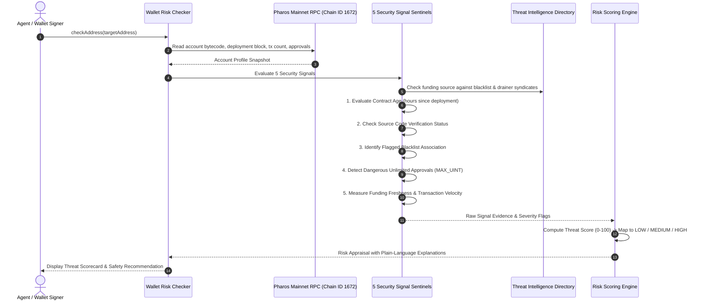

# Wallet Risk Checker

Interacting blindly with unverified smart contracts or freshly funded counterparty wallets is one of the most common causes of capital loss in Web3. Malicious drainers, unverified honeypots, and phishing syndicates frequently spin up disposable contracts to capture approvals and steal funds.

The **Wallet Risk Checker** performs pre-transaction security audits on Pharos Mainnet. It inspects on-chain account profiles across **5 distinct security signals**, scores threat levels from 0 to 100, assigns an overall risk tier (`LOW`, `MEDIUM`, or `HIGH`), and formulates plain-language risk appraisals before a user or agent submits a transaction.

---

## Architecture & Inspection Flow



---

## The 5 Security Signals

The checker evaluates five orthogonal indicators to calculate an aggregate risk posture:

### 1. Contract Age Sentinel
- **Signal**: How long has this contract existed on Pharos?
- **Risk Indicator**: Freshly deployed contracts (< 24 hours old) represent elevated risk. Exploits and rug-pulls overwhelmingly originate from ephemeral contracts deployed shortly before an attack.
- **Evaluation**: Mature contracts (> 30 days) receive 0 risk points; contracts under 24 hours receive a high severity flag.

### 2. Code Verification Sentinel
- **Signal**: Has the contract's Solidity source code been compiled and verified on Pharos explorers?
- **Risk Indicator**: Unverified bytecode cannot be audited, hiding potential honeypot traps, hidden mint functions, or reentrancy bugs.
- **Evaluation**: Verified contracts pass cleanly; unverified opaque bytecode triggers a critical severity alert.

### 3. Flagged Address Association Sentinel
- **Signal**: Did the account receive initial gas funding or direct transfers from known exploiters?
- **Risk Indicator**: Sybil accounts and fresh drainer wallets are typically funded by centralized mixer outputs or known attacker addresses.
- **Evaluation**: Cross-checks upstream funding sources against the built-in Pharos Threat Intelligence Directory. Any connection to blacklisted drainers immediately elevates the risk to `HIGH`.

### 4. Approval Anomaly Sentinel
- **Signal**: Does the account hold active unlimited token allowances (`type(uint256).max`) to unverified spenders?
- **Risk Indicator**: Dangling unlimited approvals allow compromised spenders to drain balances asynchronously at any future date.
- **Evaluation**: Flags broad ERC-20 allowances granted to non-whitelisted or unverified contract addresses.

### 5. Funding Freshness Sentinel
- **Signal**: Is this a brand-new wallet with minimal transaction history?
- **Risk Indicator**: Disposable "burner" accounts funded minutes before requesting a high-value transfer or signature are common phishing vectors.
- **Evaluation**: Flags accounts created within 6 hours with fewer than 3 historical transactions.

---

## Risk Tier Classification

| Risk Level | Threat Score | Criteria & Recommendation |
| :--- | :---: | :--- |
| **`LOW`** | `0 - 29` | Verified source code, mature history, no threat connections. Safe for standard interaction. |
| **`MEDIUM`** | `30 - 69` | Minor caution flags (e.g. young deployment or dangling approvals). Proceed with caution; verify transaction calldata. |
| **`HIGH`** | `70 - 100` | Severe red flags (unverified bytecode, blacklisted funding, or honeypot indicators). Halt interaction immediately. |

---

## CLI Usage

The package includes the `pharos-risk` CLI for testing and address audits:

```bash
# 1. Run comparative demonstration (Clean vs Risky vs Burner vs Uninitialized)
pharos-risk demo

# 2. Audit a specific address on Pharos Mainnet
pharos-risk check 0xba3b00c3b0632b6fa622f990924976725227b68a

# 3. Inspect known blacklist and threat intelligence entries
pharos-risk threats
```

---

## Demonstration Scenarios

The suite includes four benchmark profiles demonstrating the evaluator across clean and dangerous cases:

1. **Clean Example (FaroSwap Router v1)**:
   - Verified Solidity source code, mature 90-day deployment history, zero blacklist associations.
   - Result: **`LOW` Risk** (Threat Score: `0 / 100`).
2. **Risky Example (Malicious Honeypot Deployer)**:
   - Deployed 1.2 hours ago, unverified opaque bytecode, funded directly by a blacklisted drainer syndicate.
   - Result: **`HIGH` Risk** (Threat Score: `100 / 100`).
3. **Cautionary Example (Disposable Burner Wallet)**:
   - Freshly funded 30 minutes ago with unlimited approvals to unverified third-party spenders.
   - Result: **`MEDIUM` Risk** (Threat Score: `45 / 100`).
4. **Edge Case (Uninitialized Account)**:
   - Fresh recipient address with zero nonces, handled safely without false-positive alarms.
   - Result: **`LOW` Risk** (Threat Score: `15 / 100`).

---

## Verification & Test Suite

The risk checker is tested across 13 unit tests in Vitest:

```bash
./node_modules/.bin/vitest run tasks/20-wallet-risk-checker
```

**Test Coverage Highlights**:
- **Requirement 01**: Individual evaluation of all 5 security signals (contract age, code verification, flagged association, approvals, funding freshness).
- **Requirement 02**: Accurate mapping to `LOW`, `MEDIUM`, and `HIGH` risk tiers with explicit triggering reasons.
- **Requirement 03**: Human-readable, jargon-free explanations for each flagged signal.
- **Requirement 04**: Verification against clean (FaroSwap) and risky (Honeypot) benchmark accounts.
- **Edge Cases**: Uninitialized zero-nonce accounts and dynamic threat directory updates.
