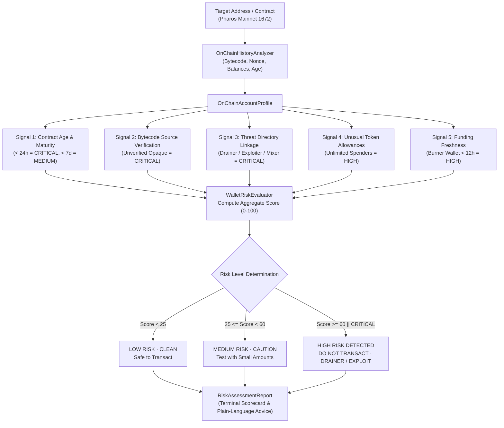

# Pharos Compliance & Security: Wallet Risk Checker Skill

## Overview
The **Pharos Wallet Risk Checker** is an autonomous pre-transaction security audit and counterparty verification agent engineered for **Pharos Mainnet (Chain ID 1672)**. It protects users, institutional treasuries, and autonomous AI agents from interacting with phishing drainers, flash-loan exploiters, unverified honeypots, and disposable sybil burner wallets by examining on-chain account history across **5 distinct security signals**.

### Core Capabilities:
1. **Multi-Signal Threat Radar (Requirement 01)**:
   - **Signal 1 (Contract Age & Maturity)**: Identifies flash-deployed smart contracts (< 24 hours = CRITICAL; < 7 days = MEDIUM).
   - **Signal 2 (Bytecode Transparency)**: Detects opaque, unverified EVM bytecode lacking open-source verification on PharosScan (CRITICAL).
   - **Signal 3 (Threat Directory Association)**: Cross-references direct transactions or inbound funding from known drainers, exploiters, or mixers (CRITICAL).
   - **Signal 4 (Approval Anomalies)**: Flags dangerous unlimited (MaxUint256) ERC-20 allowances granted to untrusted external spenders (HIGH).
   - **Signal 5 (Funding Freshness)**: Distinguishes disposable burner wallets (< 12 hours old, <= 2 txs) from established accounts and uninitialized addresses.
2. **Deterministic Risk Rating & Scoring Engine (Requirement 02)**:
   - Evaluates total numerical risk score (0 to 100).
   - Classifies accounts into 3 discrete risk tiers:
     - `LOW RISK · CLEAN` (Score 0-24, zero critical triggers, safe to transact)
     - `MEDIUM RISK · CAUTION` (Score 25-59, cautionary warnings, proceed with care)
     - `HIGH RISK DETECTED` (Score 60-100 or any CRITICAL trigger, immediate danger, do not transact)
3. **Plain-Language Explanations (Requirement 03)**:
   - For every triggered flag, provides clear, human explanations explaining *what* was detected and *why* it presents a threat, avoiding bureaucratic jargon.
4. **Comparative Benchmark Demonstrations (Requirement 04)**:
   - Built-in benchmarks demonstrating clean verified protocols (FaroSwap Router v1), dangerous honeypots/drainers, disposable burners, and uninitialized addresses.

---

## Architecture Flow



---

## CLI Commands

```bash
# Run comparative simulation demonstrating clean vs risky accounts
pharos-risk demo
npm run risk -- demo

# Audit any on-chain address or contract live on Pharos Mainnet
pharos-risk check 0x1000000000000000000000000000000000000001
pharos-risk check 0xBad0000000000000000000000000000000000bad

# View known threat intelligence directory
pharos-risk threats
```
