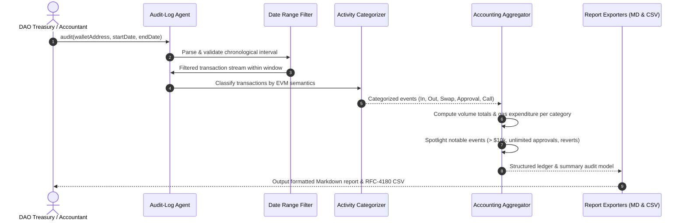

# Audit-Log Agent

For Web3 treasuries, fund managers, and DAO operations, generating plain-language accounting reports from raw on-chain activity is a repetitive and error-prone process. Block explorer logs group all transactions together without distinguishing between cash-inflows, vendor payments, DEX swaps, or security permissions like ERC-20 token approvals.

The **Audit-Log Agent** reconciles on-chain wallet history over any specified date range. It categorizes raw transactions into **5 distinct accounting buckets** (Transfers In, Transfers Out, DEX Swaps, Token Approvals, and Contract Interactions), calculates category turnover totals, flags notable high-value or unusual transactions with direct PharosScan links, and exports clean reports in both **Markdown** and **RFC-4180 CSV** formats.

---

## Architecture & Reconciliation Pipeline



---

## Core Components & Mechanics

### 1. Address & Date Range Filtering
The agent accepts a target wallet address and temporal bounds:
- Supports calendar dates (`YYYY-MM-DD`) and full ISO-8601 timestamps (`YYYY-MM-DDTHH:mm:ssZ`).
- Enforces strict chronological sanity checks (rejecting inverted start/end ranges).
- Filters raw block and transaction timestamps strictly within the defined UTC window, ignoring transactions outside the scope.

### 2. 5-Way Activity Categorization
Rather than treating all EVM contract calls identically, the categorizer inspects method selectors, event logs, and counterparty entities:
- **`TRANSFER_IN`**: Inbound native PROS or ERC-20 token receipts from external addresses or exchanges.
- **`TRANSFER_OUT`**: Outbound disbursements, payroll tranches, or vendor settlements.
- **`DEX_SWAP`**: Automated market maker trades (e.g. on FaroSwap) with extracted input/output asset pairs and exchange rates.
- **`TOKEN_APPROVAL`**: ERC-20 allowance modifications (`approve` / `permit`). Categorized as zero-cashflow governance permissions.
- **`CONTRACT_INTERACTION`**: Protocol interactions such as lending deposits (Harbor / Morpho), staking, or multisig operations.

### 3. Category Accounting & Notable Transaction Spotlights
The aggregator generates a concise financial overview:
- **Category Totals**: Net USD turnover, transaction count, percentage of activity, and total gas spent per category.
- **Notable Transaction Flagging**: Isolates transactions requiring auditor attention:
  - High-value transfers exceeding `$10,000.00 USD`.
  - Dangerous unlimited token allowances (`type(uint256).max`) granted to third-party spenders.
  - Reverted EVM executions (which consumed gas without state changes).
- **Explorer Permalinks**: Each notable transaction is linked directly to the canonical Pharos block explorer (`https://pharosscan.xyz/tx/0x...`).

### 4. Dual Format Export (Markdown & CSV)
The agent produces audit-ready artifacts:
- **Markdown Report (`.md`)**: A human-readable compliance document featuring an executive summary, category breakdown tables, and notable event narratives.
- **RFC-4180 CSV Spreadsheet (`.csv`)**: A structured transaction ledger containing timestamps, transaction hashes, categories, asset amounts, USD valuations, counterparty labels, and gas fees, suitable for direct import into accounting software (e.g., QuickBooks or Cryptio).

---

## CLI Usage

The package includes the `pharos-audit` binary for interactive audits:

```bash
# 1. Run demonstration audit over corporate treasury sample data
pharos-audit demo

# 2. Generate an audit report for a specific wallet and date range
pharos-audit report 0x6119871b4eb66db137dcfad59655853ea6fe58ce \
  --from 2026-02-01 \
  --to 2026-02-28 \
  --format all \
  --out ./audit-reports

# 3. View known recognized Pharos protocols and counterparties
pharos-audit directory
```

---

## Verification & Test Suite

The audit agent is verified across 12 unit tests in Vitest:

```bash
./node_modules/.bin/vitest run tasks/21-audit-log-agent
```

**Test Coverage Highlights**:
- **Requirement 01**: Parsing valid ISO-8601 and calendar date ranges, rejecting inverted bounds, and date interval filtering.
- **Requirement 02**: Accurate 5-way categorization across transfers in, transfers out, token swaps, approvals, and contract interactions.
- **Requirement 03**: Category volume totals, transaction counts, and spotlighting notable events with PharosScan explorer links.
- **Requirement 04**: Structured Markdown document generation and RFC-4180 compliant CSV ledger export.
- **Edge Cases**: Reverted transactions with non-zero gas fees and empty date intervals.
