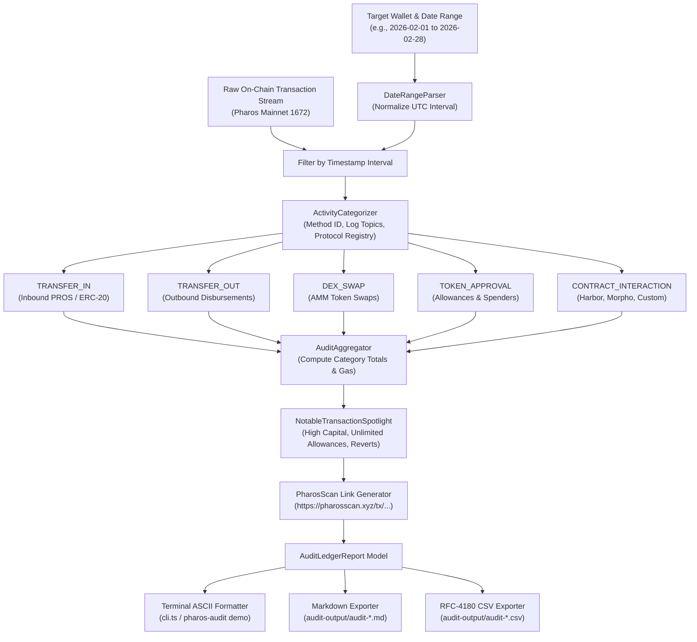

# Pharos Compliance & Accounting: Audit-Log Agent Skill

## Overview
The **Pharos Audit-Log Agent** is an autonomous on-chain transaction reconciliation and financial compliance audit engine engineered for **Pharos Mainnet (Chain ID 1672)**. It ingests historical blockchain events for any specified wallet address and date range, classifies transactions across **5 standardized activity categories**, computes aggregated financial turnovers, isolates notable compliance events with direct **PharosScan** explorer links, and exports comprehensive audit artifacts in **Markdown** and **RFC-4180 CSV** formats.

### Core Capabilities:
1. **Temporal Filtering & Date Range Ingestion (Requirement 01)**:
   - Ingests start and end dates supporting ISO-8601 (`YYYY-MM-DDTHH:mm:ssZ`) and calendar format (`YYYY-MM-DD`).
   - Normalizes date ranges into explicit millisecond Unix timestamps in UTC.
   - Rejects inverted intervals, future paradoxes, or malformed formats with descriptive error reporting.
2. **Multi-Category Transaction Taxonomy (Requirement 02)**:
   - Groups transactions into 5 canonical categories:
     - `TRANSFER_IN`: Inbound native PROS or ERC-20 token receipts from external senders, CEX hot wallets, or bridges.
     - `TRANSFER_OUT`: Outbound token transfers and disbursements to third-party accounts.
     - `DEX_SWAP`: Automated Market Maker (AMM) token swaps (e.g. FaroSwap Router) with input/output pair tracking.
     - `TOKEN_APPROVAL`: ERC-20 token allowance approvals (`approve`/`increaseAllowance`), tracking spender addresses and isolating permissions from cash-flow turnover.
     - `CONTRACT_INTERACTION`: DeFi lending deposits (Harbor), margin positions (Morpho Blue), staking, and smart contract method invocations.
3. **Category Accounting & Notable Transaction Spotlight (Requirement 03)**:
   - Computes aggregated USD volume turnover, transaction counts, percentage market share, and net token volume tallies per category.
   - Automatically spotlights notable compliance events:
     - High capital movement exceeding configurable threshold (default: $\ge \$10,000$ USD).
     - Unlimited token allowances (`MaxUint256`) representing potential security attack vectors.
     - Failed or reverted on-chain transactions where gas was expended without net asset delivery.
   - Formulates direct explorer verification links (`https://pharosscan.xyz/tx/0x...`) for every notable event.
4. **Structured Multi-Format Compliance Exporters (Requirement 04)**:
   - **Markdown Report (`.md`)**: Formatted executive summary, financial metrics table, category breakdown table, notable events callout list, and full chronological transaction ledger.
   - **RFC-4180 CSV Ledger (`.csv`)**: Machine-readable spreadsheet export with complete columns: `EntryId`, `TxHash`, `BlockNumber`, `TimestampIso`, `Category`, `CounterpartyAddress`, `CounterpartyLabel`, `AssetSymbol`, `NominalAmount`, `UsdValuation`, `GasFeePaidPros`, `IsNotable`, `NotableReason`, `PlainLanguageDescription`, `ExplorerUrl`.

---

## Architecture Flow



---

## CLI Usage

```bash
# Run interactive multi-scenario audit demo with generated reports
pharos-audit demo
npm run audit -- demo

# Audit a wallet across a specific date range
pharos-audit report 0x71c80000000000000000000000000000000071C8 --from 2026-02-01 --to 2026-02-28

# Audit and export exclusively in Markdown format
pharos-audit report 0x71c80000000000000000000000000000000071C8 --format md --output ./reports

# Audit and export exclusively in CSV format
pharos-audit report 0x71c80000000000000000000000000000000071C8 --format csv --output ./reports

# View recognized protocol and entity directory
pharos-audit directory
```
