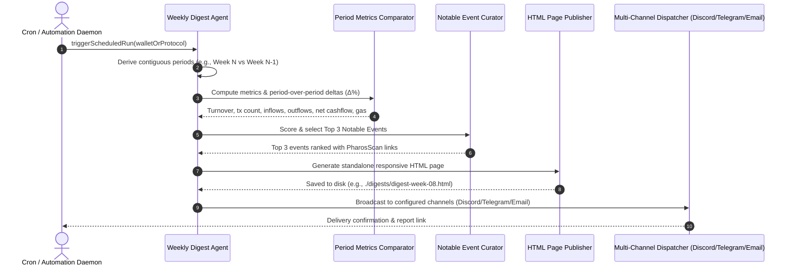

# Weekly Digest Agent

DAO treasuries, DeFi protocol teams, and fund managers need regular visibility into their on-chain operations. Manually querying block explorers every Monday morning to calculate turnover, compare volume trends, and identify anomalous transactions is time-consuming and prone to human error.

The **Weekly Digest Agent** is an autonomous executive reporting agent for Pharos Mainnet. It runs on a scheduled cadence (default: every Monday at 09:00 UTC), compares key metrics across contiguous accounting windows ($T_{\text{current}}$ vs $T_{\text{previous}}$), spotlights the **Top 3 Notable Events** of the week with direct PharosScan links, and delivers polished reports across multiple real channels (**Discord**, **Telegram**, **Email**) and as a standalone published **HTML web page**.

---

## Architecture & Reporting Pipeline



---

## Core Components & Mechanics

### 1. Recurrence Scheduling & Contiguous Windows
The scheduling engine manages periodic execution:
- **Default Cadence**: Configured by default for weekly execution (`WEEKLY`, Mondays at 09:00 UTC, cron `0 9 * * 1`).
- **Configurable Cadence**: Supports `DAILY`, `BIWEEKLY`, or arbitrary cron schedules with customizable execution hours.
- **Contiguous Windowing**: Automatically derives two adjacent, non-overlapping time intervals (e.g., Week 08 vs Week 07), ensuring accurate period-over-period comparisons without temporal gaps or overlaps.

### 2. Period-over-Period Metric Comparisons
The comparator evaluates performance across essential financial dimensions:
- **Turnover Volume**: Total USD capital moved across all operations.
- **Transaction Count & Throughput**: Activity velocity and usage frequency.
- **Inbound vs Outbound Flows**: Net cashflow direction (surplus vs deficit).
- **Gas Expenditure**: Cumulative network fee costs in PROS and USD.
- **Delta Calculations ($\Delta\%$)**: Calculates exact percentage change rates and assigns trend badges (`SURGE`, `CLIMB`, `STABLE`, `DECLINE`), handling zero baselines without division-by-zero errors.

### 3. Top 3 Notable Event Spotlight
Rather than listing every minor transaction, the curator scores and highlights strictly the three most consequential events of the period:
- **Significance Scoring**: Ranks events based on dollar volume, EVM execution status (reverted calls vs successful transfers), governance actions, and liquidity rebalancing.
- **Direct Explorer Links**: Every highlighted event includes its rank (#1, #2, #3), plain-language summary, and a direct link to the transaction on PharosScan (`https://pharosscan.xyz/tx/0x...`).
- **Placeholder Handling**: If a period contains fewer than three transactions, the curator synthesizes clean informational placeholders.

### 4. Multi-Channel Delivery & Published Web Page
The agent supports four distinct delivery targets:
- **Published HTML Page**: Generates a self-contained, responsive dark-mode HTML executive report with CSS tables and trend badges, ready to be hosted or served locally.
- **Discord Webhook**: Delivers rich Discord Embeds with color-coded severity (green for net positive flow, blue for neutral, red for deficit) and character length guards.
- **Telegram Bot**: Formats clean HTML messages compatible with Telegram Bot API.
- **Email Digest**: Generates styled HTML email bodies suitable for corporate email clients.

---

## CLI Usage

The package includes the `pharos-digest` CLI for interactive execution and scheduling:

```bash
# 1. Run full demonstration (Week 08 vs Week 07 comparison + Top 3 events + multi-channel export)
pharos-digest demo

# 2. Inspect or modify recurrence schedule configuration
pharos-digest schedule
pharos-digest schedule --cadence daily --hour 8

# 3. Generate a digest for a specific target wallet or protocol
pharos-digest generate 0x6119871b4eb66db137dcfad59655853ea6fe58ce \
  --publish-html \
  --out ./reports
```

---

## Verification & Test Suite

The weekly digest agent is tested across 14 unit tests in Vitest:

```bash
./node_modules/.bin/vitest run tasks/22-weekly-digest-agent
```

**Test Coverage Highlights**:
- **Requirement 01**: Default weekly schedule initialization (`0 9 * * 1`), schedule reconfiguration to daily/biweekly, next occurrence date math, and contiguous period window derivations.
- **Requirement 02**: Period-over-period metric aggregations, percentage change rates ($\Delta\%$), and zero-baseline handling.
- **Requirement 03**: Selection and ranking of strictly the Top 3 notable events with PharosScan links and empty-state handling.
- **Requirement 04**: Publishing standalone dark-mode HTML pages to disk, formatting rich Discord Embeds, Telegram HTML messages, and email bodies.
- **Protocol Mode**: Adaptability to DeFi protocol operations (e.g. FaroSwap AMM pool volume).
