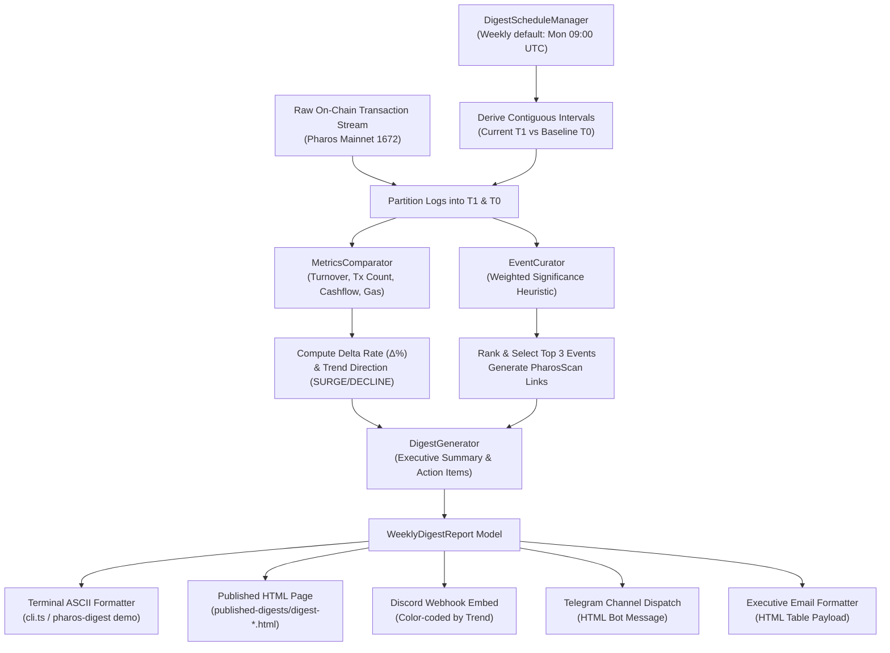

# Pharos Support & Reporting: Weekly Digest Agent Skill

## Overview
The **Pharos Weekly Digest Agent** is an autonomous periodic activity summary and reporting engine engineered for **Pharos Mainnet (Chain ID 1672)**. It continuously monitors on-chain events for designated wallets (corporate treasuries, foundation reserves) or protocols (FaroSwap AMM, Harbor Lending, Morpho Blue), tracks period-over-period financial KPIs, extracts the **Top 3 Notable Events** of the week with direct **PharosScan** explorer links, and delivers polished executive digests on schedule across multiple channels: **Telegram**, **Discord Webhooks**, **Email**, or **Standalone Published HTML Pages**.

### Core Capabilities:
1. **Configurable Recurrence Schedule Engine (Requirement 01)**:
   - Operates on a weekly recurrence schedule by default (every Monday at 09:00 UTC, cron: `0 9 * * 1`).
   - Dynamically reconfigurable to daily, biweekly, or custom cron expressions and execution hours.
   - Calculates next calendar trigger dates and contiguous accounting intervals (Period $T_1$ vs Baseline $T_0$).
2. **Comparative Period Metrics & Trend Gauges (Requirement 02)**:
   - Ingests raw on-chain transaction history for current ($T_1$) and baseline ($T_0$) intervals.
   - Computes key operational KPIs: Total Turnover Volume USD, Transaction Throughput, Inbound Receipts, Outbound Disbursements, Net Cashflow Position, and Network Gas Expended in PROS.
   - Calculates absolute differences and percentage rate of change ($\Delta\%$).
   - Categorizes momentum into discrete trend tiers: `SURGE` ($\ge +25\%$), `CLIMB` ($+5\%$ to $+25\%$), `STABLE` ($-5\%$ to $+5\%$), `DECLINE` ($-5\%$ to $-25\%$), and `PLUMMET` ($< -25\%$).
   - Safely handles zero baseline volume without `NaN` or `Infinity` divisions.
3. **Top 3 Notable Events Spotlight (Requirement 03)**:
   - Heuristically scores each transaction by capital magnitude ($10\text{k USD} \to +10\text{ pts}$) and operational criticality (Security reverts = $+120\text{ pts}$, Governance = $+100\text{ pts}$, Liquidity deposits = $+80\text{ pts}$, AMM swaps = $+70\text{ pts}$).
   - Filters and selects strictly the **Top 3** most significant events, ordered by rank (`#1`, `#2`, `#3`).
   - Links every notable event directly to the official Pharos explorer: `https://pharosscan.xyz/tx/0x...`.
   - Synthesizes informative fallback sentinel highlights when intervals exhibit low volume.
4. **Multi-Channel & Published Page Delivery (Requirement 04)**:
   - **Published HTML Executive Page**: Self-contained, responsive dark-mode HTML page (`published-digests/digest-*.html`) with trend badges, metric cards, and event links.
   - **Discord Webhook Embed**: Formats rich embed with dynamic color coding (Green for surges, Blue for stable, Red for contractions) and field length safeguards ($\le 1024$ chars).
   - **Telegram Channel Dispatch**: Formats clean HTML messages compatible with Telegram Bot API `sendMessage`.
   - **Email Body Formatter**: Generates executive HTML email suitable for compliance teams.

---

## Architecture Flow



---

## CLI Commands

```bash
# Run interactive multi-target demo (Treasury Wallet + FaroSwap Protocol)
pharos-digest demo
npm run digest -- demo

# Inspect or reconfigure recurrence schedule (Requirement 01)
pharos-digest schedule
pharos-digest schedule --cadence DAILY --hour 14

# Generate weekly digest for a custom wallet or protocol
pharos-digest generate 0x71c80000000000000000000000000000000071C8 --label "Pharos Foundation"
pharos-digest generate 0x1000000000000000000000000000000000000001 --kind PROTOCOL --label "FaroSwap AMM"

# Generate and deliver exclusively to published HTML page
pharos-digest generate 0x71c80000000000000000000000000000000071C8 --channel page --out-dir ./reports
```
