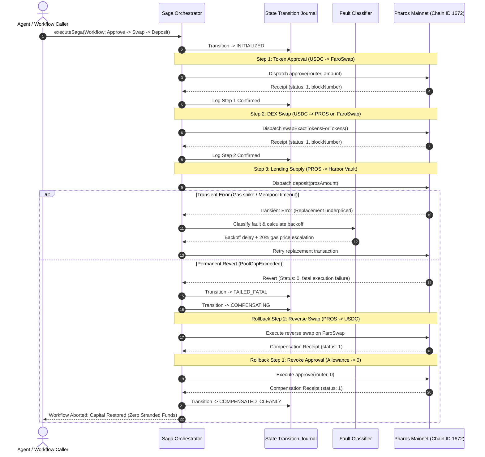

# Saga Executor for Multi-Step On-Chain Workflows

Multi-step DeFi operations—such as approving a router, swapping tokens on a DEX, and supplying the acquired tokens into a lending pool—cannot always be bundled into a single atomic transaction. When interacting across separate protocols, if Step 3 fails (for instance, because a lending pool hits its supply cap or the contract reverts), funds are often left stranded in an intermediate token, with open approvals exposed to potential exploit.

The **Saga Executor** implements the distributed Saga pattern for on-chain operations on Pharos. It coordinates sequential dependent steps, verifies transaction receipts (`status === 1`) before proceeding, applies intelligent retries with gas price escalation for transient network faults, unwinds completed actions via **Compensating Reverse Transactions** in LIFO order when permanent failures occur, and maintains an append-only state journal throughout execution.

---

## Architectural Mechanics



---

## Key Components

### 1. Sequential Dependent Step Verification
The workflow consists of at least three interdependent steps:
- **Step 1 (`APPROVE`)**: Grants allowance for the source asset (USDC) to FaroSwap Router.
- **Step 2 (`SWAP`)**: Swaps USDC for PROS on FaroSwap AMM.
- **Step 3 (`DEPOSIT`)**: Deposits the acquired PROS into the Harbor Lending Pool.

Each step explicitly waits for on-chain receipt confirmation (`receipt.status === 1`) and verifies confirmed block heights before initiating the next step.

### 2. Intelligent Retry Policy for Transient Faults
The `FaultClassifier` categorizes errors before deciding whether to retry or fail:
- **Transient Failures**: Network latency, temporary mempool drops, replacement transaction underpricing, and RPC timeouts. For these, the orchestrator applies exponential backoff ($1.8\times$ factor with random jitter) and automatically escalates the replacement transaction's gas price by **+20%**.
- **Permanent / Fatal Failures**: EVM execution reverts (such as `PoolCapExceeded`, `SlippageExceeded`, or `ArithmeticOverflow`). These are recognized as fatal; retrying would waste gas, so the orchestrator halts forward execution and initiates compensation immediately.

### 3. Compensating Rollback Actions (Zero Stranded Funds)
When a permanent failure occurs, the orchestrator unwinds completed steps in **Last-In, First-Out (LIFO)** order:
- If Step 3 fails after Step 1 and Step 2 succeeded:
  1. **Rollback Step 2**: Executes a compensating reverse swap on FaroSwap (PROS back into USDC), restoring the user's principal asset.
  2. **Rollback Step 1**: Calls `approve(router, 0)` to revoke the allowance granted in Step 1, closing potential allowance attack vectors.
- Result: 100% of the initial capital is restored to the borrower's wallet, with no dangling permissions left open.

### 4. Real-Time State Transition Journal
An append-only state journal records every phase transition with ISO-8601 timestamps, step indices, and error diagnostics:
`INITIALIZED` $\to$ `IN_PROGRESS` $\to$ `STEP_CONFIRMED` $\to$ `FAILED_FATAL` $\to$ `COMPENSATING` $\to$ `COMPENSATED_CLEANLY`.

The journal provides complete auditability, enabling operators to inspect the exact state of any in-flight or compensated workflow.

---

## CLI Usage

The package includes the `pharos-saga` binary for demonstrations and workflow testing:

```bash
# 1. Run comparative demonstration (Run 1: Full Success vs Run 2: Forced Revert + Rollback)
pharos-saga demo

# 2. View active retry and transient fault classification policies
pharos-saga policy

# 3. Simulate a forced failure on a specific step to inspect reverse compensation
pharos-saga test-failure --fail-at-step 3
```

---

## Verification & Test Suite

The saga executor is verified across 12 unit tests in Vitest:

```bash
./node_modules/.bin/vitest run tasks/23-saga-executor
```

**Test Coverage Highlights**:
- **Requirement 01**: Defining $\ge 3$ sequential steps, rejecting sub-3 step sagas, and verifying confirmed receipts before advancing.
- **Requirement 02**: Accurate categorization of transient errors vs fatal reverts, backoff calculation, and +20% gas price escalation.
- **Requirement 03**: Clean reverse compensation in LIFO order (reverse swap + approval revocation) with zero stranded funds.
- **Requirement 04**: Append-only state transition logging and ASCII execution timeline formatting.
- **Requirement 05**: Demonstrating a full end-to-end success run and a forced-failure run with automated rollback.
