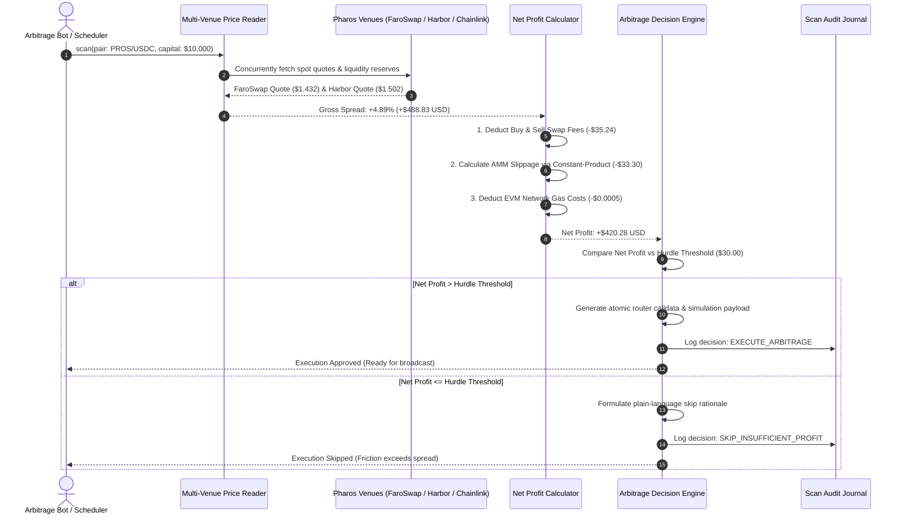

# Arbitrage Scanner

In decentralized finance, temporary price discrepancies frequently emerge between automated market makers (AMMs) and reference oracle feeds. However, naive arbitrage bots that trade on raw price differences consistently lose capital. They fail to account for the full friction waterfall: two-leg protocol swap fees, non-linear constant-product price impact (slippage), and EVM network gas costs.

The **Arbitrage Scanner** concurrently reads spot prices across multiple venues on Pharos (FaroSwap AMM reserves, Harbor Protocol Lending oracles, and Chainlink reference feeds), deducts a complete **itemized friction cost waterfall**, gates execution against a configurable profit hurdle (default: `$30.00 USD`), logs every scan cycle to a tamper-evident audit journal, and prepares atomic simulation-safe routing calldata without risking real funds.

---

## Architecture & Evaluation Pipeline



---

## Core Components & Mechanics

### 1. Concurrent Multi-Venue Price Reading
The scanner samples at least two distinct liquidity sources in the same execution cycle:
- **FaroSwap AMM**: Queries constant-product reserves ($x \cdot y = k$) to obtain exact marginal spot prices and liquidity depth for the `PROS/USDC` pair.
- **Harbor Lending Oracle / Chainlink Feed**: Queries reference valuations (`0x1Ed3e8CdC173363593BfAD9bF77aa2A0e7351DB8`) to measure cross-market dislocations.
- Concurrently queries both venues in parallel via `Promise.all` to minimize temporal latency between quotes.

### 2. Comprehensive Friction Deduction Waterfall
The calculator translates a deceptive gross price spread into true net profit:
- **Gross Spread**: The raw theoretical difference between buy and sell venues:
  $$\text{Gross Profit} = \text{Capital} \times \left(\frac{P_{\text{sell}} - P_{\text{buy}}}{P_{\text{buy}}}\right)$$
- **Protocol Swap Fees**: Deducts pool fees across both legs (e.g., $0.30\%$ on FaroSwap buy leg $+ 0.05\%$ on Harbor sell leg).
- **Dynamic Price Impact (Slippage)**: Models pool depth impact using the constant-product formula, scaling non-linearly with trade size relative to pool liquidity.
- **EVM Network Gas Cost**: Computes execution cost for atomic multi-hop routing ($285\text{k gas} \times \text{gasPrice}$).
- **Net Profit**: $\text{Gross Profit} - \text{Swap Fees} - \text{Slippage} - \text{Gas Cost}$.

### 3. Configurable Hurdle Gate & Skip Rationale
The engine acts only when the net yield exceeds a configurable safety hurdle (default: `$30.00 USD`):
- **Profitable Execution**: If net profit exceeds the hurdle, the engine synthesizes an atomic Foundry `cast send` reproduction command and dry-run simulation payload.
- **Explicit Skip Explanations**: If the opportunity is unprofitable or falls below the threshold, the engine logs a clear explanation:
  > *"Skipped: Net profit of -$1.31 USD is below hurdle threshold of $30.00 USD. Total friction costs ($68.33 USD) exceeded the gross spread ($67.02 USD)."*

### 4. Append-Only Scan Audit Journal
Every scan cycle is appended to the `ScanAuditJournal`:
- Logs timestamp, asset pair, buy venue, sell venue, gross spread percentage, itemized fee deductions, net profit, and final decision.
- Enables historical analysis of market efficiency and post-mortem verification of execution choices.

### 5. Zero-Risk Simulation Safety
By default, the scanner operates in zero-broadcast simulation mode:
- It produces execution calldata and dry-run URLs without committing private keys or capital.
- Safely handles edge cases like zero liquidity depth, inverted prices, and extreme gas fee spikes without throwing unhandled exceptions.

---

## CLI Usage

The package includes the `pharos-arbitrage` binary for interactive scanning:

```bash
# 1. Run demonstration covering profitable arbitrage vs unprofitable spread
pharos-arbitrage demo

# 2. View registered liquidity venues and reference feeds on Pharos Mainnet
pharos-arbitrage venues

# 3. Scan a custom pair and capital allocation
pharos-arbitrage scan --pair PROS/USDC --capital 10000 --hurdle 25
```

---

## Verification & Test Suite

The arbitrage scanner is tested across 13 unit tests in Vitest:

```bash
./node_modules/.bin/vitest run tasks/24-arbitrage-scanner
```

**Test Coverage Highlights**:
- **Requirement 01**: Concurrently reading spot quotes across multiple distinct venues (AMM pool reserves and oracle reference feeds).
- **Requirement 02**: Accurate mathematical deduction of swap fees, non-linear constant-product slippage, and EVM gas costs.
- **Requirement 03**: Hurdle gate enforcement ($\ge \$30.00$ net profit), generating atomic calldata when profitable, and logging plain-language skip rationales when unprofitable.
- **Requirement 04**: Append-only scan audit journal logging gross spreads, itemized costs, net yields, and decisions.
- **Requirement 05**: Zero-risk simulation mode, zero-liquidity resilience, and extreme gas spike handling.
