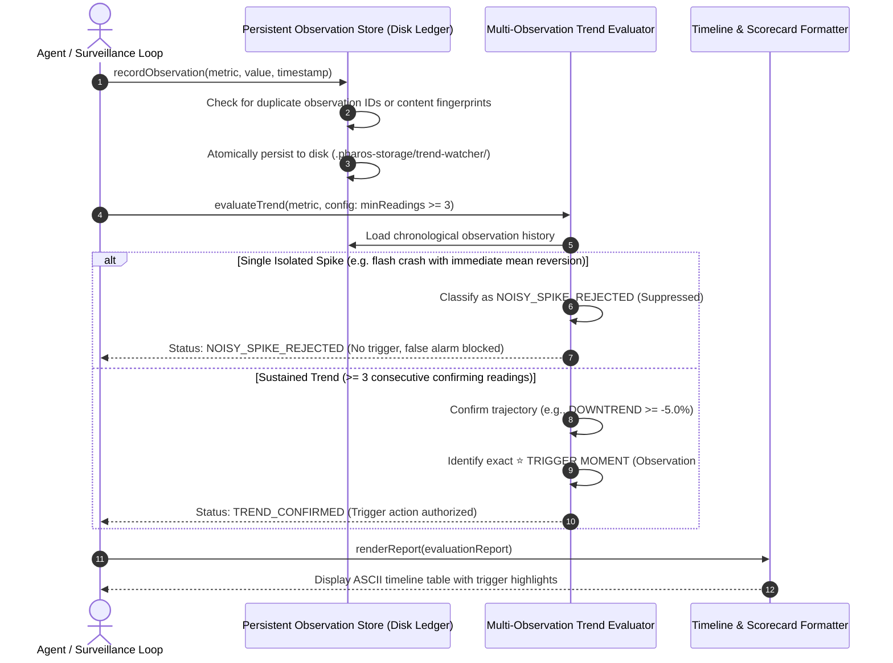

# Trend Watcher

In decentralized finance, automated bots that trigger actions based on an isolated single-block price reading are inherently vulnerable. Flash loans, sandwich attacks, temporary oracle blips, and illiquid pool swings frequently create momentary price spikes that immediately revert within seconds. A bot reacting to a single tick risks executing disastrous trades or triggering false liquidations.

The **Trend Watcher** provides stateful memory and noise filtration for autonomous agents on Pharos. It persists metric observations across runs in an atomic on-disk ledger, enforces a configurable multi-observation confirmation rule (requiring at least 3 consecutive corroborating readings), recovers cleanly across process restarts without losing or duplicating history, identifies the exact moment a genuine trend is confirmed, and suppresses isolated flash spikes.

---

## Architecture & Evaluation Pipeline



---

## Core Components & Invariants

### 1. Crash-Resilient Persistent Storage
Autonomous agents must not rely solely on volatile in-memory arrays:
- **Disk Persistence**: Observations are saved to an atomic, durable JSON ledger on disk (`.pharos-storage/trend-watcher/observations-ledger.json`).
- **Atomic Write Pattern**: Uses a temporary file write followed by atomic replacement (`renameSync`) to ensure zero file corruption even if the process is terminated mid-write.
- **Process Restart Recovery**: Upon initialization, a newly spawned agent instance loads 100% of the historical ledger from disk.
- **Deduplication Engine**: Fingerprints observations by ID and content hash, ignoring duplicate submissions during retries or network replays.

### 2. Configurable Multi-Observation Rule
To filter out random walk noise, the trend condition requires multi-step confirmation:
- **Minimum 3 Observations**: The evaluator strictly enforces `minimumConsecutiveReadings >= 3` on configuration (rejecting any setting $< 3$).
- **Directional Trajectory**: Monitors for consistent `UPTREND`, `DOWNTREND`, or directional flow.
- **Cumulative Thresholds**: Validates that both the consecutive reading count and the cumulative percentage change hurdle (e.g., $\ge 5\%$ cumulative drop) are met simultaneously.

### 3. Flash Spike & Noise Suppression
A key invariant is proving that single-tick price spikes do not trigger execution:
- **Transient Spike Detection**: If an asset drops by $-23\%$ in an isolated tick (due to a flash-loan swap) but snaps back to baseline on the next tick, the evaluator detects the lack of consecutive confirmation.
- **Classification**: Flags the movement as `NOISY_SPIKE_REJECTED`, logging the transient deviation while preventing downstream bot actions or capital dispatch.

### 4. Trigger Moment Identification & History Timeline
The evaluator outputs an auditable chronological report:
- **Full Historical Ledger**: Displays observation index, timestamp, raw value, step-by-step delta ($\Delta\%$), and cumulative change from baseline.
- **Trigger Moment Highlighting**: Pinpoints the exact observation (e.g. Observation #3 at 14:15 UTC) where the trend criteria were satisfied, creating a clear audit trail for operational post-mortems.

---

## CLI Usage

The package includes the `pharos-trend` binary for interactive demonstrations and monitoring:

```bash
# 1. Run full demonstration (Single Spike Rejection vs Confirmed Trend vs Restart Recovery)
pharos-trend demo

# 2. Record an observation manually
pharos-trend record --metric PROS_USD --value 1.46

# 3. View the stored observation history and current trend status
pharos-trend history --metric PROS_USD
```

---

## Verification & Test Suite

The trend watcher is verified across 12 unit tests in Vitest:

```bash
./node_modules/.bin/vitest run tasks/25-trend-watcher
```

**Test Coverage Highlights**:
- **Requirement 01**: Persistent on-disk storage, atomic file writes, and instance rehydration from disk.
- **Requirement 02**: Strictly rejecting `minReadings < 3`, confirming trends on $\ge 3$ consecutive readings, and adapting to custom thresholds.
- **Requirement 03**: Zero data loss across simulated process restarts and deduplication of repeated observations.
- **Requirement 04**: Chronological history tracking and pinpointing the exact observation index and timestamp of the trigger moment.
- **Requirement 05**: Rejecting isolated single-tick spikes and snapback recoveries as transient noise.
