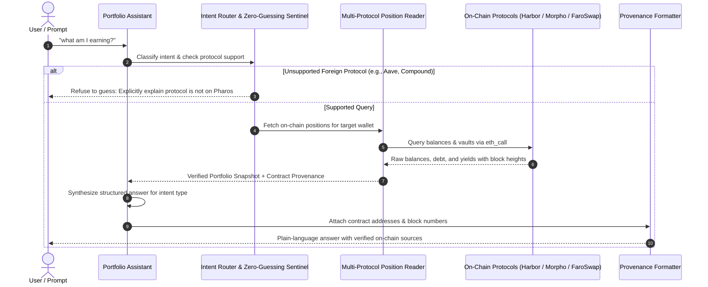

# Portfolio Assistant

DeFi participants on Pharos often have capital scattered across multiple protocols: staking pools, DEX liquidity pairs, lending markets, and yield vaults. Keeping track of aggregate net worth, ongoing borrow obligations, and blended yields usually requires visiting multiple disjointed dApp dashboards.

Conversely, asking generic LLMs about wallet balances is notoriously dangerous: AI models frequently hallucinate balances, confuse testnets with mainnet, or invent phantom yields.

The **Portfolio Assistant** is a read-only conversational assistant and balance inspection engine for Pharos Mainnet. It reads positions across multiple protocols (Harbor RWA Hub, Morpho Blue, FaroSwap) and liquid wallet balances, answers **5 distinct natural-language question types**, provides **provenance citations** (contract address and block number) for every figure, strictly refuses to guess when asked about unsupported protocols, and operates entirely in read-only mode (`eth_call`).

---

## Architecture & Query Pipeline



---

## Core Capabilities & Mechanics

### 1. Multi-Protocol Position Reading
The reader aggregates positions across three major DeFi venues on Pharos, alongside liquid wallet holdings:
- **Liquid Wallet Tokens**: Native `PROS`, `USDC`, and `USDT` held directly in the wallet.
- **Harbor RWA Hub**: Real-World Asset yield vaults (e.g. APC3M 3-month receivables vault and VRPC vehicle receivables vault).
- **Morpho Blue Lending**: Collateralized supply and active borrowing balances with Health Factor tracking.
- **FaroSwap AMM**: Liquidity provider (LP) share valuations and fee accruals.

### 2. 5 Distinct Natural-Language Query Types
The natural language engine recognizes five key query patterns:
1. **Yield & Earnings** (*"what am I earning?", "what's my yield?"*):
   - Computes weighted portfolio APY, total active earning capital, and projected annual yield in USD.
2. **Asset Location** (*"where is my USDC?", "which pools hold my PROS?"*):
   - Itemizes every venue holding the specified token (wallet, vaults, and liquidity pools) with exact token counts and percentages.
3. **Biggest Position** (*"what's my biggest position?", "top asset"*):
   - Analyzes portfolio concentration, identifying the largest position by USD value and calculating its share of total net worth.
4. **Net Worth Overview** (*"what is my total net worth?", "portfolio overview"*):
   - Compiles a full balance sheet: liquid tokens, deposited DeFi collateral, total borrowed debt, and net equity.
5. **Debt & Liabilities** (*"do I have any loans?", "what is my borrow position?"*):
   - Lists all outstanding loans, current borrow APY, loan-to-value (LTV), and liquidation Health Factor.

### 3. Cryptographic Provenance (Every Figure Has a Source)
To guarantee transparency, every balance, APY, and valuation reported by the assistant is accompanied by a provenance citation:
- **Contract Address**: Exact physical contract address on Pharos Mainnet.
- **Block Height**: The confirmed block number at which the state was sampled (e.g., `#1842910`).
- **Explorer Permalinks**: Links to PharosScan (`https://pharosscan.xyz/address/0x...`) allowing users to independently verify any reported number.

### 4. Zero-Guessing Sentinel
When users ask about protocols that are unsupported or not deployed on Pharos (e.g. *"how much am I earning on Aave or Compound?"*):
- The assistant **strictly refuses to guess or fabricate numbers**.
- It halts forward processing and provides a clear disclaimer explaining that the requested protocol is unsupported, listing the verified venues available on Pharos (Harbor, Morpho Blue, and FaroSwap).

### 5. Strict Read-Only Safety Invariant
The assistant is strictly an information retrieval tool:
- Contains zero private keys and zero signing abstractions.
- All on-chain queries execute exclusively through read-only `eth_call` RPC methods.
- It is architecturally impossible for the assistant to initiate, sign, or broadcast transactions.

---

## CLI Usage

The package includes the `pharos-portfolio` CLI for interactive queries and balance inspections:

```bash
# 1. Run demonstration covering all 5 query types + zero-guessing sentinel
pharos-portfolio demo

# 2. Ask a natural-language question about a wallet
pharos-portfolio ask "what am I earning?" --wallet 0x6119871b4eb66db137dcfad59655853ea6fe58ce
pharos-portfolio ask "where is my USDC?" --wallet 0x6119871b4eb66db137dcfad59655853ea6fe58ce

# 3. View supported protocols and vaults on Pharos Mainnet
pharos-portfolio protocols
```

---

## Verification & Test Suite

The portfolio assistant is verified across 14 unit tests in Vitest:

```bash
./node_modules/.bin/vitest run tasks/26-portfolio-assistant
```

**Test Coverage Highlights**:
- **Requirement 01**: Ingesting positions across multiple protocols (Harbor, Morpho, FaroSwap) and liquid wallet balances.
- **Requirement 02**: Accurately classifying and answering all 5 query types (Yield, Asset Location, Biggest Position, Net Worth, Debt).
- **Requirement 03**: Attaching physical contract addresses and confirmed block heights to every numerical output.
- **Requirement 04**: Rejecting unsupported foreign protocols with clear disclaimers instead of guessing.
- **Requirement 05**: Enforcing read-only operation with zero transaction signing code paths.
