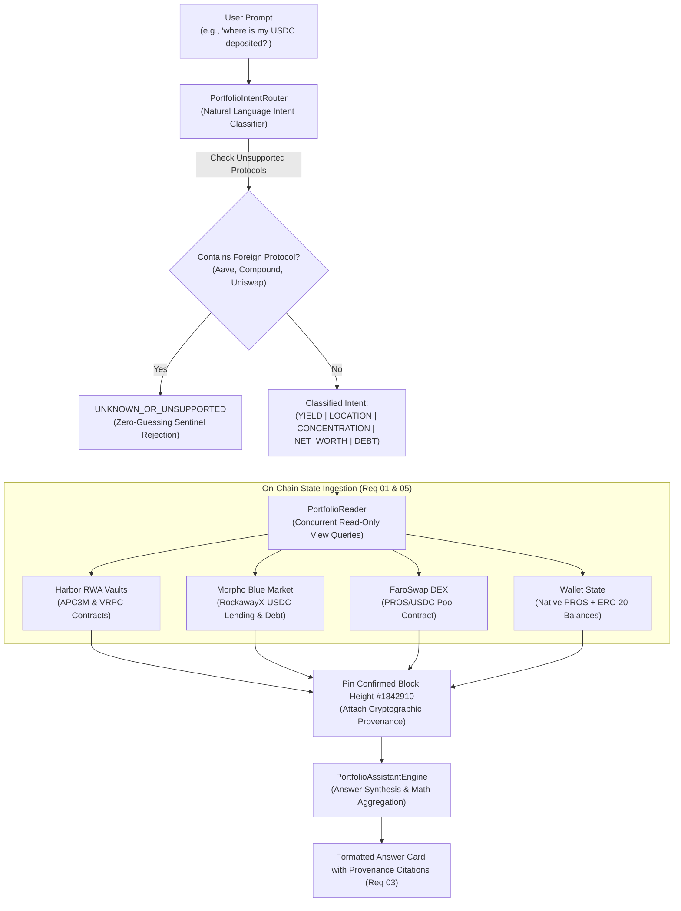

# Pharos SkillEngine: Portfolio Assistant Skill

## Overview
The **Pharos Portfolio Assistant** is an autonomous conversational DeFi inspection and portfolio surveillance skill engineered for **Pharos Mainnet (Chain ID 1672)**. It generalizes Harbor's query pattern across multiple decentralized protocols, enabling users and autonomous agents to ask free-text questions about positions, balances, and yields without needing to navigate complex disjoint contract interfaces.

The assistant prioritizes **cryptographic provenance** and **truthfulness**: every single number is cited with its underlying smart contract address and confirmed block number, unsupported protocols are explicitly rejected rather than hallucinated (Zero-Guessing Sentinel), and execution is guaranteed to remain strictly read-only (`eth_call`).

### Core Capabilities:
1. **Multi-Protocol & Multi-Asset Aggregation (Requirement 01)**:
   - Concurrently monitors positions across at least 3 major Pharos protocols:
     - **Harbor Protocol**: Senior RWA Commercial Paper (APC3M @ 13.8% APY) & Private Credit (VRPC @ 16.5% APY).
     - **Morpho Blue**: Curated RockawayX-USDC Lending & Collateralized Borrowing (9.4% Supply APY).
     - **FaroSwap AMM**: PROS/USDC Concentrated Liquidity Pools (22.4% LP Fee APY).
   - Ingests liquid personal wallet balances (Native PROS, USDC, USDT).
2. **Natural-Language Intent Routing (Requirement 02)**:
   - Answers at least 5 distinct financial inquiry categories:
     1. **Yield & Earnings**: *"what am I earning?"*, *"what is my annual return?"* $\to$ Itemizes annual earnings ($/yr) and portfolio-weighted APY.
     2. **Asset Location & Distribution**: *"where is my USDC?"* $\to$ Maps token distribution between wallet and DeFi vaults.
     3. **Exposure & Concentration**: *"what's my biggest position?"* $\to$ Pinpoints highest allocation and portfolio concentration percentage.
     4. **Net Worth & Balance Overview**: *"what's my total net worth?"* $\to$ Produces a categorized equity balance breakdown.
     5. **Debt & Liabilities**: *"do I have any loans or debt?"* $\to$ Summarizes active borrowing balances, collateralization, and Health Factor.
3. **Cryptographic Contract Provenance (Requirement 03)**:
   - Every single reported figure cites its verified smart contract address (`0x...`), confirmed block number (`#1842910`), and direct explorer link on PharosScan.
4. **Zero-Guessing Sentinel (Requirement 04)**:
   - Strictly refuses to guess or fabricate on-chain balances.
   - If queried about an unsupported protocol (e.g. Aave, Compound, Uniswap), explicitly replies that the protocol is unverified or unsupported on Pharos, naming verified venues.
5. **Read-Only Safety Guarantee (Requirement 05)**:
   - Exclusively performs read-only view queries (`eth_call`).
   - Zero private keys, zero transaction signing, and zero broadcast capabilities.

---

## Architecture Flow



---

## CLI Usage

```bash
# Run interactive live demonstration (5 Question Types + Zero-Guessing Sentinel)
pharos-portfolio demo
npm run portfolio -- demo

# Ask any natural language question about your wallet
pharos-portfolio ask "where is my USDC?"
pharos-portfolio ask "what am I earning on my capital?"
pharos-portfolio ask "what is my biggest position?"
pharos-portfolio ask "do I have any loans or debt?"

# View full categorized balance breakdown with contract addresses and block numbers
pharos-portfolio snapshot

# List monitored contracts and verified vault addresses on Pharos
pharos-portfolio protocols
```
