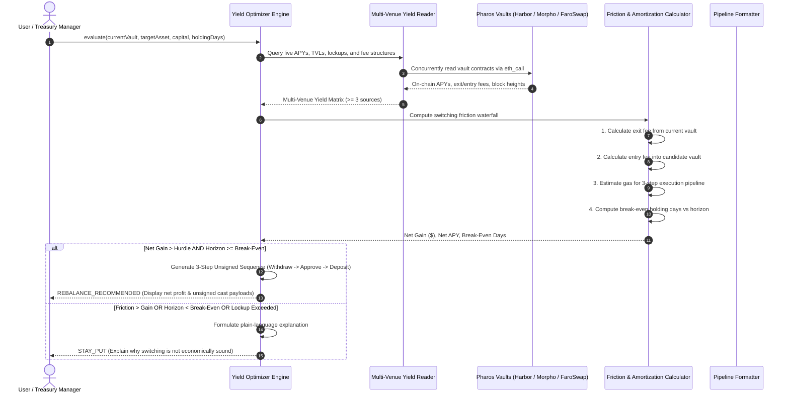

# Yield Optimizer

Yield chasing across DeFi vaults is notoriously deceiving. When an investor sees a vault offering 16.5% APY compared to their current 9.4% allocation, migrating capital seems obvious. However, switching vaults incurs multiple layers of friction: exit fees from the current vault, entry fees on the destination vault, and EVM gas costs across multiple transactions (withdraw, approve, deposit). 

If capital is only held for a short duration, or if the fee waterfall exceeds the yield differential, rebalancing directly destroys capital.

The **Yield Optimizer** provides automated yield surveillance and capital rebalancing analysis on Pharos Mainnet. It compares live yields across at least 3 distinct venues (Harbor RWA vaults, Morpho Blue, and FaroSwap), models an **itemized switching friction waterfall**, amortizes costs across user holding periods, outputs an explicit recommendation (`REBALANCE_RECOMMENDED` or `STAY_PUT` with a plain-language explanation), and synthesizes a non-custodial 3-step unsigned transaction sequence for user signature.

---

## Architecture & Rebalancing Pipeline



---

## Core Components & Mechanics

### 1. Multi-Venue Yield Ingestion
The optimizer actively samples live on-chain data across at least three distinct yield venues on Pharos:
- **Harbor APC3M Vault** (`0x1111...`): 3-month account receivables RWA vault (13.8% APY, 0.10% entry fee, 0.05% exit fee, 90-day tenor).
- **Morpho Blue RockawayX Market** (`0x2222...`): USDC lending pool (9.4% APY, 0.00% entry fee, 0.00% exit fee, no lockup).
- **Harbor VRPC Vault** (`0x3333...`): Vehicle receivables pool (16.5% APY, 0.15% entry fee, 0.10% exit fee, 60-day tenor).
- **FaroSwap AMM LP Pool** (`0x4444...`): `PROS/USDC` liquidity provision (22.4% blended fee yield, no entry/exit fees, high price volatility).

Every quote records its exact smart contract address and confirmed block number.

### 2. Itemized Switching Friction Waterfall
Rather than comparing raw APYs, the optimizer computes exact switching friction:
- **Exit Fee**: Percentage fee deducted by the source vault upon withdrawal.
- **Entry Fee**: Percentage fee charged by the target vault upon deposit.
- **EVM Network Gas Cost**: Estimates gas for the complete 3-step execution sequence:
  $$\text{Gas Units} \approx 320,000\text{ gas} \times \text{gasPrice}$$
- **Total Switching Friction**: $\text{Exit Fee} + \text{Entry Fee} + \text{Gas Cost}$.

### 3. Holding Period Amortization & Break-Even Math
Switching friction is a one-time fixed cost, while yield accumulates daily:
- **Daily Yield Differential**:
  $$\Delta \text{Daily Yield} = \text{Capital} \times \left(\frac{\text{APY}_{\text{target}} - \text{APY}_{\text{source}}}{365}\right)$$
- **Break-Even Period**:
  $$\text{Break-Even Days} = \frac{\text{Total Switching Friction}}{\Delta \text{Daily Yield}}$$
- If the investor's intended holding horizon is shorter than the break-even days, rebalancing results in a net financial loss, even if the destination APY is higher.
- **Lockup Tenor Enforcement**: The engine also checks whether the destination vault enforces a mandatory lockup period (e.g. 90 days), rejecting transfers if the user's holding horizon is shorter than the lockup.

### 4. Decisive Recommendations (`REBALANCE` vs `STAY_PUT`)
- **`REBALANCE_RECOMMENDED`**: Emitted when the destination APY is higher, the user's holding horizon exceeds the break-even period, and net dollar gain clears the safety hurdle (default: `$25.00 USD`).
- **`STAY_PUT`**: Emitted with an explicit explanation when switching is disadvantageous:
  > *"Stay Put: Switching from Morpho Blue to Harbor APC3M yields a net loss of -$1.28 USD over your 3-day holding horizon. Total friction ($2.00 USD) exceeds the gross yield differential ($0.72 USD). Minimum break-even horizon is 17 days."*

### 5. Non-Custodial Unsigned Execution Pipeline
When a rebalance is recommended, the engine prepares a sequential 3-step transaction sequence:
1. **Step 1**: Withdraw principal from current vault.
2. **Step 2**: Approve transfer of tokens to the new vault.
3. **Step 3**: Deposit tokens into the target vault.

Each step includes ABI-encoded calldata and copy-paste Foundry `cast send` commands. The agent **never holds private keys** or executes transactions autonomously.

---

## CLI Usage

The package includes the `pharos-yield` binary for interactive optimization:

```bash
# 1. Run demonstration covering both REBALANCE_RECOMMENDED and STAY_PUT scenarios
pharos-yield demo

# 2. Compare live yields across all registered venues on Pharos Mainnet
pharos-yield compare

# 3. Analyze a custom rebalance scenario
pharos-yield analyze \
  --from 0x2222222222222222222222222222222222222222 \
  --capital 10000 \
  --days 90
```

---

## Verification & Test Suite

The yield optimizer is tested across 13 unit tests in Vitest:

```bash
./node_modules/.bin/vitest run tasks/27-yield-optimizer
```

**Test Coverage Highlights**:
- **Requirement 01**: Comparing at least 3 distinct on-chain yield venues with confirmed contract addresses and block numbers.
- **Requirement 02**: Calculating itemized friction (exit fee, entry fee, gas), holding period amortization, and vault lockup tenor enforcement.
- **Requirement 03**: Outputting `REBALANCE_RECOMMENDED` with dollar net gain and break-even days, and `STAY_PUT` with explicit rationales when friction exceeds returns.
- **Requirement 04**: Non-custodial 3-step unsigned transaction synthesis with zero private key custody.
