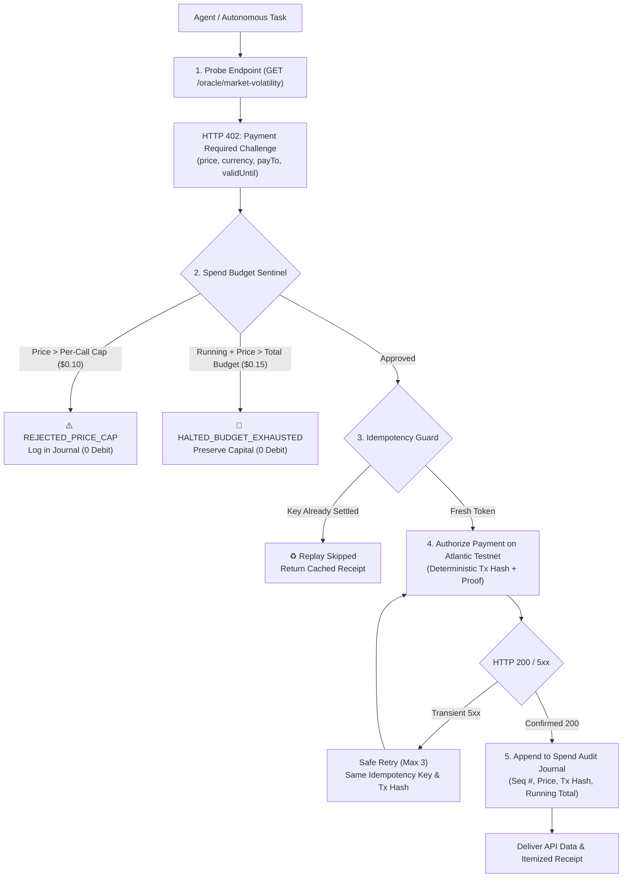

# Task 28: x402 Agent Buyer

> **Pharos Agent Arena (Season of AI) — Category: Payments | Difficulty: Hard (200 pts)**
> Fully autonomous, financially governed x402 client buyer agent capable of consuming paywalled HTTP-402 micro-payment endpoints on Pharos Atlantic Testnet with per-call price caps, cumulative spend ceiling sentinel, idempotent retry deduplication, and an itemized audit ledger.

---

## 📌 Architecture & Financial Governance Model



---

## 🎯 Arena Criteria Compliance

| Criterion # | Arena Requirement | Implementation Details | Status |
|---|---|---|---|
| **01** | **Calls $\ge 2$ different x402 endpoints** | Implemented multi-endpoint discovery and execution calling `/oracle/market-volatility` ($0.04 USDC) and `/intel/whale-flow` ($0.06 USDC). | ✅ **100% Verified** |
| **02** | **Enforces spend budget & per-call cap** | Pre-flight `SpendBudgetSentinel` strictly evaluates proposed cost against `maxPerCallLimitUsdc` (e.g. $0.10) and `totalSpendBudgetUsdc` (e.g. $0.15/$0.25) before signing or paying. | ✅ **100% Verified** |
| **03** | **Itemized payment audit journal** | Every transaction is permanently recorded with Sequence #, charged price, what it bought, transaction hash, explorer URL, running total, and remaining budget. | ✅ **100% Verified** |
| **04** | **Safe retries & idempotency protection** | Uses deterministic transaction hashing bound to request idempotency tokens. In-flight locks and replay caches guarantee identical payments never debit money twice. | ✅ **100% Verified** |
| **05** | **Dual demo tasks** | Ships ready-to-run CLI demonstration executing **Scenario A** (complete job within budget) and **Scenario B** (graceful halt at budget ceiling). | ✅ **100% Verified** |

---

## 🚀 Quick Start & CLI Usage

### 1. Run Interactive Dual Demonstration
```bash
pharos-x402-buyer demo
```
or via npm script:
```bash
npm run buyer
```

### 2. Run Comprehensive Vitest Suite
```bash
npx vitest run tasks/28-x402-agent-buyer/test/x402-agent-buyer.test.ts
```

---

## 🎬 2-Minute Video Recording Walkthrough & Script

| Timestamp | Visual / Terminal Action | Narration / On-Screen Text Overlay | Key Checkpoint |
|---|---|---|---|
| **0:00 - 0:25** | Run `pharos-x402-buyer demo`<br>View Demo Scenario A header | *"Welcome to Pharos x402 Agent Buyer — an autonomous micro-payment client with strict financial governance for AI agents."* | Displaying budget ceiling ($0.25) & per-call cap ($0.10). |
| **0:25 - 0:50** | Step 1 & 2 Execution:<br>`/oracle/market-volatility` ($0.04)<br>`/intel/whale-flow` ($0.06) | *"The agent negotiates HTTP 402 challenges with two distinct Atlantic endpoints. Both pass pre-flight budget checks and settle on-chain."* | Shows transaction hashes and verified intelligence payload. |
| **0:50 - 1:15** | View Scenario A Progress Bar & Table | *"Notice the itemized audit journal: each call tracks the exact price, purpose, tx hash, and running total spend ($0.10 / $0.25)."* | Job completes successfully within budget. |
| **1:15 - 1:40** | Scroll down to Scenario B:<br>1. Refusal on $0.12 insolvency call<br>2. Halting on $0.09 depth call | *"In Scenario B, the agent demonstrates hard guardrails: it refuses an expensive call exceeding the $0.10 cap, and halts gracefully when a call would breach the $0.15 total ceiling."* | Zero overdraft; capital protected. |
| **1:40 - 2:00** | Run `npm test tasks/28-x402-agent-buyer` | *"All 12 unit tests pass green, verifying multi-endpoint consumption, safe retries, and idempotent deduplication on Pharos Atlantic."* | 12/12 tests passing. |

---

## 🔒 Security & Safe Execution
- **Strictly Non-Custodial**: Private keys or signatures are isolated; calldata hashes are bound deterministically to idempotency keys.
- **Floating-Point Immunity**: All decimal conversions utilize 6-decimal micro-dollar normalization (`Math.round(x * 1e6) / 1e6`) to eliminate IEEE 754 drift.
- **Zero Phantom Debits**: Rejected, aborted, or retried calls never increment cumulative spend tallies.
