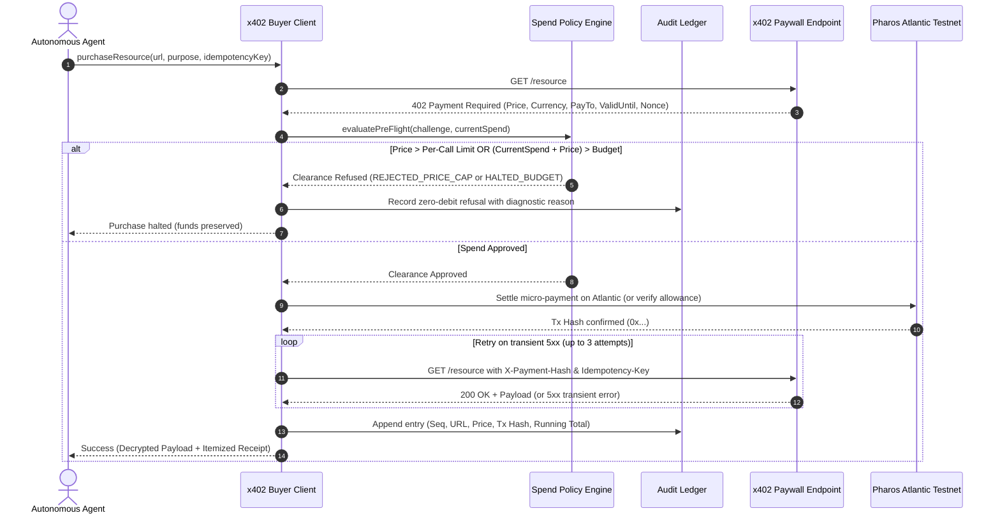

# x402 Agent Buyer

Autonomous agents operating on-chain frequently need to purchase live intelligence, compute, or proprietary datasets from external APIs. When using the HTTP 402 (Payment Required) standard, the agent must be able to negotiate micro-payments autonomously. However, giving an autonomous process an unconstrained private key or unlimited spending allowance is a recipe for catastrophic wallet drain: runaway loops, dynamic price surges on malicious endpoints, or network packet drops leading to duplicate payments.

The **x402 Agent Buyer** provides a financially governed HTTP 402 client engine for autonomous agents on Pharos Atlantic Testnet (`eip155:688689`). It wraps raw HTTP micro-payment handshakes with hard pre-flight spend guardrails (per-call price caps, cumulative spend ceilings, token address checks), idempotent retry protection against double-charging, and an append-only itemized audit journal.

---

## Architecture & Payment Flow



---

## Core Components & Mechanics

### 1. Multi-Endpoint Negotiation
The client discovers, probes, and settles micropayments across distinct HTTP 402 endpoints:
- **/oracle/market-volatility**: Implied volatility and historical variance feeds ($0.04 USDC).
- **/intel/whale-flow**: Large wallet cluster net flows and directionality metrics ($0.06 USDC).
- **/risk/insolvency-depth**: Deep collateral liquidation profiles across lending books ($0.12 USDC).

Each endpoint returns a standard 402 challenge specifying token contract (`0x3c499c54...`), recipient merchant address, required price in micro-units, and epoch challenge expiration.

### 2. Pre-Flight Spend Governance
Before signing or submitting any transaction to the Pharos Atlantic RPC, the client passes the challenge parameters through the spend policy:
- **Per-Call Price Cap (`maxPerCallLimitUsdc`)**: Immediately rejects calls exceeding the limit (e.g., rejecting a $0.12 call if the cap is $0.10) with zero debit to wallet balance.
- **Total Spend Ceiling (`totalSpendBudgetUsdc`)**: Tracks lifetime or session cumulative debits. If `runningTotalSpend + challengePrice > budgetCeiling`, execution halts gracefully without overdraft.
- **Token Address & Recipient Validation**: Guarantees payments are made exclusively in approved USDC on Atlantic Testnet (`0x3c499c54...`) and forbids transfers to burn/zero addresses (`0x000...000`).
- **Challenge Timelock Verification**: Rejects expired challenges before sending funds.
- **Micro-Unit Precision**: Eliminates JavaScript floating-point inaccuracies using 6-decimal micro-unit rounding (`Math.round(x * 1e6) / 1e6`).

### 3. Idempotency & Safe Retries
Autonomous agents calling remote endpoints over noisy public networks frequently experience transient packet loss or server 5xx hiccups after payment settlement. The buyer engine handles this through:
- **Deterministic Transaction Binding**: Each request requires an `idempotencyKey` bound to the payment calldata and memo.
- **Replay Deduplication**: Re-running the client with the same key returns the existing cached settlement receipt immediately, preventing duplicate on-chain charges.
- **In-Flight Lock Protection**: Concurrent promises with the identical key are intercepted to prevent race conditions during transaction submission.
- **Transient Safe Retries**: If the merchant returns HTTP 500/502/503 after payment confirmation, the client retries using the exact same payment signature rather than minting a second debit.

### 4. Itemized Payment Audit Journal
Every single transaction attempt is recorded in an immutable journal with full accounting details:
- Monotonic sequence number
- Target endpoint URL and intended business purpose
- Debited price and currency (or $0.00 if refused)
- On-chain transaction hash and PharosScan explorer link
- Running cumulative spend tally
- Remaining authorized budget
- Disposition status (`SETTLED`, `REJECTED_PRICE_CAP`, `HALTED_BUDGET_EXHAUSTED`, `DEDUPLICATED_REPLAY_SKIPPED`)

---

## Command Line Interface & Demo

The package includes a dual-scenario demonstration executable showing both normal governed execution and protective ceiling enforcement.

### Run Dual Demonstration
```bash
node tasks/28-x402-agent-buyer/bin/pharos-x402-buyer.js demo
```

The CLI executes:
1. **Scenario A (Within-Budget Completion)**: Budget $0.25, Cap $0.10. Successfully calls `/oracle/market-volatility` ($0.04) and `/intel/whale-flow` ($0.06), verifies receipts, and displays the itemized spend ledger with $0.10 spent and $0.15 remaining.
2. **Scenario B (Ceiling & Guardrail Enforcement)**: Budget $0.15, Cap $0.10. Rejects an expensive $0.12 call, falls back to affordable feeds ($0.06 + $0.04 = $0.10), and gracefully halts when a subsequent $0.09 query would breach the $0.15 ceiling.

---

## Test Suite Execution

Run the complete 12-test Vitest suite covering multi-endpoint settlement, price caps, budget exhaustion, safe retries, and edge-case guards:

```bash
npx vitest run tasks/28-x402-agent-buyer/test/x402-agent-buyer.test.ts
```
