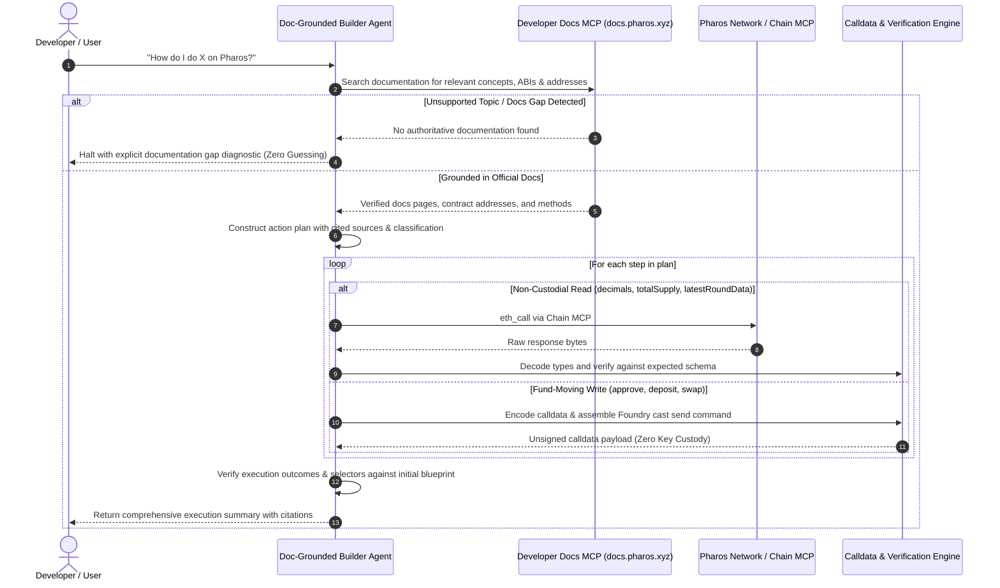

# Doc-Grounded Builder Agent

Autonomous agents asked *"how do I do X on Pharos?"* frequently suffer from one of two failure modes:
1. **Hallucination & Fabrication**: Inventing fake contract addresses, obsolete function signatures, or unsupported bridge architectures (e.g., pretending a Solana Wormhole bridge exists on Pharos).
2. **Custodial Danger**: Attempting to execute fund movements autonomously with custodial private keys, exposing user capital to unauthorized drain.

The **Doc-Grounded Builder Agent** solves this by establishing a verifiable 4-stage pipeline that bridges official documentation to on-chain execution:
- **Retrieves & Cites**: Searches Pharos Developer Documentation via Developer Docs MCP and extracts exact URLs, sections, and excerpts before taking any action.
- **Differentiates Read vs Write**: Executes read queries directly via Chain MCP (`eth_call`), while strictly preparing unsigned calldata and Foundry `cast` commands for any fund-moving transactions (zero key custody).
- **Verifies On-Chain**: Validates return values, 4-byte function selectors, and block state against the documented plan.
- **Refuses Ungrounded Inquiries**: Detects documentation gaps and explicitly halts rather than guessing when a user asks about unsupported protocols.

---

## Architecture & Verification Pipeline



---

## Core Mechanics

### 1. Documentation Retrieval & Provenance Citations
Before any plan is formed, the agent queries the Developer Docs repository for the target functionality:
- **Pharos Native Token (PROS)**: References `https://docs.pharos.xyz/tokens/native-pros`, extracting precision (18 decimals) and core contract references.
- **Harbor RWA Vaults**: References `https://docs.pharos.xyz/ecosystem/harbor-protocol`, extracting the two-step ERC-4626 deposit workflow (ERC-20 approval followed by vault deposit).
- **Oracle Data Feeds**: References `https://docs.pharos.xyz/oracles/price-feeds`, extracting `AggregatorV3Interface` specifications and round query methods (`description()`, `latestRoundData()`).

Every generated action plan cites the page title, URL, section, and quoted excerpt as justification for each step.

### 2. Non-Custodial Safety & Calldata Preparation
The agent strictly segregates read actions from fund-moving transactions:
- **State Reads**: Executed directly against the Pharos RPC (`eth_call`). Results are parsed into human-readable units (e.g. 18-decimal scaling for PROS, USD decimal formatting for oracle prices).
- **Fund Movements**: The agent never stores or handles private keys. Instead, it computes the exact 4-byte method selector and ABI calldata, assembling a ready-to-sign Foundry command:
  ```bash
  cast send <VAULT_ADDRESS> "deposit(uint256,address)" <AMOUNT> <RECEIVER> \
    --rpc-url https://atlantic.dplabs-internal.com \
    --private-key $YOUR_WALLET_PRIVATE_KEY
  ```
  The user retains 100% custody and inspects the payload before signing.

### 3. On-Chain Outcome & Selector Verification
After synthesizing the execution sequence, the agent executes chain verification:
- **Selector Integrity**: Confirms that approval payloads match standard ERC-20 `0x095ea7b3` (`approve(address,uint256)`) and deposit payloads match ERC-4626 `0x6e553f65` (`deposit(uint256,address)`).
- **State Proofs**: Associates every query result with the block height at which the call was evaluated (e.g., Block `#24891042`).

### 4. Anti-Hallucination & Gap Interception
When users query unsupported external chains or non-existent bridges (such as Solana Wormhole or Bitcoin Ordinals staking on Pharos):
- The agent cross-checks query tokens against supported ecosystem domains.
- If no official documentation covers the request, the agent halts immediately and returns an unambiguous refusal message explaining that the topic is not covered in official Pharos developer documentation.
- The agent refuses to invent phantom contracts or substitute unofficial assumptions.

---

## Command Line Interface & Demo

### Run Full Multi-Scenario Demonstration
```bash
node tasks/29-doc-grounded-builder-agent/bin/pharos-builder.js demo
```

The interactive demonstration runs 4 distinct scenarios:
1. **Scenario 1 (Token Metrics)**: Non-custodial read queries for native PROS token decimals and circulating supply with official docs citations.
2. **Scenario 2 (Harbor Vault Deposit)**: Formulates a 2-step deposit plan, prepares unsigned calldata for `approve` and `deposit`, and outputs Foundry `cast` commands without key custody.
3. **Scenario 3 (Oracle Telemetry)**: Verifies feed description and consensus round pricing via live AggregatorV3 calls.
4. **Scenario 4 (Anti-Hallucination Guard)**: Intercepts an unsupported Solana Wormhole inquiry and halts with a documentation gap explanation.

### Ask Custom Inquiries
```bash
node tasks/29-doc-grounded-builder-agent/bin/pharos-builder.js ask "How do I check circulating supply of native PROS?"
node tasks/29-doc-grounded-builder-agent/bin/pharos-builder.js ask "How do I deposit 50 USDC into the Harbor vault?"
node tasks/29-doc-grounded-builder-agent/bin/pharos-builder.js ask "How do I deploy an EVM subnet bridge to Solana?"
```

---

## Test Suite Execution

Run the complete 12-test Vitest suite covering citation planning, read/write segregation, calldata encoding, on-chain outcome verification, and documentation gap handling:

```bash
npx vitest run tasks/29-doc-grounded-builder-agent/test/doc-grounded-builder.test.ts
```
