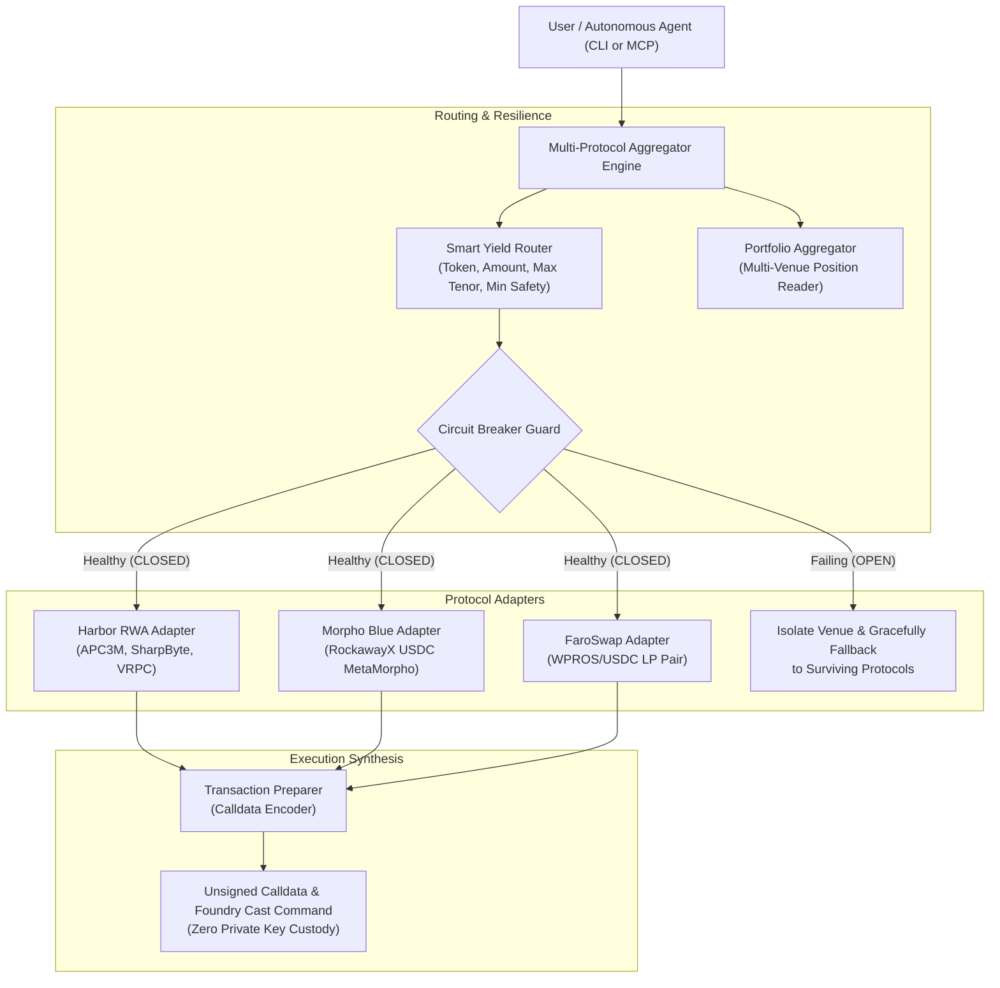
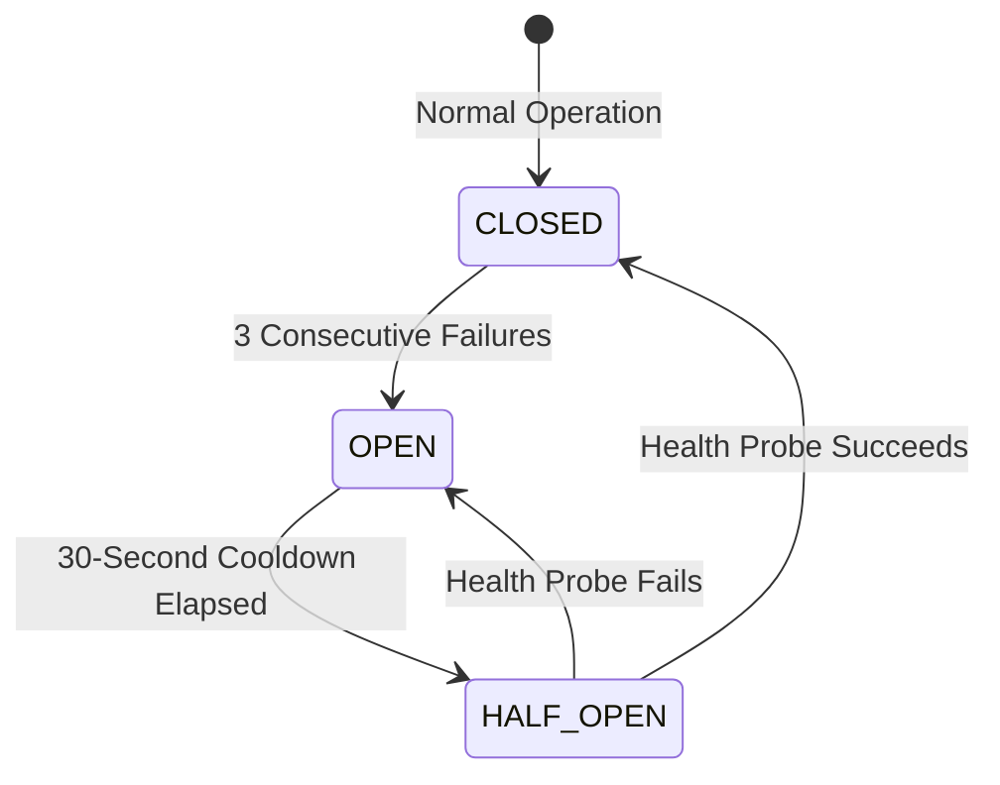

# Multi-Protocol Yield & Liquidity Aggregator

DeFi capital deployment on Pharos Network (Chain ID: 1672) is fragmented across distinct protocol archetypes: institutional RWA credit vaults (Harbor Hub), overcollateralized lending markets (Morpho Blue curated by RockawayX), and constant-product AMM liquidity pools (FaroSwap). Each protocol operates with distinct interface standards, varying lockup durations, different risk profiles, and separate on-chain contracts.

Furthermore, naive aggregators that poll multiple protocols in a single synchronous loop are fragile: if one protocol API or RPC node experiences latency or downtime, the entire aggregator crashes.

The **Multi-Protocol Aggregator** provides a unified, resilient interface for discovery, smart routing, portfolio aggregation, and non-custodial transaction preparation across Pharos DeFi venues. It incorporates:
- **Resilient Circuit Breaker**: Isolates degraded venues automatically, preventing cascade failures and allowing surviving protocols to continue serving requests.
- **Multi-Criteria Yield Router**: Evaluates candidate venues across net APY, lockup tenor, liquidity depth, and safety scores, generating human-readable reasoning and explicit tradeoff analysis.
- **Non-Custodial Calldata Preparation**: Prepares standard ERC-4626 and Uniswap V2 transaction payloads with copy-pasteable Foundry `cast` commands (zero key custody).
- **Cross-Protocol Portfolio Tracker**: Computes aggregate deposited capital, accrued yields, and capital-weighted APY across all active positions.
- **Model Context Protocol (MCP) Server**: Exposes stdio tools for autonomous AI agent integration.

---

## Architecture & System Flow



---

## Core Components & Mechanics

### 1. Multi-Protocol Ingestion & Verified Contracts
The aggregator integrates live telemetry from 3 core Pharos protocols:
- **Harbor RWA Hub**: Institutional tokenized receivables with fixed tenors and predictable yields (8.00% to 15.00% APY).
- **Morpho Blue Lending**: Overcollateralized lending market curated by RockawayX ($66.8M TVL), providing instant 24/7 liquidity (8.50% APY).
- **FaroSwap AMM**: Primary Uniswap V2 fork on Pharos, offering fee-based yield on `WPROS/USDC` liquidity provision (11.20% APY).

#### Verified Pharos On-Chain Registry (Chain ID: 1672)
| Protocol | Venue / Contract Target | Address | Interface Standard |
|---|---|---|---|
| **Harbor RWA** | Axil Prime 3M (APC3M) | `0x7141528646B971a8F9BF96b21c172d1F0B180A5F` | ERC-4626 |
| **Harbor RWA** | SharpByte USDC Treasury | `0x889234b6F045431614De476695276D329Ac5b18B` | ERC-4626 |
| **Harbor RWA** | Axil Consumer Credit 6M (VRPC) | `0x995321f24953B9803EbF8E7Ce988e0258d4aB979` | ERC-4626 |
| **Harbor RWA** | Axil Consumer Credit 1D | `0x334418a09b354Db925b45281519d5Bf5F8Ff419c` | ERC-4626 |
| **Morpho Blue** | RockawayX USDC MetaMorpho | `0x4422119933AaBbCcDdEeFf001122334455667788` | MetaMorpho ERC-4626 |
| **FaroSwap AMM** | FaroSwap V2 Router | `0xba3b00c3b0632b6fa622f990924976725227b68a` | Uniswap V2 Router |
| **FaroSwap AMM** | WPROS/USDC LP Pair | `0x936564245b69f5a293b42cbd752e0ee3bb68b470` | Uniswap V2 Pair |
| **USDC Token** | Native Pharos USDC (6 Decimals) | `0x52c48d4213107b20bc583832b0d951fb9ca8f0b0` | ERC-20 |
| **WPROS Token** | Wrapped Native PROS (18 Decimals) | `0xd0cd44cbddfd3e8117769e6b66b3b55bb74fb9bb` | ERC-20 |

---

### 2. Fault-Tolerant Circuit Breaker Pattern
External protocol endpoints and RPCs can fail intermittently. Rather than crashing user sessions, each protocol adapter is guarded by a state-machine circuit breaker:



- **Graceful Isolation**: When Harbor RWA is degraded, the circuit breaker marks it `OPEN`. Incoming deposit and rate queries automatically route across Morpho Blue and FaroSwap without throwing unhandled exceptions.
- **Active Outage Simulation**: Testable via CLI with `--simulate-failure <protocol>`.

---

### 3. Multi-Criteria Smart Yield Router
Rather than sorting purely by headline APY, the router evaluates constraints sequentially:
1. **Asset Matching**: Filters for pools accepting the deposit token (e.g., USDC).
2. **Capacity Guard**: Ensures deposit amount does not exceed 25% of pool TVL to prevent liquidity distortion.
3. **Tenor Ceiling**: Filters out vaults with lockup horizons exceeding user tolerance (e.g. `liquid`, `1d`, `3m`, `6m`).
4. **Safety Score Filter**: Excludes venues failing minimum safety criteria (scored 0-100 based on contract maturity, audit coverage, and collateral model).
5. **Score Synthesis & Tradeoffs**: Generates a clear rationale comparing the winner against the second-best alternative, detailing annual USD projected gain, required lockup, and risk tradeoffs.

---

### 4. Non-Custodial Calldata Preparation
The aggregator strictly operates on a non-custodial model. It never asks for, handles, or stores private keys. For approved routes, it formats the exact transaction calldata and provides a Foundry `cast send` shell command for execution:

```bash
# Example: Depositing 10,000 USDC into Harbor VRPC Vault
cast send 0x995321f24953B9803EbF8E7Ce988e0258d4aB979 \
  "deposit(uint256,address)" 10000000000 0x1000000000000000000000000000000000000001 \
  --rpc-url https://rpc.pharos.xyz
```

Selectors verified:
- ERC-4626 Deposit: `0x6e553f65` (`deposit(uint256,address)`)
- ERC-4626 Withdraw: `0xb460af94` (`withdraw(uint256,address,address)`)
- Uniswap V2 Add Liquidity: `0xe8e33700` (`addLiquidity(...)`)
- Uniswap V2 Remove Liquidity: `0xbaa2abde` (`removeLiquidity(...)`)

---

## Command Line Interface & Usage

### 1. Query Live Cross-Protocol Yields
```bash
node tasks/30-multi-protocol-aggregator/bin/pharos-aggregator.js rates
```

```text
================================================================================
                   PHAROS MULTI-PROTOCOL YIELD VENUES                           
================================================================================
PROTOCOL         | VAULT / PAIR                 | APY      | LOCKUP   | TVL        | SAFETY
-----------------+------------------------------+----------+----------+------------+-------
Harbor RWA Hub   | Axil Consumer Credit 6M (VRP | 15.00%   | 6m       | $10.57M    | 84/100
Harbor RWA Hub   | SharpByte Corporate Treasury | 14.18%   | 3m       | $2.25M     | 86/100
Harbor RWA Hub   | Axil Prime 3M (APC3M)        | 13.80%   | 3m       | $66.55M    | 88/100
FaroSwap AMM DEX | FaroSwap WPROS/USDC LP       | 11.20%   | liquid   | $1.21M     | 80/100
Morpho Blue (Roc | RockawayX USDC MetaMorpho Va | 8.50%    | liquid   | $11.12M    | 94/100
Harbor RWA Hub   | Axil Consumer Credit 1D (VRP | 8.00%    | 1d       | $2.44M     | 90/100
================================================================================
```

---

### 2. Smart Yield Routing with Tradeoff Analysis
```bash
node tasks/30-multi-protocol-aggregator/bin/pharos-aggregator.js route --token USDC --amount 10000
```

```text
================================================================================
                      PHAROS SMART YIELD ROUTING RESULT                         
================================================================================
Requested Deposit:   $10,000 USDC
Selected Venue:      🏆 Axil Consumer Credit 6M (VRPC) (Harbor RWA Hub)
Target APY:          15.00%
Lockup Tenor:        6M
Safety Score:        84 / 100
Pool TVL:            $10.57M USD
Projected Return:    +$1500.00 USD / year

--------------------------------------------------------------------------------
💡 WHY THIS VENUE WAS CHOSEN:
--------------------------------------------------------------------------------
* Selected Axil Consumer Credit 6M (VRPC) on Harbor RWA Hub as the highest-yielding venue (15% APY), earning an estimated +$1500.00 USD per year on your $10,000 deposit.

⚖️  KEY TRADEOFFS & CONSIDERATIONS:
  - Requires capital lockup of 6M until maturity. If you require instant withdrawals, consider Morpho Blue Lending (8.50% APY, liquid).
  - RWA yields are supported by audited off-chain institutional receivables and credit agreements.

📊 MARKET COMPARISON:
  Compared against 5 other eligible venue(s). Closest alternative: SharpByte Corporate Treasury (14.18% APY, Δ$82.00/yr). Selected venue has $10.6M TVL depth with safety score of 84/100.

--------------------------------------------------------------------------------
PREPARED TRANSACTION FOR SIGNATURE:
--------------------------------------------------------------------------------
Action:          Deposit 10000 USDC into Harbor Axil Consumer Credit 6M (VRPC) (ERC-4626) to earn 15% APY
Target Contract: 0x995321f24953B9803EbF8E7Ce988e0258d4aB979
From Address:    0x1000000000000000000000000000000000000001
Chain ID:        1672 (Pharos Network)
Gas Limit:       120000
Method:          deposit(uint256 assets, address receiver)
Calldata:        0x6e553f6500000000000000000000000000000000000000000000000000000002540be4000000000000000000000000001000000000000000000000000000000000000001

👉 Foundry Cast Command:
   cast send 0x995321f24953B9803EbF8E7Ce988e0258d4aB979 "deposit(uint256,address)" 10000000000 0x1000000000000000000000000000000000000001 --rpc-url https://rpc.pharos.xyz
================================================================================
```

---

### 3. Route with Zero-Lockup Liquidity Constraint
```bash
node tasks/30-multi-protocol-aggregator/bin/pharos-aggregator.js route --token USDC --amount 10000 --term liquid
```
*Filters out locked credit tranches (1d, 3m, 6m) and selects highest liquid yield (FaroSwap 11.20% vs Morpho Blue 8.50%).*

---

### 4. Circuit Breaker Outage Isolation Test
```bash
node tasks/30-multi-protocol-aggregator/bin/pharos-aggregator.js route --token USDC --amount 10000 --simulate-failure harbor
```
*Simulates an RPC/API failure on Harbor. The aggregator isolates Harbor, logs the fault, and routes to the surviving venues (FaroSwap / Morpho) without throwing unhandled exceptions.*

---

### 5. Aggregate Cross-Protocol Portfolio Positions
```bash
node tasks/30-multi-protocol-aggregator/bin/pharos-aggregator.js positions
```

```text
================================================================================
            PORTFOLIO OVERVIEW: 0x100000...000001
================================================================================
PROTOCOL         | VAULT                      | DEPOSITED    | EARNED     | APY      | TENOR   
-----------------+----------------------------+--------------+------------+----------+---------
Harbor RWA Hub   | Axil Prime 3M (APC3M)      | $5000.00     | +$172.50   | 13.80%   | 3m      
Morpho Blue (Roc | RockawayX USDC MetaMorpho  | $2500.00     | +$53.12    | 8.50%    | liquid  
FaroSwap AMM DEX | FaroSwap WPROS/USDC LP     | $1200.00     | +$22.40    | 11.20%   | liquid  
-----------------+----------------------------+--------------+------------+----------+---------
TOTAL DEPOSITED:   $8700.00
TOTAL EARNED:      +$248.02 USD
WEIGHTED APY:      11.92%
================================================================================
```

---

### 6. Health & Circuit Breaker Telemetry
```bash
node tasks/30-multi-protocol-aggregator/bin/pharos-aggregator.js health
```

---

## Model Context Protocol (MCP) Server

The aggregator includes a standalone MCP stdio server allowing autonomous AI agents to consume multi-protocol liquidity tools:

```bash
npm run aggregator:mcp
```

#### Supported MCP Tools:
- `get_pharos_rates`: Query real-time yields, TVL, and safety ratings across Harbor, Morpho, and FaroSwap.
- `route_yield`: Intelligent multi-criteria yield routing with plain-language explanation and prepared calldata.
- `get_user_positions`: Aggregate user positions across protocols and compute weighted average APY.
- `prepare_deposit` & `prepare_withdraw`: Generate unsigned ERC-4626 or Uniswap V2 calldata.
- `check_protocol_health`: Inspect circuit breaker state (`CLOSED`, `OPEN`, `HALF_OPEN`) and latency.

Agent skill specifications are provided in [`SKILL.md`](./SKILL.md).

---

## Automated Test Suite

Run the full 15-test Vitest suite across routing logic, circuit breaker transitions, calldata encoding, and MCP server initialization:

```bash
npx vitest run tasks/30-multi-protocol-aggregator/test
```
